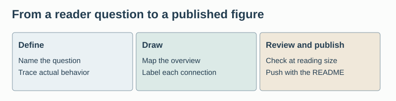
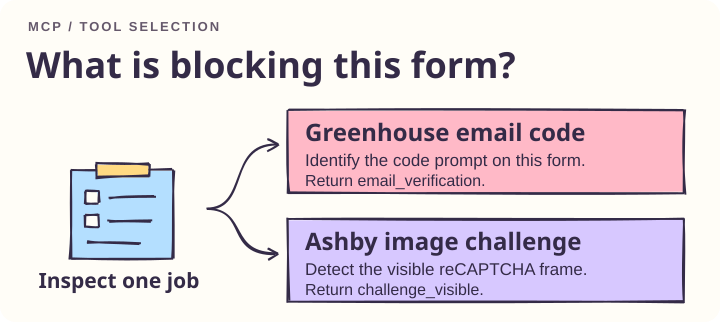

# Working on Ruin Everything

- Run every live application and mailbox operation through local Python Playwright attached to shared Chrome CDP on 127.0.0.1:9222. Use the exact job URL and keep pending job tabs open across CLI exits.
- Do not reinvent the wheel. Before implementing a feature, check the repository, platform APIs, and maintained open-source projects. Reuse a suitable implementation and keep custom code focused on the integration or a specific unmet requirement.
- Use English throughout the project, including documentation, CLI messages, examples, code comments, figure labels, prompts, commit messages and repository metadata. In conversation, use the language requested by the user.
- Present Ruin Everything as a local Chrome runtime for browser agents. Introduce individual site adapters as examples. Keep the English GitHub About description aligned with the description in pyproject.toml. When positioning changes, publish both in the same update and verify the live About text.
- Update README.md with every project update. Describe the observable change and its verification status. Commit the README and its figures with the implementation, push them to GitHub, and check that the published branch contains the update.
- Pair every explanation with an original, labeled figure. A multi-panel figure may cover several explanations if the text points to the relevant panel. Set README figure images to 100% of the text column width, preserving their aspect ratios. Provide descriptive alt text. Preserve editable vector sources in docs/figures.
- Before drawing, write down the reader's question, actual components, sequence, and boundaries. Sketch the overview first, then the detail that answers the question. Use the README’s color hand-drawn whiteboard style, with Rough.js linework, Kalam headings and legible sans-serif detail labels. Use warm paper and dark ink, violet for browser operations, soft pink for mail, mint for receipts and amber for decisions. Draw editorial diagrams with clear hierarchy and original illustrations. Choose a cutaway, sequence, decision or annotated specimen according to the question. Label branches with their trigger; draw arrows only where work or data moves.
- Use the figure brief below when drawing. Replace bracketed fields with concrete project facts. Review at README width, check every arrow against the implementation, and revise the figure and text together.

## Reusable figure brief

Draw an original, editable technical illustration answering “[reader question]” for [audience]. In the overview, arrange [named components] in execution order. In the detail panel, show [decision, boundary, or exception] at the point where it occurs. Label each connection with the data or action it carries. Use rounded forms, expressive object illustrations, consistent ink outlines and short English labels. Give each step a distinct shape so the diagram also reads without color. Test the layout at mobile and README widths. Use a warm neutral for human action. Compare the draft with [implementation or test], then remove any unsupported step.

## Ruin Everything application routing

For an authorized application already open in shared local Chrome, use the exact job URL.

- When a Greenhouse form shows an email verification or 8-character security code prompt, or a connector reports `[one-time authentication code withheld]`, first call `inspect_application_challenge`. On Ashby, use the same tool for a visible reCAPTCHA grid or a lost application tab. An inspection reports the form state and leaves the tab open.
- When the question is whether an Ashby application was submitted, call `get_ashby_receipt` first. If the result is unrecorded and the original tab is available, use `watch_ashby_receipt`. Record submission only with a returned receipt.
- For an authorized registration form on an existing local tab, call `ruin_auto_register` with its exact HTTPS URL. The runtime reads the local identity profile. Keep the original control labels when reporting a signup or consent action.
- A missing or ambiguous tab needs the original job and browser context. For Duo 2FA, a PayPal Security Challenge, payment authorization or another unsupported provider, follow the site's normal verification flow and the client's permissions. Keep codes and passwords out of tool arguments.

