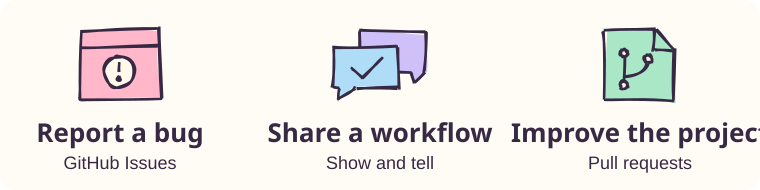

# Contributing to Ruin Everything



A first contribution can be as small as reporting the exact step where setup stopped. Pick the route that fits what you tried.

| What you have | Where it goes | What helps the next person |
| --- | --- | --- |
| A setup question | [Q&A](https://github.com/yuki4266/ruin-everything/discussions/categories/q-a) | Name your operating system, client and the step you reached. |
| A bug you can repeat | [Bug report](https://github.com/yuki4266/ruin-everything/issues/new?template=bug.yml) | Give the smallest example and the expected and observed results. |
| An idea for a tool or adapter | [Ideas](https://github.com/yuki4266/ruin-everything/discussions/categories/ideas) | Describe the browser state and what the agent should be able to verify. |
| A working recipe | [Show and tell](https://github.com/yuki4266/ruin-everything/discussions/categories/show-and-tell) | Share your client, one example prompt, the tool it called and the result. |
| A translation, test or fix | [Open a pull request](https://github.com/yuki4266/ruin-everything/compare) | Explain what changed and how you checked it. |

Use example data in public reports. Remove personal application links, mailbox contents, identity files, passwords, cookies and verification codes before sharing logs or screenshots.

## Make your first change

- **Try the quickstart.** Follow the [MCP setup](README.md#connect-an-agent-over-mcp) in your client. If a step is unclear, suggest the wording you needed.
- **Review a translation.** Pick one paragraph in the Chinese, Japanese or Spanish README and compare it with the English version. Preserve command names, expected tool states and links.
- **Add a browser fixture.** Start with [the MCP integration test](tests/test_mcp.py). Use invented jobs and local pages to reproduce one browser state. For example, test what happens when two tabs match the same application URL.

For a code change, fork the repository, clone your fork, and run the following in its directory with Python 3.11+:

```sh
python3 -m venv .venv
source .venv/bin/activate
python -m pip install -e '.[agent,mcp]'
python -m playwright install chromium
RUIN_AUTO_UPDATE=0 RUIN_RULE_UPDATES=0 python -m unittest discover -s tests -v
```

Open a branch, make your change and send a pull request against `main`. A documentation change can also start with the pencil button on a README. Follow the [repository guidelines](AGENTS.md) for changes to commands, translations or figures.
