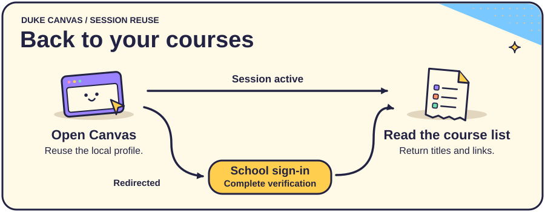
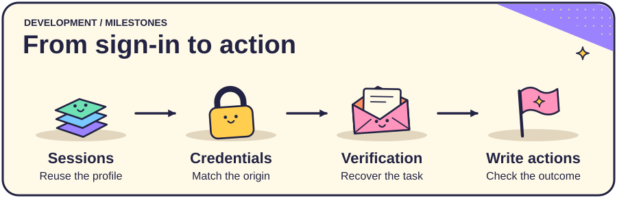

# Development plan

## Duke Canvas acceptance criteria

The first task targets Duke University's main Canvas instance. A valid session should return accessible course links directly. If redirected, keep the query alive during sign-in and retry the course page once. If the retry redirects again, stop and report the loop. An empty course table should yield an empty result.

Future recovery work includes distinguishing a denied challenge from a timeout, helping users reconnect a replacement phone, and explaining missing courses or a different school instance. Duke's remembered-device option applies to the same browser and computer for five days when offered. [Student guide](https://go.canvas.duke.edu/students/) · [MFA help](https://idms-mfa.oit.duke.edu/mfa/help) · [Canvas support](https://go.canvas.duke.edu/get-help/)

## Milestones

| Area | Implemented | Further acceptance work |
| --- | --- | --- |
| Session reuse | Persistent local profile and optional CDP attachment | Verify that revoking task access prevents navigation. |
| Credential filling | Same-origin keyring lookup and local fill | Exercise origin changes with test credentials and inspect model input and logs for leakage. |
| Verification | Interactive Duke sign-in and optional standard TOTP for generic tasks | Distinguish expired codes, denied challenges and device recovery. Define mailbox scope and retention before adding email codes. |
| Write operations | Single-tab click loop | Define permitted targets, duration and revocation for payments, deletions and public sends. Simulate a lost submission response and verify recovery without duplication. |

Upcoming design decisions include which course details to retrieve next, whether to expose the CLI through a browser extension or an MCP tool, and how users should grant and revoke action-specific permissions.
