<p align="right"><a href="README.md">English</a> &nbsp;·&nbsp; <a href="README.zh-CN.md">简体中文</a> &nbsp;·&nbsp; <a href="README.ja.md">日本語</a> &nbsp;·&nbsp; <strong>Español</strong></p>

# 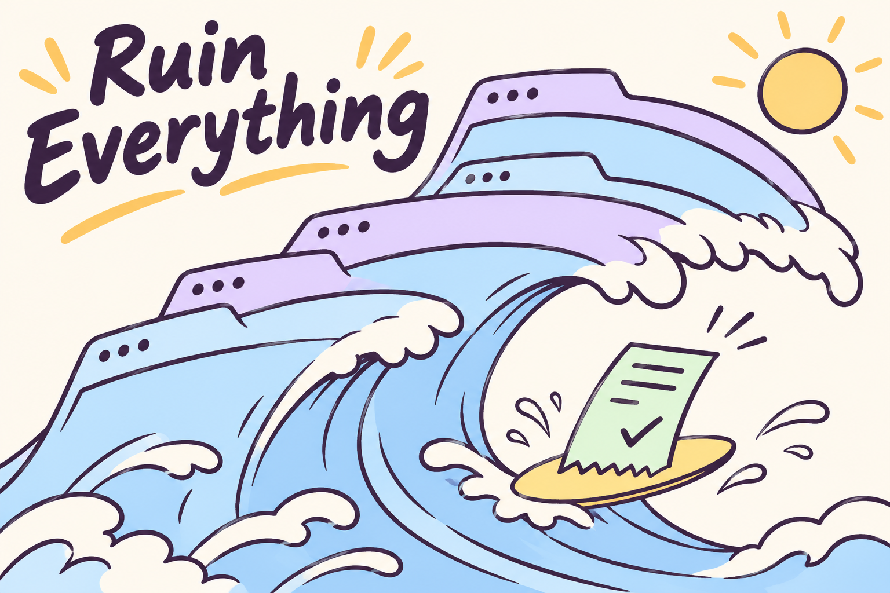

<p align="center">
  <a href="https://github.com/yuki4266/ruin-everything/stargazers">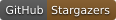</a>
  <a href="#use-a-shared-local-chrome-window"></a>
  <a href="#connect-an-agent-over-mcp"></a>
  <a href="LICENSE"></a>
</p>

**Retome una tarea en el navegador donde la dejó el agente anterior.** Ruin se conecta a Chrome en su equipo. Otra ejecución de la CLI o un cliente MCP puede volver a la misma pestaña de la candidatura, completar un paso de verificación compatible y consultar la confirmación del sitio.

[Configurar Chrome](#use-a-shared-local-chrome-window) · [Conectar un cliente MCP](#connect-an-agent-over-mcp) · [Ver lo que se ha probado](#verification) · [Prueba tu primera llamada MCP](#first-mcp-call) · [Cómo contribuir](#community)

| En tu navegador | Qué puede hacer Ruin |
| --- | --- |
| Greenhouse pide un código por correo para una candidatura | [Localice el mensaje nuevo en Outlook y rellene el código.](#verify-a-greenhouse-application-with-outlook-web) |
| Cerró la pestaña de Ashby después de enviar la candidatura | [Consulte el justificante guardado con la URL exacta de la oferta.](#receipt-storage-and-retries) |
| Workday pide iniciar sesión | [Use su perfil local y regrese a la oferta después de activar la cuenta en un sitio compatible.](#workday-accounts-and-signed-in-sessions) |
| Tiene números de teléfono de varios países | [Elija el número predeterminado en el editor local.](#local-account-registration) |

<a name="choose-a-starting-point"></a>

## Elige un punto de partida

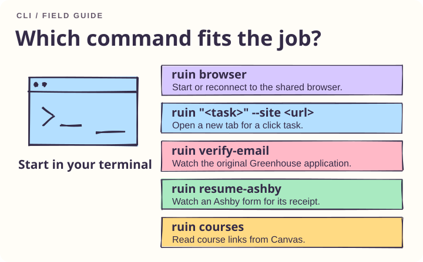

Para una nueva tarea, inicie el navegador compartido y abra el sitio de destino. Para una solicitud interrumpida, elija el observador específico del sitio y pase la URL del trabajo original. Las tareas de clic genéricas abren una nueva pestaña.

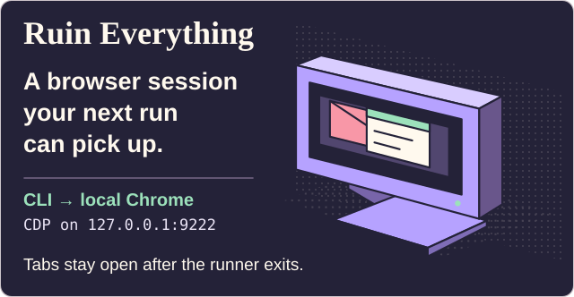

<a name="use-a-shared-local-chrome-window"></a>

## Utilice una ventana Chrome local compartida

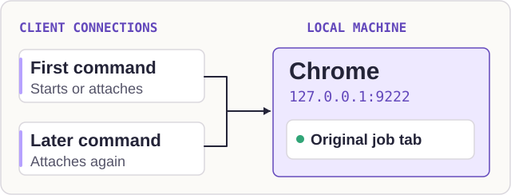

Instale desde el directorio del repositorio con Python 3.11+ y Google Chrome:

```sh
python3 -m venv .venv
source .venv/bin/activate
python -m pip install -e .
ruin browser
```

Ejecute `ruin browser` para iniciar o volver a conectarse al navegador de proyectos. Cada tarea CLI utiliza Python Playwright sobre CDP. El punto final predeterminado es `http://127.0.0.1:9222`. El ejecutor inicia Chrome con un perfil dedicado en `~/.ruin-everything/canvas-browser` cuando este puerto está libre. La conexión CDP conserva la configuración de contexto del navegador existente, incluido su comportamiento de descarga. Chrome permanece abierto después de que sale el comando. Otros clientes locales pueden conectarse al mismo punto final y ubicar la pestaña del trabajo por su URL completa. Otorgue a un cliente la propiedad del envío de cada solicitud.

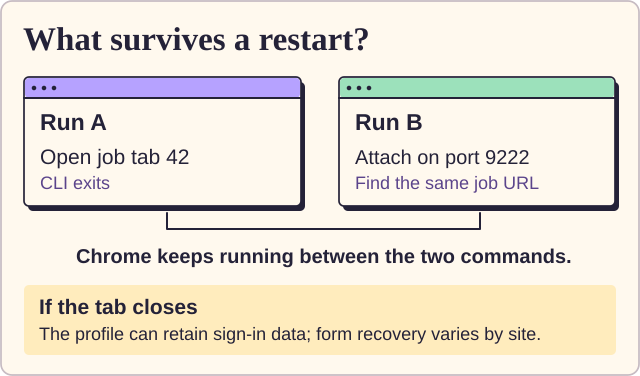

Abra Outlook Web en este perfil y complete cualquier inicio de sesión requerido en Microsoft antes de solicitar un código de correo electrónico nuevo. Cerrar la pestaña de trabajo, salir de Chrome o que una sesión del sitio expire aún puede interrumpir una aplicación. Un borrador en un navegador específico de chat se debe recuperar por separado.

<a name="run-a-browser-click-task"></a>

## Ejecutar una tarea de clic del navegador

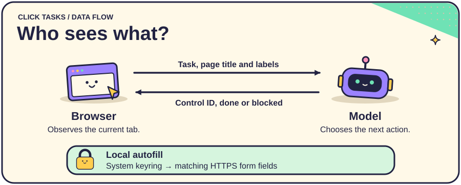

Instale las dependencias opcionales con `python -m pip install -e '.[agent]'` y configure `OPENAI_API_KEY`. Proporcione al modelo una página de inicio HTTPS y una tarea específica:

```sh
ruin "Open the help page" --site https://example.org --channel chrome
```

El ejecutor envía la tarea, el título de la página y las etiquetas de acción visibles al modelo seleccionado. Hace clic directamente en el control elegido y observa la página nuevamente. Una tarea puede utilizar una pestaña y hasta 20 pasos.

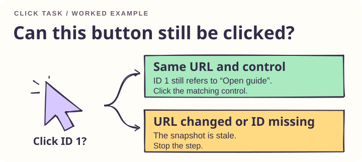

Por ejemplo, si un botón visible tiene la etiqueta **Open guide**, el modelo puede seleccionar su ID actual. Una URL modificada o una ID que falta en la instantánea detiene ese paso. Una decisión de modelo bloqueada deja la página abierta para inspección.

<a name="local-credential-filling"></a>

### Llenado de credenciales locales

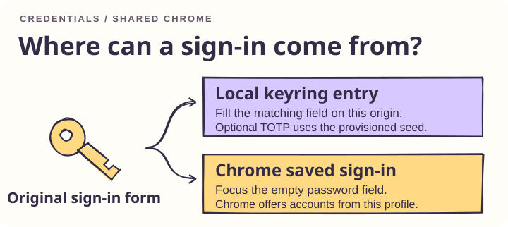

Agregue `--autofill` para usar el conjunto de claves del sistema y el formulario de inicio de sesión de Chrome. Para un formulario con un campo de contraseña visible que se envía al origen HTTPS seleccionado, el ejecutor hace clic en el campo vacío para que Chrome pueda ofrecer las credenciales guardadas en **ese perfil del navegador**. Complete el inicio de sesión en la pestaña abierta. El ejecutor espera hasta tres minutos hasta que desaparezcan los campos de credenciales y luego reanuda la tarea. Deja la selección de cuentas y el envío de formularios en la interfaz de usuario de inicio de sesión. Un dispositivo Chrome verifica la continuación de la misma pestaña con una política de script restrictiva.

<a name="local-account-registration"></a>

#### Registro de cuenta local

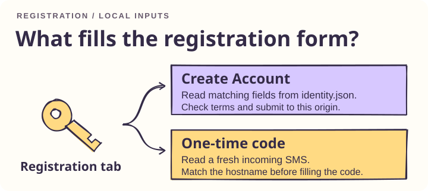

Ejecute `ruin identity` para elegir regiones del teléfono por nombre, guardar varios números, seleccionar un valor predeterminado y revelar la contraseña mientras edita. El editor fuera de línea utiliza el control de selección nativo del navegador y la biblioteca de números de teléfono para códigos de marcación y formato internacional. [números de teléfono de Python](https://github.com/daviddrysdale/python-phonenumbers)

Para la configuración manual de una tarea del navegador con `--site`, cree `~/.ruin/identity.json` con permisos solo de propietario (`chmod 600`). Configure `auto_signup` en `true` y proporcione valores de cadena para `first_name`, `last_name`, `email`, `phone` y `default_password`. Este archivo almacena la contraseña en texto sin formato. El ejecutor local verifica el origen HTTPS seleccionado antes de cada decisión del modelo hasta que envía un registro. Reconoce un botón de envío **Create Account**, **Create an Account**, **Register** o **Sign Up** visible en un formulario POST del mismo origen, completa los campos reconocidos y marca las casillas denominadas Términos de servicio, Términos de uso y Política de privacidad. En un formulario normal del mismo origen, también puede completar un campo de teléfono de contacto editable y vacío. Un campo de registro coincidente visible al que le falta un valor de perfil deja la pestaña abierta para su finalización.

Para un campo de código de un solo uso posterior, el ejecutor verifica macOS Messages durante hasta 30 segundos para detectar un texto entrante recibido desde el envío y que termina en `@hostname #code`. Se requiere acceso de lectura a la base de datos de Mensajes. Los resultados de la verificación y recepción del MCP incluyen un campo `signup_policy` que informa la configuración local. Los dispositivos Chrome y SQLite ejercitan el envío de formularios, entradas telefónicas normales, acciones entre orígenes, antigüedad del mensaje, dirección y coincidencia de dominio.

<a name="workday-accounts-and-signed-in-sessions"></a>

#### Puzle de rotación en Feishu Jobs

Con el puzle abierto, activa `auto_signup` en el perfil local y pasa la URL completa de la página de acceso a `ruin_auto_register`. Como muestra la figura, la herramienta compara los bordes de los dos anillos y arrastra el control una vez. En el sitio de empleo de Learnings, el sistema aceptó el movimiento y el botón de reenvío mostró una cuenta atrás de 30 segundos. La herramienta devuelve `sms_requested` al ver la cuenta atrás y `slider_pending` si el resultado sigue pendiente.

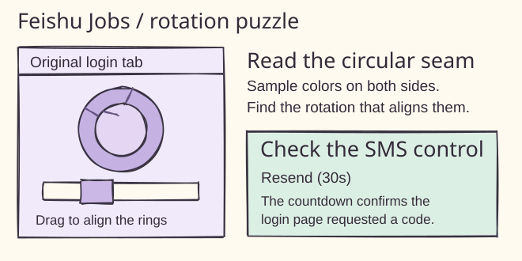

#### Acceso por SMS en el portal de ZhongAn en Moka

Cuando aparezca el puzle de NetEase Yidun en una oferta del portal universitario de ZhongAn, activa `auto_signup` en el perfil local y pasa a `ruin_auto_register` la URL completa con el fragmento `#/job/…`. Como muestra la figura, la herramienta busca el hueco por el contorno de la pieza y la arrastra en la pestaña original. En la prueba en el sitio de ZhongAn apareció la cuenta atrás para pedir otro SMS. La herramienta devuelve `sms_requested` al verla y `slider_pending` si el resultado está pendiente.

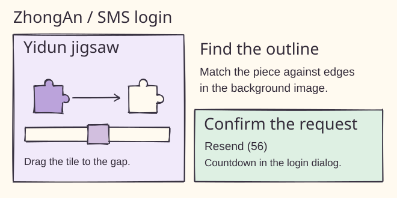

#### Cuentas Workday y sesiones iniciadas

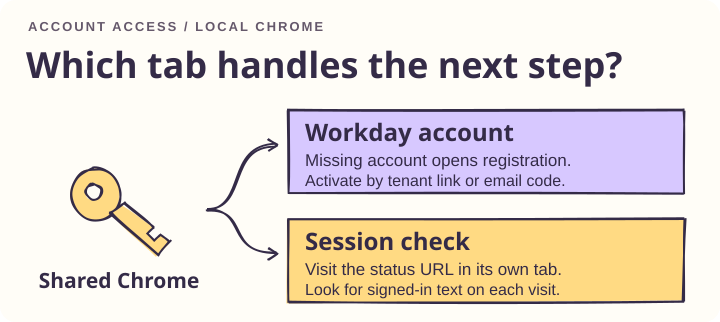

En los formularios de inquilino Workday en inglés compatibles, la tarea del navegador CLI prueba primero el correo electrónico y la contraseña locales. Un mensaje explícito de cuenta faltante abre el registro. Un error de inicio de sesión genérico deja abierto el trabajo original. Después del registro, Ruin comprueba el buzón de correo Outlook en el que se ha iniciado sesión en busca de un nuevo mensaje de activación, sigue un enlace de activación directo en el host del inquilino exacto, espera una confirmación visible y regresa a la URL del trabajo. El adaptador admite formularios POST nativos y diálogos Workday basados ​​en scripts con un control de envío reconocido. Los accesorios locales de Chrome cubren cuentas existentes, registro, activación y regreso al trabajo. Los diseños de los inquilinos de producción y los enlaces de correo electrónico ajustados pueden diferir.

Si la cabecera también muestra Sign In, Ruin utiliza el control del cuadro de diálogo de Workday. Para verificar el correo con seis dígitos, busca un mensaje nuevo de Outlook con un enlace al mismo sitio de la empresa y un único código identificado como tal. Introduce el código en la pestaña original y espera la confirmación de activación. Los controles de Jain Global se inspeccionaron en Chrome y el flujo de seis dígitos se probó con un buzón simulado.

Para un código enviado a una pestaña existente, utilice el tiempo de solicitud registrado cuando el sitio envió el SMS. Opcionalmente, agregue `sms_senders` al archivo de identidad local, asignando un nombre de host exacto a su cadena de remitente dedicada. Los códigos simples de seis dígitos deben provenir de ese remitente. Los mensajes vinculados a un dominio funcionan sin una entrada de remitente. Ambas rutas requieren acceso de lectura a la base de datos de mensajes de Mac.

```sh
ruin verify-sms --site "$VERIFICATION_URL" --requested-at "$REQUEST_UNIX_SECONDS"
ruin keep-alive --site "$STATUS_URL" --signed-in-text "Account overview" --interval 900 --timeout 86400
```

Keep-alive abre una pestaña separada para la página de estado HTTPS seleccionada. Utilice una página de solo lectura con texto exclusivo para la vista de inicio de sesión. El proceso verifica ese texto después de cada visita, se detiene en redirecciones o texto faltante y cierra su propia pestaña cuando finaliza. Ejecute el comando durante el tiempo deseado. Los sitios controlan la duración de sus propias sesiones. Las comprobaciones simuladas de Chrome cubren solicitudes GET repetidas y la preservación de la pestaña original.


Para proporcionar credenciales para el llenado local, utilice las entradas siguientes. La entrada TOTP opcional contiene la semilla Base32 del sitio.

```sh
keyring set ruin:https://example.org username
keyring set ruin:https://example.org password
keyring set ruin:https://example.org totp
```

<a name="verify-a-greenhouse-application-with-outlook-web"></a>

## Verificar una candidatura en Greenhouse con Outlook Web

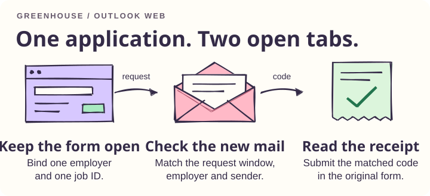

En macOS o Linux, conéctese a una sesión Chrome local habilitada para depuración que ya haya iniciado sesión en Outlook Web y la pestaña de trabajo Greenhouse original abierta. Reemplace la URL de ejemplo y el empleador con el trabajo exacto y el nombre utilizado en su correo electrónico. Inicie el observador antes de que la aplicación solicite un código. El flujo de trabajo de la aplicación existente aún posee el envío inicial.

```sh
ruin verify-email --cdp http://127.0.0.1:9222 \
  --site https://job-boards.greenhouse.io/example/jobs/12345 \
  --company "Example Employer" --timeout 180
```

El observador toma una instantánea de las filas visibles de la bandeja de entrada de Outlook y espera una fila nueva o actualizada cuya marca de tiempo sigue a la ventana de solicitud. Verifica el empleador, el texto del asunto y el remitente de Greenhouse, lee el código del mensaje abierto y lo envía en la pestaña del trabajo original. Un bloqueo local serializa los procesos de vigilancia. Mantenga inactivas otras aplicaciones para el mismo empleador durante la verificación.

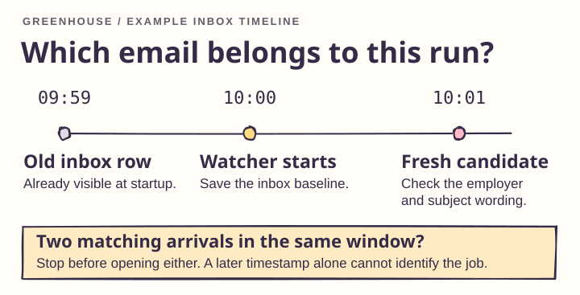

En el diagrama de la bandeja de entrada, ya existe un mensaje de las 09:59 cuando el observador comienza a las 10:00. El observador compara al candidato de las 10:01 con el empleador y el texto de verificación en la fila, luego verifica al remitente en el mensaje abierto. Si dos nuevos candidatos coinciden, se detiene antes de seleccionar cualquiera de ellos. Estos tiempos ilustran el orden; el observador utiliza las marcas de tiempo grabadas de la ejecución en vivo.

<a name="recover-an-open-challenge"></a>

### Recuperar un desafío abierto

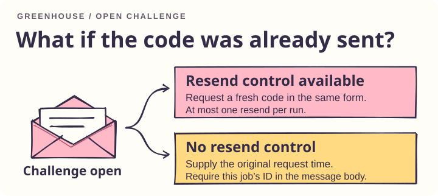

Si un desafío ya está abierto al inicio y ofrece un control de reenvío, solicita un código nuevo allí. Realiza como máximo un reenvío por ejecución.

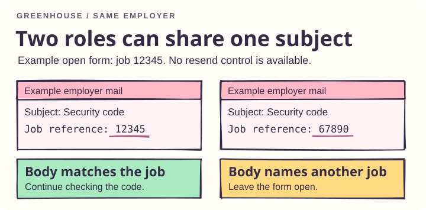

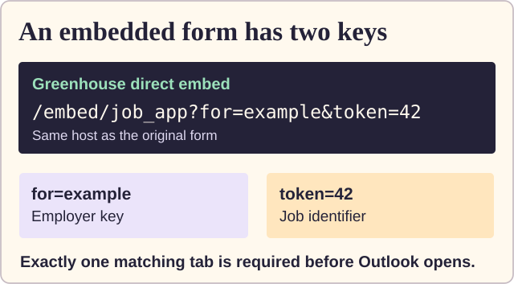

Para una inserción directa de Greenhouse, pase la URL completa entre comillas (incluidos `for` y `token`). Si un desafío existente no tiene control de reenvío, proporcione `--requested-at UNIX_SECONDS` desde la solicitud original de ese trabajo. Para esta ruta de recuperación, el cuerpo del mensaje también debe identificar el ID del trabajo. Un sujeto compartido por dos roles en el mismo empleador no puede establecer a qué formulario pertenece el código. Allí se debe manejar una pestaña en el navegador aislado de otro chat.

El prototipo admite formularios Greenhouse de nivel superior en inglés y diseños Outlook que exponen identificadores de mensajes, marcas de tiempo, direcciones de remitente y un cuerpo de mensaje. La falta de pruebas o una coincidencia ambigua detiene la verificación. Sólo un recibo visible cuenta como éxito. También puede ocurrir un tiempo de espera * después del envío de *; verifique la pestaña original antes de volver a intentarlo. Los contenidos y códigos de los mensajes permanecen fuera del bucle del modelo. La integración ha sido probada con accesorios del navegador; la compatibilidad con un formulario de empleador en vivo y un inquilino Outlook aún no está verificada.

<a name="resume-an-authorized-ashby-application"></a>

## Reanudar una candidatura en Ashby autorizada

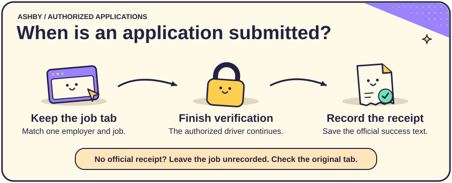

Utilice este flujo de trabajo cuando una solicitud revisada ya haya alcanzado la verificación. El controlador de la aplicación original posee la autorización para ese trabajo y completa el desafío en vivo en la misma pestaña. Inicie el observador de recibos junto con ese controlador, utilizando la URL exacta de la aplicación:

```sh
ruin resume-ashby --cdp http://127.0.0.1:9222 \
  --site 'https://jobs.ashbyhq.com/EMPLOYER/JOB-UUID/application' --timeout 300
```

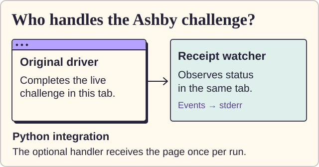

La CLI se adjunta a una pestaña coincidente y emite cambios de estado JSON en caso de error estándar. En `challenge_visible`, el controlador autorizado utiliza el widget actual. Un controlador que utilice la API Python puede proporcionar su propio controlador aprobado directamente:

```python
receipt = await resume_ashby(context, application_url, timeout=300,
                             directory=receipt_directory, on_event=report_status,
                             on_challenge=complete_authorized_challenge)
```

Importe `resume_ashby` desde `ruin.agent.ashby`. El controlador recibe la página Playwright original una vez por ejecución. La CLI independiente observa el navegador; requiere un controlador de aplicación o una persona para interactuar con el widget. Un desafío completado puede enviar automáticamente el formulario. Deje en vuelo cualquier envío existente y observe su resultado. Un botón Submit habilitado por sí solo no es prueba suficiente para enviar otra solicitud.

<a name="receipt-storage-and-retries"></a>

### Almacenamiento de recibos y reintentos

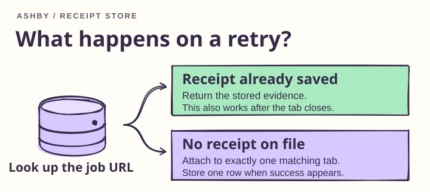

El observador registra el éxito sólo cuando el mismo trabajo muestra el estado visible de Ashby **Success** con **Your application was successfully submitted**. Devuelve el recibo como JSON en la salida estándar y almacena una fila por trabajo en `~/.ruin-everything/ashby-receipts.sqlite3`. Un reintento devuelve ese recibo almacenado. Un tiempo de espera, un trabajo modificado o una pestaña ambigua producen un error sin marcar el trabajo enviado. Un rastreador de aplicaciones externo debe importar solo un acuse de recibo devuelto.

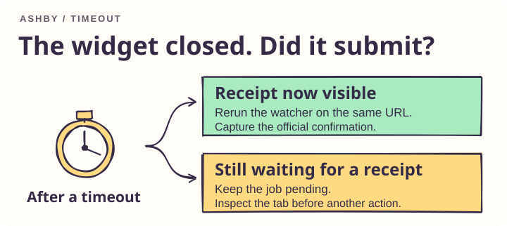

Por ejemplo, un desafío puede desaparecer mientras el sitio aún está procesando la solicitud. Si el observador se agota, verifique la pestaña original antes de realizar otra acción. Si esa pestaña luego muestra el recibo oficial, vuelva a ejecutar el observador con la misma URL para capturarlo.

El recibo ilustrado es un ejemplo. El patrón de recibo proviene de una aplicación Baseten completa. El comando reutilizable se probó con páginas Ashby simuladas en Chrome, incluido un recibo oculto, un trabajo modificado, pestañas duplicadas y un reintento después de cerrar la pestaña.

<a name="connect-an-agent-over-mcp"></a>

## Conecte un agente a través de MCP

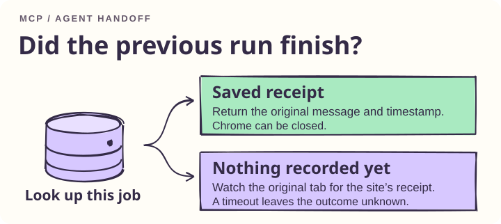

Las versiones etiquetadas incluyen el servidor MCP. Un cliente compatible con el registro puede iniciarlo con `uvx ruin-everything@0.2.0`. [Versiones en GitHub](https://github.com/yuki4266/ruin-everything/releases)

Proporcione al cliente la URL exacta del trabajo y describa lo que ve. Si la pregunta es si se aprobó una solicitud Ashby, el cliente verifica primero el diario de recibos. Si el formulario está esperando verificación, el cliente inspecciona la pestaña abierta.

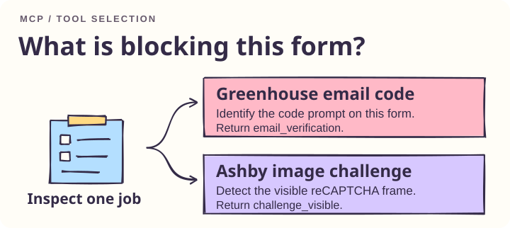

| Herramienta | Cuándo usarla | Resultado |
| --- | --- | --- |
| `ruin_auto_register` | El formulario de registro o contacto seleccionado está abierto en su URL HTTPS exacta. | Acción de perfil local y política de registro actual. Un formulario enviado aún puede requerir verificación. |
| `inspect_application_challenge` | Greenhouse solicita un código de correo electrónico de ocho caracteres, un conector informa `[one-time authentication code withheld]` o Ashby muestra una cuadrícula reCAPTCHA. Úselo también para localizar un formulario compatible perdido. | El proveedor y el estado visible. Una pestaña faltante o duplicada obtiene su propio resultado. El formulario permanece abierto. |
| `get_ashby_receipt` | En el momento del traspaso, incluso con Chrome cerrado | Un recibo guardado o `unrecorded`. Un registro perdido deja el resultado desconocido. |
| `watch_ashby_receipt` | El formulario original está abierto y el resultado es incierto. | Un recibo existente o evidencia nueva del mismo trabajo. Un tiempo de espera es un error de herramienta. El observador deja el formulario abierto. |

Instalar [ultravioleta](https://docs.astral.sh/uv/getting-started/installation/) una vez. En un cliente MCP con configuración JSON, este ejemplo ejecuta la última versión [Lanzamiento de PyPI](https://pypi.org/project/ruin-everything/). El cliente debe poder encontrar `uvx` en su RUTA. También funciona una ruta absoluta a `uvx`.

```json
{
  "mcpServers": {
    "ruin-everything": {
      "command": "uvx",
      "args": [
        "--isolated", "--refresh",
        "--from", "ruin-everything[mcp]",
        "ruin-mcp"
      ],
      "env": { "RUIN_AUTO_UPDATE": "0" }
    }
  }
}
```

Para rastrear la rama GitHub directamente, configure `--from` en `ruin-everything[mcp] @ git+https://github.com/yuki4266/ruin-everything.git@main`. Ambas configuraciones inician el ejecutable `ruin-mcp` real. Una prueba de humo de dos versiones verificó la actualización tanto en Git como en la ruta del paquete. Una instalación editable existente aún puede iniciarla directamente.

Para registrar el servidor para su cuenta de usuario, ejecute el comando para su cliente. Abra una nueva sesión para seleccionar la lista de herramientas.

```sh
codex mcp add ruin-everything --env RUIN_AUTO_UPDATE=0 -- uvx --isolated --refresh --from 'ruin-everything[mcp]' ruin-mcp
claude mcp add --scope user --transport stdio ruin-everything -e RUIN_AUTO_UPDATE=0 -- uvx --isolated --refresh --from 'ruin-everything[mcp]' ruin-mcp
```

<a id="first-mcp-call"></a>

### Prueba tu primera llamada MCP

Tras conectar el cliente, prueba esta petición con la URL ficticia del ejemplo. Funciona con Chrome cerrado y no requiere una candidatura ni un perfil personal.

> Llama a `get_ashby_receipt` con `https://jobs.ashbyhq.com/example/aaaaaaaa-bbbb-cccc-dddd-eeeeeeeeeeee/application` y dime qué estado devuelve.

En una instalación nueva se espera `unrecorded`. El servidor ha consultado el registro local y no ha encontrado un comprobante para este ejemplo. Verificamos esta consulta de solo lectura con la versión de PyPI.

El repositorio incluye [instrucciones de enrutamiento](AGENTS.md#ruin-everything-application-routing) para Codex y los importa desde [CLAUDE.md](CLAUDE.md). Para aplicarlos en otros espacios de trabajo, copie la sección de enrutamiento de aplicaciones en su `~/.codex/AGENTS.md` o `~/.claude/CLAUDE.md` de nivel de usuario. Los permisos de cliente y la verificación del sitio aún se aplican a Duo, PayPal y otros proveedores no compatibles.

Las cuatro herramientas aceptan `site`. El inspector comprueba una vez de forma predeterminada. Configure `wait_seconds` en 1–300 para observar esa misma pestaña en busca de un cambio desde `pending`. Desde la CLI, utilice `ruin watch --site "$JOB_URL" --timeout 30`. La vigilancia finaliza después de detectar un estado compatible, perder la pestaña original o alcanzar el límite de tiempo.

En una simulación local de Chrome, una nueva sesión de CLI de Codex a la que se le dio solo la URL de Greenhouse y el síntoma de código de ocho caracteres seleccionó `inspect_application_challenge` como su primera llamada de herramienta y devolvió `email_verification`. El formulario simulado permaneció vacío.

El monitor de recibos Ashby acepta `timeout_seconds` (predeterminado 15, rango 1–300). Un recibo devuelto contiene `state`, `site`, `observed_at` y la confirmación del sitio `message`. El controlador de la aplicación posee la interacción del formulario. Después de un tiempo de espera, verifique la misma URL nuevamente antes de considerar otro envío.

El servidor utiliza el SDK oficial de MCP Python sobre stdio. Un cliente de automatización del navegador como Playwright MCP se puede ejecutar junto con él conectándolo al mismo Chrome local con `--cdp-endpoint http://127.0.0.1:9222`. La prueba de integración espera a que Chrome anuncie su puerto de depuración local y luego conecta dos clientes SDK sucesivos a la página del empleador simulada. [SDK de MCP Python](https://github.com/modelcontextprotocol/python-sdk) · [Opciones de conexión del MCP Playwright](https://github.com/microsoft/playwright-mcp#configuration)

<a name="how-updates-reach-your-machine"></a>

## Cómo llegan las actualizaciones a tu máquina

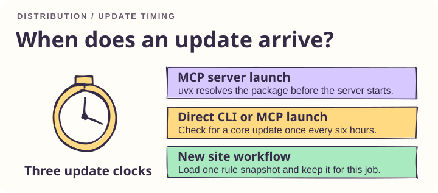

| Qué se actualiza | Cuándo se actualiza |
| --- | --- |
| Paquete MCP a través de uvx | En el próximo inicio del servidor, uv resuelve la última versión disponible desde la fuente configurada. Un servidor de ejecución prolongada mantiene su código cargado hasta que se reinicia. La instalación inicial y la actualización en línea requieren acceso a la red. |
| Instalación directa | El inicio de CLI y MCP programa una comprobación en segundo plano como máximo una vez cada seis horas por instalación. Si la rama `main` sigue a `origin/main` y el árbol de trabajo está limpio, se actualiza mediante avance rápido. Una instalación normal de pip busca una versión más reciente de PyPI. Las herramientas uv instaladas utilizan su propio comando de actualización. Configure `RUIN_AUTO_UPDATE=0` para administrar las versiones usted mismo. |
| Reglas del sitio | Cada nueva verificación Greenhouse u observación Ashby en vivo descarga el [archivo de selectores](ruin/rules/sites.json) del proyecto con un tiempo de espera de red de dos segundos. Un flujo de trabajo mantiene su instantánea inicial hasta su finalización. Las actualizaciones sin conexión o no válidas recurren al último caché válido en `~/.ruin/sites.json` y luego a los valores predeterminados empaquetados. Configure `RUIN_RULE_UPDATES=0` para usar la copia incluida. |

El archivo de reglas describe los elementos del recibo Ashby, las entradas de verificación Greenhouse y el patrón de código de correo electrónico, y las filas y cuerpos de los mensajes Outlook. Los adaptadores instalados imponen orígenes confiables, identidad del remitente, coincidencia de trabajos y redacción de recibos. Un cambio en esas comprobaciones requiere una liberación del código.

Para mantenedores, configure uno [PyPI Trusted Publisher](https://docs.pypi.org/trusted-publishers/creating-a-project-through-oidc/) para el proyecto `ruin-everything`, propietario `yuki4266`, repositorio `ruin-everything`, flujo de trabajo `publish.yml` y entorno `pypi`. Un envío a main crea la versión en `pyproject.toml` con el número de ejecución del flujo de trabajo como un cuarto componente de la versión. Para una versión etiquetada, configure la versión del proyecto y presione la etiqueta correspondiente (por ejemplo, `0.2.0` y `v0.2.0`). Ambas rutas ejecutan las pruebas del navegador, crean y verifican la rueda y la distribución del código fuente, luego publican utilizando la identidad OIDC de GitHub. [Liberar flujo de trabajo](.github/workflows/publish.yml) · [actualizaciones de herramientas uv](https://docs.astral.sh/uv/concepts/tools/)

<a name="example-read-courses-after-school-sign-in"></a>

## Ejemplo: leer cursos después del inicio de sesión escolar

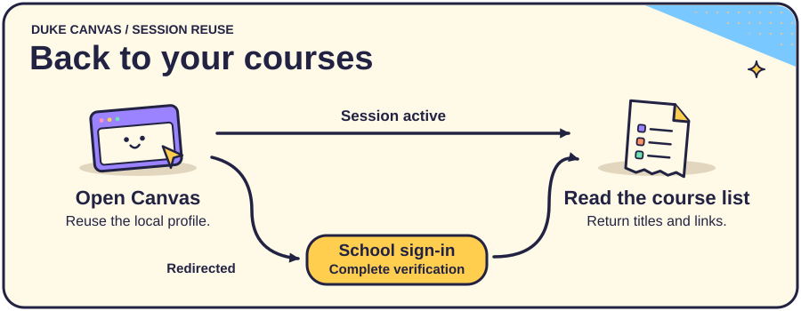

El adaptador Duke Canvas demuestra cómo se reanuda una tarea después de un inicio de sesión interactivo. Ejecute la búsqueda en el perfil compartido:

```sh
ruin courses
```

El resultado contiene nombres de cursos y enlaces. Utilice `--json` para salida estructurada:

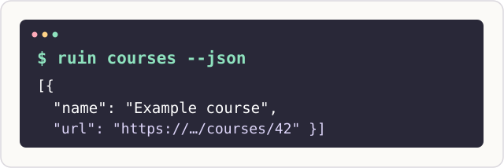

Para seleccionar explícitamente un punto final de depuración local existente, ejecute:

```sh
ruin courses --cdp http://127.0.0.1:9222 --json
```

La rama de inicio de sesión espera hasta 180 segundos para que la escuela regrese el navegador a Canvas. Configure `--timeout 300` para una espera más larga. La aprobación de Duo se realiza en la ruta de inicio de sesión de la escuela. [Recuperación del dispositivo Duke](https://oit.duke.edu/help/articles/kb0036398/)

<a name="verification"></a>

## Verificación

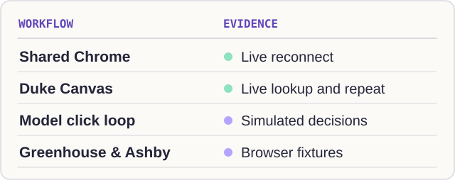

Las pruebas de actualización cubren comprobaciones de inicio superpuestas, cambios entre instantáneas de reglas, descargas no válidas y respaldo sin conexión. Las comprobaciones en tiempo de ejecución verificaron una pestaña Chrome compartida entre conexiones CDP independientes. Para pruebas del navegador, instale la compilación Playwright Chromium o use Chrome instalado. Ejecute `python -m unittest discover -s tests -v`. Instale los extras del agente para incluir la prueba del modelo simulado. Para Chrome instalado, anteponga el comando `RUIN_TEST_CHANNEL=chrome`.

Una ejecución de Duke en vivo devolvió enlaces de cursos después de iniciar sesión. Una segunda carrera con el mismo perfil también arrojó la lista después de visitar la ruta de inicio de sesión de la escuela. No se midió el número de mensajes del Duo. El bucle de clic general se ha ejercitado con una respuesta de modelo simulada.

Los diagramas dibujados a mano son SVG editables. Usan líneas Rough.js y letras Kalam. [Fuentes de figuras](docs/figures) · [áspero.js](https://roughjs.com/) · [Licencia de fuente Kalam](docs/figures/Kalam-LICENSE.txt)

[plan de desarrollo](PLAN.md) · [Pautas de contribución y cifras.](AGENTS.md) · [licencia MIT](LICENSE)

<a id="community"></a>

## Contribuye a Ruin Everything

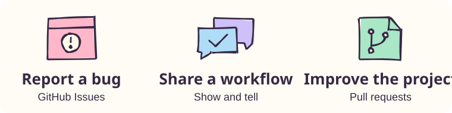

¿Has probado Ruin con tu cliente MCP? [Comparte tu configuración y el resultado de una llamada](https://github.com/yuki4266/ruin-everything/discussions/categories/show-and-tell) para que otra persona pueda reproducirla. Si te atascas durante la instalación, [pregunta en el foro de ayuda](https://github.com/yuki4266/ruin-everything/discussions/categories/q-a).

[Informar de un fallo](https://github.com/yuki4266/ruin-everything/issues/new?template=bug.yml) · [Proponer una idea](https://github.com/yuki4266/ruin-everything/discussions/categories/ideas) · [Aportar una traducción, prueba o corrección](CONTRIBUTING.md)

### Personas que contribuyen

Gracias a quienes prueban flujos de trabajo, responden preguntas y envían mejoras. Estos avatares corresponden a las contribuciones registradas mediante commits en GitHub.

<a href="https://github.com/yuki4266/ruin-everything/graphs/contributors"></a>

## Historial de estrellas

<a href="https://www.star-history.com/?repos=yuki4266%2Fruin-everything&amp;type=date">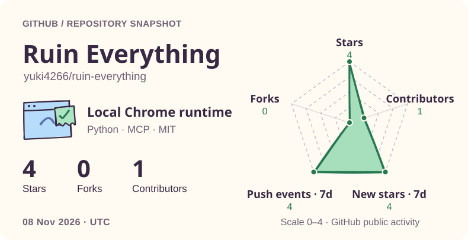</a>

Selecciona la imagen para consultar el historial de estrellas actualizado.

⭐ [Si Ruin te ayudó a retomar una tarea en el navegador, dale una estrella en GitHub.](https://github.com/yuki4266/ruin-everything)

### Configuración de inicio de sesión de confianza

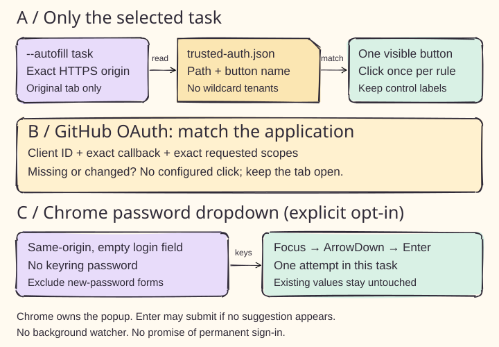

El panel A muestra `trusted_oauth_clients` en `~/.ruin-everything/trusted-auth.json`. Con `--autofill`, la tarea puede pulsar una vez por regla los botones configurados de acceso, SSO, Stay signed in o Trust this browser. Se comprueban el origen HTTPS, la ruta y la regla del botón. El panel D añade `https://*.greenhouse.io`, `https://*.myworkdayjobs.com` y `https://*.duke.edu` para subdominios de varios niveles. Las entradas exactas tienen prioridad; las credenciales y acciones siguen vinculadas al origen de la tarea. El [ejemplo](docs/trusted-auth.example.json) incluye Glama, Greenhouse, Workday y Duke SSO sin activar reglas de botones no verificadas.

El panel B exige también el ID del cliente GitHub OAuth, la URL de retorno y los permisos exactos. El texto de la tarea no amplía los permisos. El panel C permite enfocar el campo y enviar ArrowDown y Enter cuando keyring no tiene contraseña. Sin sugerencias, Enter puede enviar el formulario; no garantiza el autocompletado ni una sesión permanente.

Las pruebas con páginas simuladas en Chrome verifican coincidencias, rechazo de cambios de permisos, intentos únicos y exclusiones de campos. Las sugerencias nativas y las páginas de autorización de producción siguen sin verificar. Consulta la [referencia](docs/trusted-auth.md). Se mantienen los requisitos de permisos del navegador.

La autorización de GitHub puede usar el selector estándar sin configurar la etiqueta; el ID del cliente, la URL de retorno y los permisos siguen siendo obligatorios. Las pruebas de Chrome verifican límites de dominio, puertos, rechazo entre tenants y el selector predeterminado. El envío real a Glama sigue sin verificar.
