<p align="right"><a href="README.md">English</a> &nbsp;·&nbsp; <a href="README.zh-CN.md">简体中文</a> &nbsp;·&nbsp; <strong>日本語</strong> &nbsp;·&nbsp; <a href="README.es.md">Español</a></p>

# 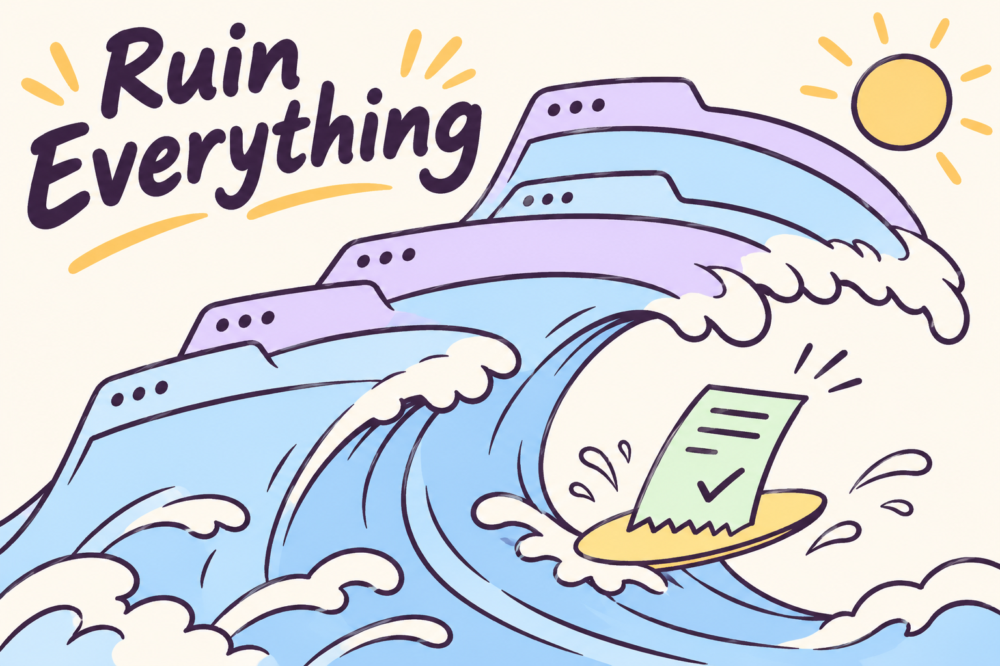

<p align="center">
  <a href="https://github.com/yuki4266/ruin-everything/stargazers">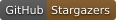</a>
  <a href="#use-a-shared-local-chrome-window"></a>
  <a href="#connect-an-agent-over-mcp"></a>
  <a href="LICENSE"></a>
</p>

**すべてのウェブサイトで使う既定のローカル Chrome ランタイム。** Ruin は `127.0.0.1:9222` でエージェントを Chrome に接続し、閲覧、移動、DOM 操作、フォーム入力、抽出、複数ステップの作業を実行します。既存のセッション、Cookie、拡張機能を再利用します。応募や機関認証のアダプターは任意の例です。

[Chromeのセットアップ](#use-a-shared-local-chrome-window) · [MCP クライアントを接続する](#connect-an-agent-over-mcp) · [何がテストされたかを確認する](#verification) · [MCP ツールを試す](#first-mcp-call) · [貢献する](#community)

## 既定のバックグラウンド実行

図 A：タスクページは CDP のフォーカス仮想化と active ライフサイクルを使い、Chrome を前面に出さずに操作できます。ログイン、認証、メール、プロフィール編集の明示的な `bring_to_front` 呼び出しを削除しました。新規タブは `Target.createTarget` の `background: true` で作成します。入力と画面取得は選択したページで行い、認証の成否はサイトが判断します。

図 B：移動先に一致する既存タブ、または URL が変わっていない Agent タブを再利用します。それ以外は同じ Chrome コンテキストに背景タブを作成し、ユーザーの空白タブも保持します。`site` による明示的な選択も可能です。プロファイル横の非公開 `agent-tabs.json` は target ID、用途、URL ハッシュを保存し、`tabs` は `agent_owned` と `purpose` を返します。再接続後も同じ対象を再利用できます。手動で別 URL に移動したタブは自動再利用しません。メールや一時的な確認は別の背景タブを使います。`ruin identity` の編集タブも背景で開くため、編集時に手動で選択してください。

図 C：macOS は `open -g -n` で Chrome を起動し、固定プロファイルとセッション復元を保持します。起動引数は `--disable-background-timer-throttling`、`--disable-backgrounding-occluded-windows`、`--disable-renderer-backgrounding`、`--disable-ipc-flooding-protection` を追加します。起動済みの Chrome は再起動せず、引数は次回起動時に有効です。更新されたランタイムはタスクページの準備時に `Emulation.setFocusEmulationEnabled({enabled: true})` と `Page.setWebLifecycleState({state: "active"})` を送信します。起動済み MCP サーバーは再接続してコードを読み込んでください。

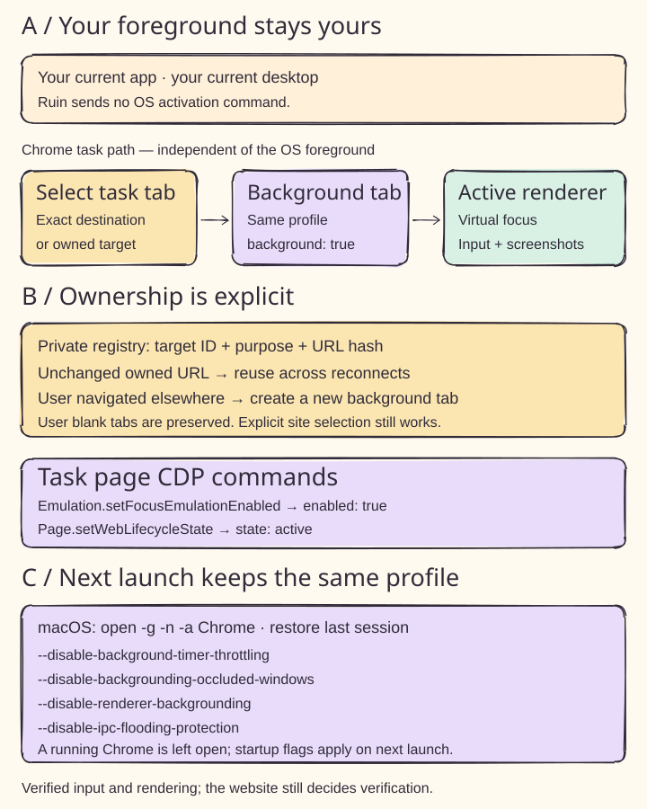

検証：背景テスト 5 件、汎用ブラウザテスト 5 件、入れ子 hCaptcha テスト 7 件、stdio MCP 統合を含む全 91 件の回帰テストが成功しました。実際の Chrome で信頼されたクリック、アニメーション、画面取得、再接続後の同一対象の再利用を確認しました。既存タブの URL と入力・再接続・後片付け前後の macOS 前面アプリは変化しませんでした。起動コマンドはテスト済みですが、Chrome の再起動や別の macOS Space は実測していません。

## ローカル ATS パスワードとアカウント復旧

図 A：`ruin ats-setup` を一度実行すると、権限 `0600` の `~/.ruin/.env` に固定の24文字パスワードを作り、`ATS_AUTO_RECOVER` を有効化します。有効な既存 `ATS_DEFAULT_PASSWORD` は保持します。環境変数が優先され、`RUIN_ATS_ENV_FILE` で別の非公開ファイルを指定できます。秘密はコマンド引数や設定結果に表示しません。メールと自動登録設定は従来のローカルプロフィールを使用し、他のアカウントのパスワードは変更しません。

図 B：選択した iCIMS / Workday テナントで、実際のフィールドと見出しからログインと新規パスワード設定を区別します。iCIMS の埋め込みフォームにも対応します。認証エラー時は表示された登録入口を優先し、既存アカウントならログインに戻ります。設定済み ATS パスワードを一度試し、失敗が続く場合だけ表示されたパスワード復旧入口を使います。未拒否の Chrome 入力済み認証情報は先に試せます。各段階はテナントとメールごとに15分間一度に制限し、CDP 再接続後も維持します。登録 URL は推測せず、認証送信は同一 HTTPS オリジンと Ruin 実行器を使用します。

`ruin_browser`、`ruin_action`、`ruin_auto_register`、モデルのブラウザー処理に接続されています。`ruin ats-account --site 'EXACT_CURRENT_HTTPS_URL'` でも直接実行できます。図 C：`reset_email_requested` は復旧要求の受理だけを表します。メール未確認なら `email_verification_pending`、パスワード設定フォームが表示されればローカル秘密を使用します。応募には別途受領表示が必要です。既存の Workday メール有効化処理も維持します。

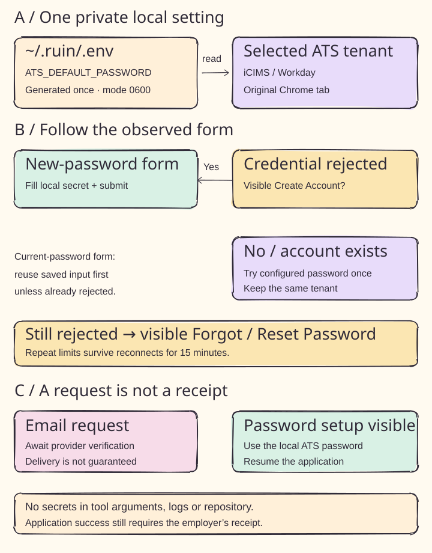

検証：追加した十一件の設定・ブラウザーテストと従来の Workday 五件が成功しました。Planview 5149 はログイン画面で、設定済みパスワードを拒否し、復旧要求を受理しました。Outlook と迷惑メールに該当メールはまだなく、パスワード変更・履歴書アップロード・応募完了は未確認です。[iCIMS 候補者ヘルプ](https://team.icims.com/jobseekerhelp)も参照してください。変更はリポジトリにあり、PyPI の新規リリースではありません。


## 入れ子の hCaptcha

図 A：汎用スライダー判定より先に hCaptcha を識別します。グリッドは `.task-image` の明示的なインデックス、キャンバスは座標クリックまたは二次元ドラッグ、チェックボックスはコントロール中心を使用します。非表示の祖先フレームを除外し、不明な課題や不確かな回答は具体的な理由とともに保留します。

図 B：各 iframe のコンテンツ原点をたどり、枠線、パディング、スクロール、正の軸方向 CSS 拡大縮小を反映します。Playwright の Chromium マウスイベントを最上位ビューポート座標で送り、`.button-submit` を押します。図 C：検証後の遷移は応募完了の証拠ではありません。保留中のフォーム送信を繰り返さず、サイトの受領表示を確認します。

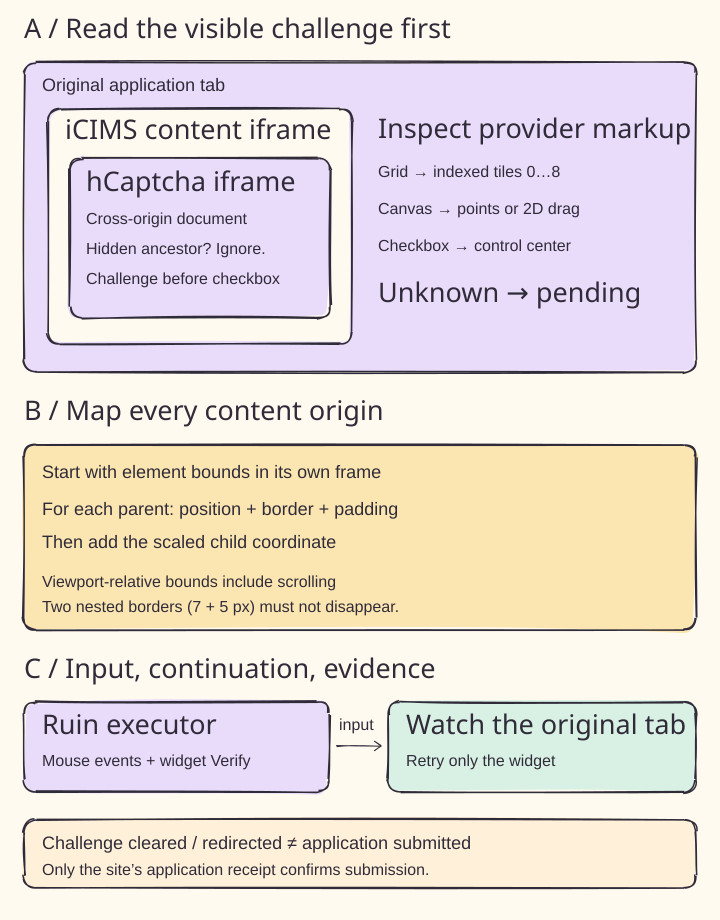

検証：追加した七つの隔離 Chromium テストと既存の七つの送信後処理テストが成功しました。Planview 5149 の元タブでは二次元ドラッグが水平スライダーに誤分類されていました。修正後の実行器がアシスタントの確認した座標でドラッグし、iCIMS ログインへ遷移しました。既定の視覚モデルはローカル Ollama のままで、無人認識の精度を保証する実測ではありません。保存済み認証情報は拒否され、履歴書アップロードと応募受領は未確認です。変更はリポジトリにあり、導入済み MCP は再接続が必要です。PyPI の新規リリースではありません。


## 汎用ブラウザ自動化

どのサイトでも `ruin_browser` を既定の入口にします。図 A は共有ランタイム、図 B はタブの選択を示します。`navigate` は移動先と一致するタブ、URL が変わっていない Agent タブの順に再利用し、どちらもなければ背景タブを開きます。`site` で現在のタブを指定できます。URL がなくサイト名だけが分かる場合は、検索エンジンで探して続行します。

```json
{"operation":"navigate","url":"https://example.org"}
```

図 C のように、返された現在の URL を `site` にして `inspect`、`read`、`click`、`fill`、`press`、`select` を続けます。検査は表示テキストとセレクターを返し、入力欄の値を読み取りません。変更操作は一つの表示要素を指定し、`value` にテキスト、キー、選択肢の値を渡します。クリックと Enter は既存の Ruin 実行器を使います。`tabs` は現在の URL 一覧です。ドメインをまたいでもタブを保持します。テキストは 24,000 文字、要素は 300 件までです。詳細は範囲を絞った `read` で取得します。

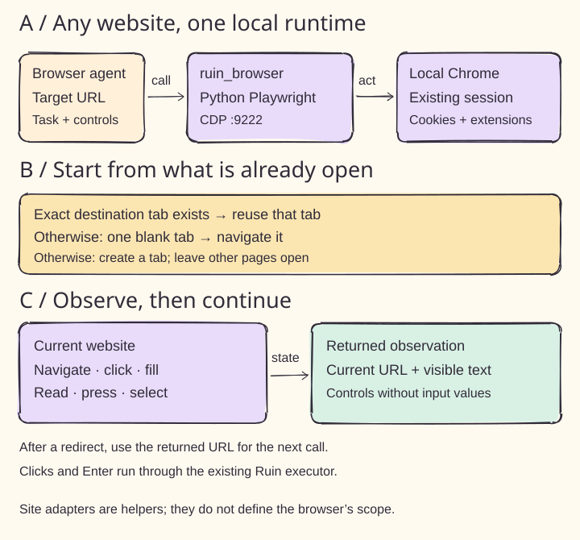

検証：独立したブラウザテスト 5 件と stdio MCP 統合テストが成功しました。ユーザーの空白タブの保持、Cookie、通常のフォーム、別ドメインへの移動、重複タブ、他のページの保持を確認しています。今回はリポジトリの更新です。ローカルのコードまたは Git ソースで MCP を再接続すると新ツールを読み込めます。新しい PyPI リリースは未公開です。


| ブラウザで | Ruinでできること |
| --- | --- |
| Greenhouse の応募画面でメールの認証コードを求められた | [Outlook の新着メールを応募先と照合し、コードを入力します。](#verify-a-greenhouse-application-with-outlook-web) |
| 応募後に Ashby のタブを閉じた | [求人の URL から保存済みの受付記録を確認できます。](#receipt-storage-and-retries) |
| Workday でサインインを求められた | [ローカルのプロフィールでログインし、対応するサイトではアカウントを有効化して求人ページに戻ります。](#workday-accounts-and-signed-in-sessions) |
| 複数の国・地域の電話番号を使っている | [オフラインの設定画面で既定の番号を選べます。](#local-account-registration) |

<a name="choose-a-starting-point"></a>

## 機関認証をバックグラウンドで処理する

`ruin watch` は共有 Chrome の既存タブと新規タブを 500 ミリ秒ごとに確認します。IEEE Xplore、ACM Digital Library、Springer Nature Link の機関検索で Duke University を選び、出版社のリダイレクトをたどります。Duke SSO では Chrome の保存済みログインを利用できます。信頼設定でパスワード候補を無効にできます。Duo の認証はブラウザー上で進めます。

macOS では継続して使う環境で `ruin watch --install` を実行すると、ログイン時にサービスが起動し、Chrome への再接続を待機します。`ruin watch --uninstall` で解除できます。`ruin watch --site URL` は従来どおり指定した応募の認証状態を確認します。

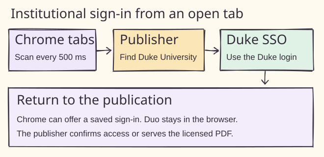

IEEE の機関検索から Duke への遷移と、既存の Duke セッションで出版社の PDF を取得できることを実機で確認しました。ACM と Springer の検索、新規タブ、重複操作の抑制はブラウザーのテスト環境で検証しました。

## 出発点を選択してください

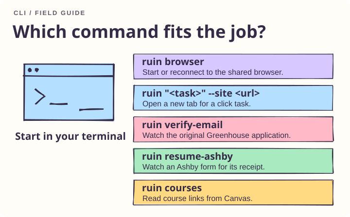

新しいタスクの場合は、共有ブラウザを起動し、ターゲット サイトを開きます。中断されたアプリケーションの場合は、サイト固有のウォッチャーを選択し、元の求人 URL を渡します。一般的なクリック タスクでは、新しいタブが開きます。

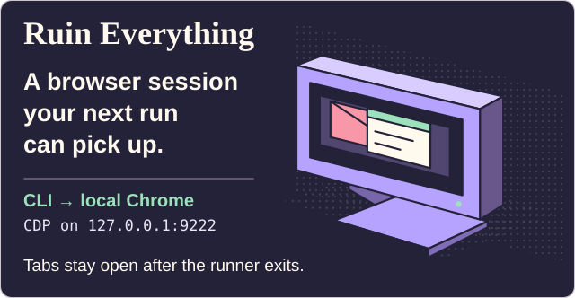

<a name="use-a-shared-local-chrome-window"></a>

## 共有ローカル Chrome ウィンドウを使用する

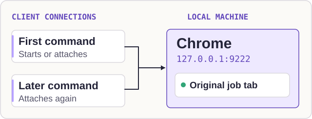

Python 3.11+ および Google Chrome を使用してリポジトリ ディレクトリからインストールします。

```sh
python3 -m venv .venv
source .venv/bin/activate
python -m pip install -e .
ruin browser
```

`ruin browser` を実行してプロジェクト ブラウザを起動するか、プロジェクト ブラウザに再接続します。すべての CLI タスクは CDP 経由で Python Playwright を使用します。デフォルトのエンドポイントは `http://127.0.0.1:9222` です。このポートが空いている場合、ランナーは `~/.ruin-everything/canvas-browser` で専用プロファイルを使用して Chrome を起動します。 CDP 接続では、ダウンロード動作を含む既存のブラウザーのコンテキスト設定が保持されます。 Chrome はコマンドが終了した後も開いたままになります。他のローカル クライアントは同じエンドポイントに接続し、完全な URL でジョブ タブを見つけることができます。各アプリケーションの提出に対する所有権を 1 人のクライアントに与えます。

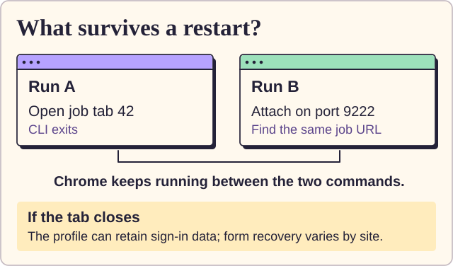

新しい電子メール コードを要求する前に、このプロファイルで Outlook Web を開き、必要な Microsoft サインインを完了してください。ジョブ タブを閉じるか、Chrome を終了するか、サイト セッションが期限切れになると、アプリケーションが中断される可能性があります。チャット専用ブラウザの下書きは、別途復元する必要があります。

<a name="run-a-browser-click-task"></a>

## ブラウザのクリックタスクを実行する

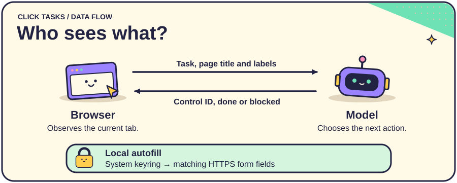

`python -m pip install -e '.[agent]'` でオプションの依存関係をインストールし、 `OPENAI_API_KEY` を設定します。モデルに HTTPS 開始ページと特定のタスクを与えます。

```sh
ruin "Open the help page" --site https://example.org --channel chrome
```

ランナーは、タスク、ページ タイトル、および表示されるアクション ラベルを選択したモデルに送信します。選択したコントロールを直接クリックし、ページを再度観察します。タスクでは 1 つのタブと最大 20 のステップを使用できます。

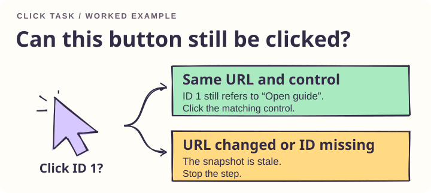

たとえば、表示されているボタンに **Open guide** というラベルが付いている場合、モデルは現在の ID を選択できます。 URL が変更された場合、またはスナップショットに ID が欠落している場合、そのステップは停止します。モデルの決定がブロックされると、ページは検査のために開かれたままになります。

<a name="local-credential-filling"></a>

### ローカル認証情報の入力

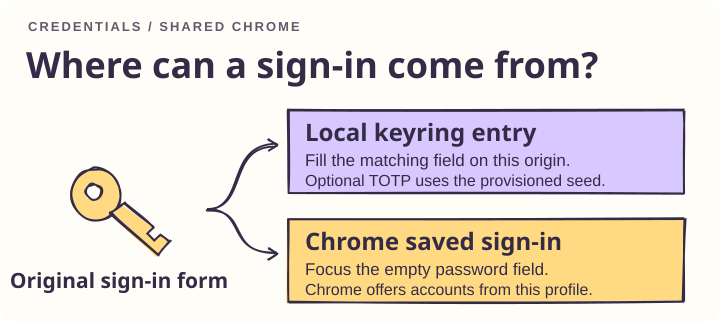

システム キーリングと Chrome のサインイン フォームを使用するには、`--autofill` を追加します。選択した HTTPS オリジンに送信する、表示されるパスワード フィールドが 1 つあるフォームの場合、ランナーは空のフィールドをクリックして、Chrome が**そのブラウザプロファイル**に保存された資格情報を提供できるようにします。開いたタブでサインインを完了します。ランナーは、資格情報フィールドが消えるまで最大 3 分間待ってから、タスクを再開します。アカウントの選択とフォームの送信はログイン UI に任せます。 Chrome フィクスチャは、制限的なスクリプト ポリシーを使用して同じタブの継続を検証します。

<a name="local-account-registration"></a>

#### ローカルアカウント登録

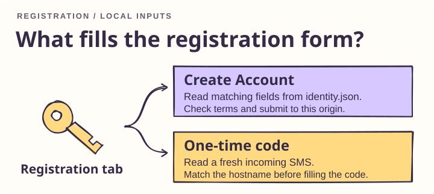

`ruin identity` を実行して、電話地域を名前で選択し、複数の番号を保存し、デフォルトを選択し、編集中にパスワードを表示します。オフライン エディターは、ブラウザーのネイティブ選択コントロールと、ダイヤル コードと国際書式設定用の電話番号ライブラリを使用します。[Python-電話番号](https://github.com/daviddrysdale/python-phonenumbers)

`--site` を使用してブラウザ タスクを手動でセットアップするには、所有者のみのアクセス許可 ( `chmod 600` ) を持つ `~/.ruin/identity.json` を作成します。 `auto_signup` を `true` に設定し、 `first_name` 、 `last_name` 、 `email` 、 `phone` および `default_password` の文字列値を指定します。このファイルにはパスワードが平文で保存されます。ローカル ランナーは、登録を送信するまで、各モデルを決定する前に、選択された HTTPS オリジンをチェックします。同じ生成元の POST フォーム上に表示される 1 つの **Create Account** 、 **Create an Account** 、 **Register** または **Sign Up** 送信ボタンを認識し、認識されたフィールドに入力し、サービス利用規約、利用規約、およびプライバシー ポリシーのラベルが付いたボックスをチェックします。通常の同一生成元フォームでは、空の編集可能な連絡先電話フィールドを 1 つ埋めることもできます。プロファイル値が欠落している一致するサインアップ フィールドが表示されている場合は、完了するためにタブが開いたままになります。

後続の 1 つのワンタイム コード フィールドについては、ランナーは macOS Messages を最大 30 秒間チェックし、送信以降に受信され `@hostname #code` で終わる受信テキストを探します。メッセージ データベースへの読み取りアクセスが必要です。 MCP チャレンジと受信結果には、ローカル設定を報告する `signup_policy` フィールドが含まれます。 Chrome および SQLite フィクスチャは、フォームの送信、通常の電話入力、クロスオリジン アクション、メッセージの経過時間、方向およびドメインのマッチングを実行します。

<a name="workday-accounts-and-signed-in-sessions"></a>

#### 飛書採用サイトの回転パズル

回転パズルが表示されたら、ローカル設定で `auto_signup` を有効にし、そのログイン画面の完全な URL を `ruin_auto_register` に渡します。図のように内円と外周の境界を照合し、スライダーを一度ドラッグします。楽信聖文の採用サイトでは認証に成功し、再送ボタンに残り 30 秒と表示されました。カウントダウンが見えると `sms_requested`、パズルの結果を確認できない場合は `slider_pending` を返します。

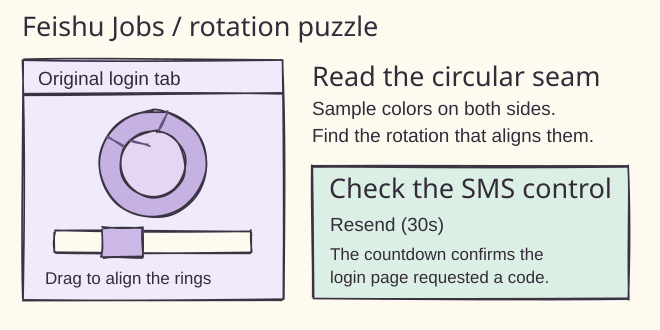

#### 衆安の Moka 採用サイトでの SMS ログイン

衆安の新卒採用ページに網易易盾のパズルが表示されたら、ローカルの `auto_signup` を有効にし、`#/job/…` を含む URL 全体を `ruin_auto_register` に渡します。図のように元のタブでピースの輪郭と穴を照合し、横にドラッグします。実際の採用サイトで SMS の再送までの秒数が表示されることを確認しました。カウントダウンを確認すると `sms_requested`、結果が確認できない場合は `slider_pending` を返します。

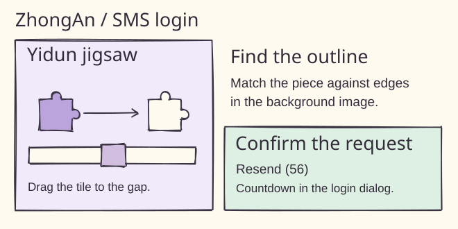

### フォーム送信後の自動確認

許可された送信には `ruin_action(site, button)` または `ruin action --site URL --button LABEL` を使います。元のタブの正確な URL とボタン名を指定します。クリック後 1.5 秒から 6 秒まで、表示中のフレームも含めて遅れて現れる認証を検査します。URL だけを渡すと、開いている認証を再開します。送信済みの記録にはサイトの受付表示を確認します。

図のように ddddocr と OpenCV で画像を照合し、表示倍率と初期位置を考慮してドラッグを補正します。ブラウザーのテストでは遅延する別オリジンのポップアップ、縮尺、初期位置、Canvas、アバター付きプレビューとグリッドを検証します。画像グリッドと単一レイヤーの画像にはローカルの Ollama を使います（標準モデルは `ollama pull qwen3-vl:2b-instruct`）。3 回試しても認証が残る場合は `challenge_pending` を返します。 衆安の実際の応募では公式の受付表示と応募履歴の初期審査ステータスを確認しました。

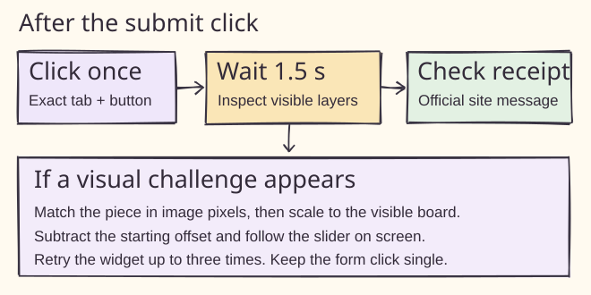


#### Workday アカウントとサインイン セッション

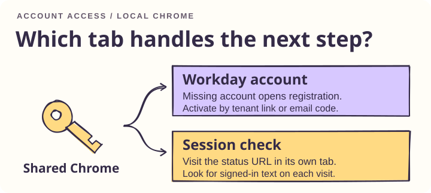

サポートされている英語の Workday テナント フォームでは、CLI ブラウザ タスクは最初にローカルの電子メールとパスワードを試行します。明示的なアカウント不足メッセージにより登録が開始されます。一般的なサインインが失敗すると、元のジョブが開いたままになります。登録後、Ruin はサインインしている Outlook メールボックスで新しいアクティベーション メッセージを確認し、正確なテナント ホスト上の直接アクティベーション リンクをたどり、表示される確認を待って求人 URL に戻ります。このアダプターは、ネイティブ POST フォームと、認識された送信コントロールを備えたスクリプト駆動の Workday ダイアログをサポートします。ローカル Chrome フィクスチャは、既存のアカウント、登録、アクティベーション、およびジョブへの復帰をカバーします。運用テナントのレイアウトとラップされた電子メール リンクは異なる場合があります。

ページ上部にも Sign In ボタンがある場合は、開いている Workday ダイアログ内のボタンを使用します。6 桁のメール認証では、同じテナントへのリンクを含む Outlook の新着メールを照合し、明示されたコードが一つだけの場合に元のタブに入力して、有効化の確認を待ちます。Jain Global のダイアログは共有 Chrome 上で確認し、コードによる有効化は模擬メールボックスで検証しました。

既存のタブに送信されるコードの場合は、サイトが SMS を送信したときに記録されたリクエスト時間を使用します。必要に応じて、`sms_senders` をローカル ID ファイルに追加し、正確なホスト名を専用の送信者文字列にマッピングします。プレーンな 6 桁のコードは、その送信者から送信されなければなりません。ドメインバインドされたメッセージは、送信者のエントリがなくても機能します。どちらのパスでも、Mac メッセージ データベースへの読み取りアクセスが必要です。

```sh
ruin verify-sms --site "$VERIFICATION_URL" --requested-at "$REQUEST_UNIX_SECONDS"
ruin keep-alive --site "$STATUS_URL" --signed-in-text "Account overview" --interval 900 --timeout 86400
```

キープアライブでは、選択した HTTPS ステータス ページの別のタブが開きます。サインインしたビューに固有のテキストを含む読み取り専用ページを使用します。このプロセスは、訪問するたびにそのテキストをチェックし、リダイレクトまたはテキストの欠落があった場合に停止し、終了すると独自のタブを閉じます。必要な期間コマンドを実行します。サイトは独自のセッションの有効期間を制御します。シミュレートされた Chrome チェックでは、繰り返される GET リクエストと元のタブの保存がカバーされます。


ローカル入力用の資格情報をプロビジョニングするには、以下のエントリを使用します。オプションの TOTP エントリには、サイトの Base32 シードが保持されます。

```sh
keyring set ruin:https://example.org username
keyring set ruin:https://example.org password
keyring set ruin:https://example.org totp
```

<a name="verify-a-greenhouse-application-with-outlook-web"></a>

## Greenhouse アプリケーションを Outlook Web で検証する

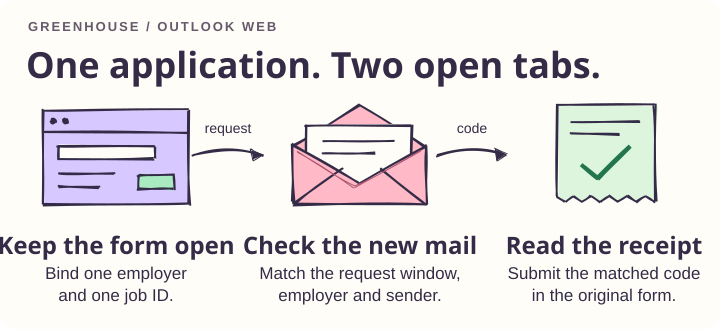

macOS または Linux では、Outlook Web がサインインしており、元の Greenhouse ジョブ タブが開いているローカル デバッグが有効な Chrome セッションに接続します。サンプルの URL と雇用主を、電子メールで使用されている正確な仕事と名前に置き換えます。アプリケーションがコードを要求する前にウォッチャーを開始します。既存のアプリケーション ワークフローは引き続き最初の送信を所有します。

```sh
ruin verify-email --cdp http://127.0.0.1:9222 \
  --site https://job-boards.greenhouse.io/example/jobs/12345 \
  --company "Example Employer" --timeout 180
```

ウォッチャーは、表示されている Outlook 受信ボックス行のスナップショットを取得し、タイムスタンプがリクエスト ウィンドウに続く新しい行または更新された行を待ちます。雇用主、件名の文言、Greenhouse 送信者をチェックし、開かれたメッセージからコードを読み取り、元のジョブ タブに送信します。ローカル ロックはウォッチャー プロセスをシリアル化します。検証中は、同じ雇用主の他のアプリケーションをアイドル状態にしておきます。

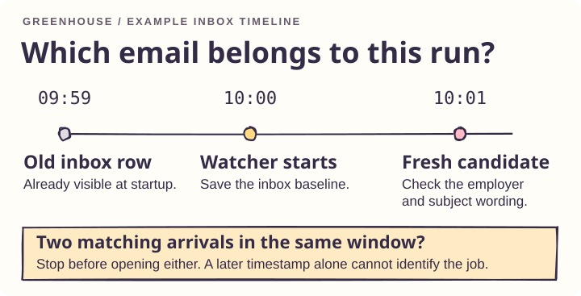

受信ボックスの図では、ウォッチャーが 10:00 に開始されたときに、09:59 のメッセージがすでに存在しています。ウォッチャーは、10:01 の候補者を雇用主とその行の検証文言と照合してから、開かれたメッセージ内の送信者をチェックします。 2 つの新しい候補が一致した場合、どちらかを選択する前に停止します。これらの時間は順序を示しています。ウォッチャーは、ライブ実行から記録されたタイムスタンプを使用します。

<a name="recover-an-open-challenge"></a>

### オープンチャレンジを回復する

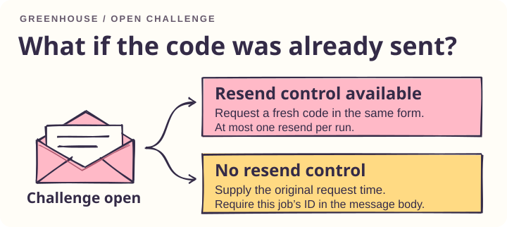

チャレンジが起動時にすでにオープンされていて、再送信制御を提供している場合は、そこで新しいコードを要求します。実行ごとに最大 1 回の再送信が行われます。

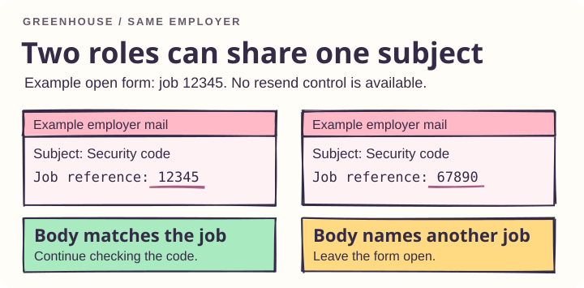

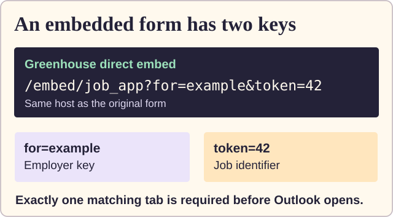

Greenhouse を直接埋め込む場合は、引用符で囲まれた完全な URL ( `for` と `token` の両方を含む) を渡します。既存のチャレンジに再送信制御がない場合は、そのジョブの元のリクエストから `--requested-at UNIX_SECONDS` を供給します。この回復パスの場合、メッセージ本文でもジョブ ID を識別する必要があります。同じ雇用主の 2 つの役割が共有するサブジェクトでは、どちらのフォームがコードを所有しているかを確立できません。別のチャットの隔離されたブラウザのタブはそこで処理される必要があります。

このプロトタイプは、英語のトップレベル Greenhouse フォームと Outlook レイアウトをサポートし、メッセージ識別子、タイムスタンプ、送信者アドレス、メッセージ本文を公開します。証拠が欠けていたり、一致があいまいな場合、検証は停止します。目に見える受付記録のみが成功とみなされます。 * 送信後に * でもタイムアウトが発生する可能性があります。再試行する前に、元のタブを確認してください。メッセージの内容とコードはモデル ループの外に留まります。統合はブラウザのフィクスチャを使用してテストされています。実際の雇用主フォームおよび Outlook テナントとの互換性は未検証のままです。

<a name="resume-an-authorized-ashby-application"></a>

## 認可された Ashby アプリケーションを再開する

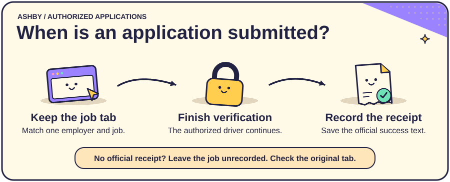

レビューされたアプリケーションがすでに検証に達している場合は、このワークフローを使用します。元のアプリケーション ドライバーはそのジョブの承認を所有し、同じタブでライブ チャレンジを完了します。正確なアプリケーション URL を使用して、そのドライバーと一緒に受付記録 ウォッチャーを起動します。

```sh
ruin resume-ashby --cdp http://127.0.0.1:9222 \
  --site 'https://jobs.ashbyhq.com/EMPLOYER/JOB-UUID/application' --timeout 300
```

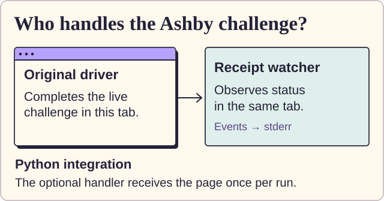

CLI は 1 つの一致するタブに接続し、標準エラーで JSON 状態の変更を出力します。 `challenge_visible` では、承認されたドライバーは現在のウィジェットを使用します。 Python API を使用するドライバーは、独自の承認済みハンドラーを直接提供できます。

```python
receipt = await resume_ashby(context, application_url, timeout=300,
                             directory=receipt_directory, on_event=report_status,
                             on_challenge=complete_authorized_challenge)
```

`ruin.agent.ashby` から `resume_ashby` をインポートします。ハンドラーは、実行ごとに 1 回、元の Playwright ページを受け取ります。スタンドアロン CLI はブラウザを監視します。ウィジェットを操作するには、アプリケーション ドライバーまたは人が必要です。チャレンジが完了すると、フォームが自動的に送信される場合があります。既存の提出物は実行中のままにして、その結果を監視します。有効になっている Submit ボタンだけでは、別のリクエストを送信する証拠としては不十分です。

<a name="receipt-storage-and-retries"></a>

### 受付記録の保存と再試行

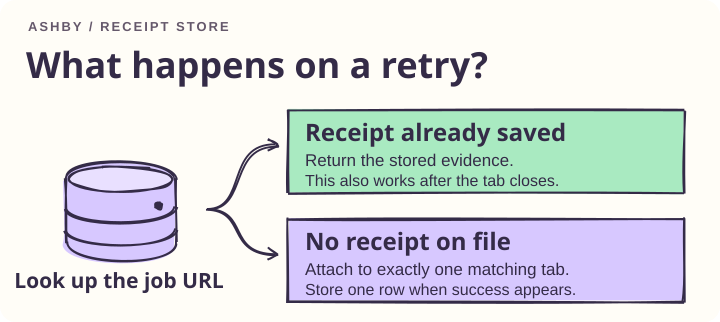

ウォッチャーは、同じジョブが Ashby の可視 **Success** ステータスを **Your application was successfully submitted** とともに表示する場合にのみ成功を記録します。標準出力に受付記録を JSON として返し、ジョブごとに 1 行を `~/.ruin-everything/ashby-receipts.sqlite3` に保存します。再試行すると、保存されている受付記録が返されます。タイムアウト、変更されたジョブ、または曖昧なタブでは、送信されたジョブにマークが付けられずにエラーが発生します。外部アプリケーション トラッカーは、返された受付記録のみをインポートする必要があります。

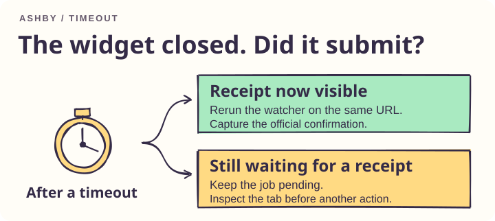

たとえば、サイトがアプリケーションを処理している間にチャレンジが消える可能性があります。ウォッチャーがタイムアウトした場合は、別のアクションを実行する前に元のタブを確認してください。後でそのタブに正式な受付記録が表示された場合は、同じ URL でウォッチャーを再実行して受付記録をキャプチャします。

イラストの領収書は一例です。受信パターンは、完成した Baseten アプリケーションから取得されます。再利用可能なコマンドは、非表示の受付記録、変更されたジョブ、重複したタブ、タブを閉じた後の再試行など、 Chrome のシミュレートされた Ashby ページでテストされました。

<a name="connect-an-agent-over-mcp"></a>

## MCP 経由でエージェントを接続する

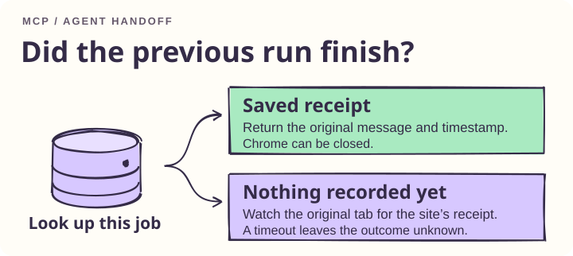

タグ付きリリースには MCP サーバーが含まれます。レジストリ対応クライアントは `uvx ruin-everything@0.2.0` で直接起動できます。 [GitHub のリリース](https://github.com/yuki4266/ruin-everything/releases)

クライアントに正確な求人 URL を伝え、表示された内容を説明します。 Ashby アプリケーションが処理されたかどうかが問題の場合、クライアントは最初に受付記録 ジャーナルを確認します。フォームが検証を待機している場合、クライアントは開いているタブを検査します。

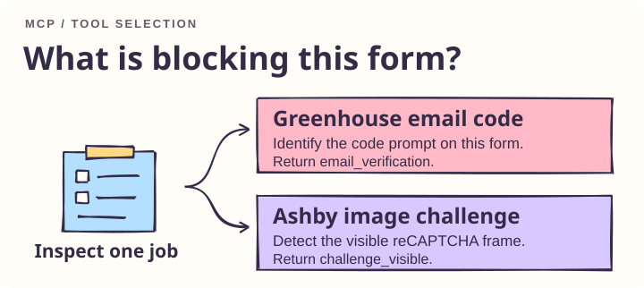

| ツール | いつ電話するか | 結果 |
| --- | --- | --- |
| `ruin_browser` | すべてのサイトの閲覧、移動、操作、抽出の既定入口。 | 共有 Chrome の現在の URL、ページ状態または操作結果。 |
| `ruin_action` | 許可されたフォームの正確な URL とボタン名。 | クリック後に認証を処理し、URL だけで認証を再開します。 |
| `ruin_auto_register` | 選択した登録フォームまたは連絡フォームは、正確な HTTPS URL で開かれます。 | ローカル プロファイル アクションと現在のサインアップ ポリシー。送信されたフォームでも検証が必要な場合があります。 |
| `inspect_application_challenge` | Greenhouse は 8 文字の電子メール コードを要求し、コネクタは `[one-time authentication code withheld]` を報告するか、Ashby が reCAPTCHA グリッドを表示します。また、失われたサポートされているフォームを見つけるためにも使用します。 | プロバイダーと表示状態。タブが欠落しているか重複している場合は、独自の結果が得られます。フォームは開いたままになります。 |
| `get_ashby_receipt` | 受け渡し時、Chromeを閉じた状態でも | 保存された受付記録または `unrecorded` 。記録が欠落していると、結果は不明のままになります。 |
| `watch_ashby_receipt` | 元の形式はオープンであり、結果は不確実です | 既存の領収書、または同じ仕事からの新しい証拠。タイムアウトはツールエラーです。ウォッチャーはフォームを開いたままにします。 |

インストール[紫外線](https://docs.astral.sh/uv/getting-started/installation/)一度。 JSON 構成の MCP クライアントでは、この例では最新の[PyPI リリース](https://pypi.org/project/ruin-everything/)。クライアントは、その PATH 上で `uvx` を見つけることができる必要があります。 `uvx` への絶対パスも機能します。

```json
{
  "mcpServers": {
    "ruin-everything": {
      "command": "uvx",
      "args": [
        "--isolated", "--refresh",
        "--from", "ruin-everything[mcp]",
        "ruin-mcp"
      ],
      "env": { "RUIN_AUTO_UPDATE": "0" }
    }
  }
}
```

GitHub ブランチを直接追跡するには、 `--from` を `ruin-everything[mcp] @ git+https://github.com/yuki4266/ruin-everything.git@main` に設定します。どちらの構成でも、実際の `ruin-mcp` 実行可能ファイルが起動されます。 2 つのバージョンのスモーク テストにより、Git パスとパッケージ パスの両方で更新が検証されました。既存の編集可能なインストールは引き続き直接起動できます。

ユーザー アカウントにサーバーを登録するには、クライアントに対してコマンドを実行します。新しいセッションを開いてツール リストを選択します。

```sh
codex mcp add ruin-everything --env RUIN_AUTO_UPDATE=0 -- uvx --isolated --refresh --from 'ruin-everything[mcp]' ruin-mcp
claude mcp add --scope user --transport stdio ruin-everything -e RUIN_AUTO_UPDATE=0 -- uvx --isolated --refresh --from 'ruin-everything[mcp]' ruin-mcp
```

<a id="first-mcp-call"></a>

### MCP ツールを試す

クライアントの接続後に、架空の求人 URL を使って次のように依頼できます。Chrome を閉じたまま試せます。応募やプロフィールの登録は不要です。

> `https://jobs.ashbyhq.com/example/aaaaaaaa-bbbb-cccc-dddd-eeeeeeeeeeee/application` を指定して `get_ashby_receipt` を呼び出し、結果の状態を教えてください。

初回は `unrecorded` が返ります。これは、この例に該当する受付記録がローカルに見つからなかったという意味です。この読み取り専用の呼び出しは PyPI の公開版で確認済みです。

リポジトリには以下が含まれます[ルーティング命令](AGENTS.md#ruin-everything-application-routing)Codex 用に作成し、からインポートします。[クロード.md](CLAUDE.md)。他のワークスペースに適用するには、アプリケーション ルーティング セクションをユーザーレベルの `~/.codex/AGENTS.md` または `~/.claude/CLAUDE.md` にコピーします。汎用のローカル Chrome ログインフローで PayPal へのログインを試すことはできます（[信頼済みログインの図、パネル C](docs/figures/trusted-auth.svg)）。PayPal Security Challenge 専用アダプターは未実装であり、ローカル Chrome でも通常のサイト認証が表示される場合があります。これはコード確認に基づく文書の明確化であり、実際の PayPal ログイン成功を検証したものではありません。Duo のコードと電話通知は通常の認証を使います。入力済みフォームと端末信頼の自動操作は、下記「永続セッションと Duke の保存済みログイン」を参照してください。

5 つの専用ツールは `site` を使用します。インスペクターはデフォルトで 1 回チェックします。同じタブで `pending` からの変更を監視するには、`wait_seconds` を 1 ～ 300 に設定します。 CLI からは、 `ruin watch --site "$JOB_URL" --timeout 30` を使用します。サポートされている状態が検出されるか、元のタブが失われるか、制限時間に達すると、監視は終了します。

ローカル Chrome シミュレーションでは、Greenhouse URL と 8 文字のコード シンプトムのみを指定した新しい Codex CLI セッションは、最初のツール呼び出しとして `inspect_application_challenge` を選択し、 `email_verification` を返しました。シミュレートされたフォームは空のままでした。

Ashby 受信ウォッチャーは `timeout_seconds` (デフォルトは 15、範囲は 1 ～ 300) を受け取ります。返送された受付記録には、 `state` 、 `site` 、 `observed_at` 、およびサイトの確認 `message` が含まれます。アプリケーション ドライバーはフォーム インタラクションを所有します。タイムアウト後、別の送信を検討する前に、同じ URL を再度確認してください。

サーバーは、stdio 経由で公式の Python MCP SDK を使用します。 Playwright MCP などのブラウザ自動化クライアントは、 `--cdp-endpoint http://127.0.0.1:9222` と同じローカル Chrome に接続することで、同時に実行できます。統合テストは、Chrome がローカル デバッグ ポートをアドバタイズするのを待ってから、2 つの連続する SDK クライアントをシミュレートされた雇用主ページに接続します。[Python MCP SDK](https://github.com/modelcontextprotocol/python-sdk) · [Playwright MCP接続オプション](https://github.com/microsoft/playwright-mcp#configuration)

<a name="how-updates-reach-your-machine"></a>

## アップデートがマシンに届く仕組み

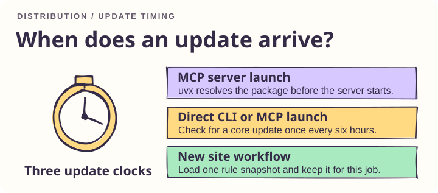

| 何が変わるのか | 手に入れたら |
| --- | --- |
| uvx 経由の MCP パッケージ | 次回のサーバーの起動時に、uv は構成されたソースから入手可能な最新バージョンを解決します。長時間実行されているサーバーは、ロードされたコードを再起動するまで保持します。初期インストールとオンライン更新にはネットワーク アクセスが必要です。 |
| 直接インストール | CLI および MCP の起動では、インストールごとに最大 6 時間に 1 回、静かなバックグラウンド チェックがスケジュールされます。 `origin/main` の早送りを追跡するクリーンな `main` チェックアウト。通常の pip インストールでは、PyPI の新しいバージョンがチェックされます。インストールされた UV ツールは独自のアップグレード コマンドを使用します。 `RUIN_AUTO_UPDATE=0` を自分でバージョン管理できるように設定します。 |
| サイトルール | 新しい Greenhouse 検証またはライブ Ashby 観察のたびに、プロジェクトの[セレクターファイル](ruin/rules/sites.json)2 秒のネットワーク タイムアウトを使用します。ワークフローは、完了まで最初のスナップショットを保持します。オフラインまたは無効な更新は、 `~/.ruin/sites.json` の最後の有効なキャッシュにフォールバックし、次にパッケージ化されたデフォルトにフォールバックします。 `RUIN_RULE_UPDATES=0` をバンドルコピーを使用するように設定します。 |

ルール ファイルには、Ashby 受信要素、Greenhouse 検証入力と電子メール コード パターン、および Outlook 行とメッセージ本文が記述されます。インストールされたアダプターは、信頼できる送信元、送信者の ID、ジョブの照合、および受信の文言を強制します。これらのチェックを変更するには、コードのリリースが必要です。

メンテナの場合は、1 つを設定します[PyPI Trusted Publisher](https://docs.pypi.org/trusted-publishers/creating-a-project-through-oidc/)プロジェクト `ruin-everything` 、オーナー `yuki4266` 、リポジトリ `ruin-everything` 、ワークフロー `publish.yml` および環境 `pypi` の場合。メインへのプッシュにより、ワークフロー実行番号を使用して `pyproject.toml` のバージョンが 4 番目のリリース コンポーネントとしてビルドされます。タグ付きリリースの場合は、プロジェクトのバージョンを設定し、一致するタグ ( `0.2.0` と `v0.2.0` など) をプッシュします。どちらのルートもブラウザー テストを実行し、ホイールとソースの配布をビルドして確認し、 GitHub の OIDC ID を使用して公開します。[リリースワークフロー](.github/workflows/publish.yml) · [UVツールのアップデート](https://docs.astral.sh/uv/concepts/tools/)

<a name="example-read-courses-after-school-sign-in"></a>

## 例: 大学にログインして履修科目を取得する

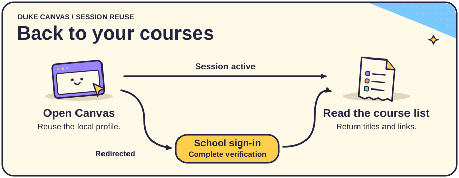

Duke Canvas アダプターは、対話型ログイン後にタスクがどのように再開されるかを示します。共有プロファイルでルックアップを実行します。

```sh
ruin courses
```

結果にはコース名とリンクが含まれます。構造化出力には `--json` を使用します。

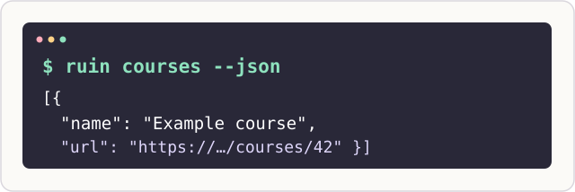

既存のローカル デバッグ エンドポイントを明示的に選択するには、次を実行します。

```sh
ruin courses --cdp http://127.0.0.1:9222 --json
```

サインイン ブランチは、学校がブラウザーを Canvas に戻すまで最大 180 秒待機します。 `--timeout 300`の待ち時間を長く設定してください。 Duo の承認は学校のサインイン パスで行われます。[Duke デバイスのリカバリ](https://oit.duke.edu/help/articles/kb0036398/)

<a name="verification"></a>

## 検証

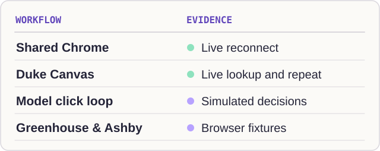

更新テストでは、重複する起動チェック、ルール スナップショット間の変更、無効なダウンロード、オフライン フォールバックがカバーされます。実行時チェックでは、独立した CDP 接続間で共有される Chrome タブが検証されました。ブラウザー テストの場合は、 Playwright Chromium ビルドをインストールするか、インストールされた Chrome を使用します。 `python -m unittest discover -s tests -v` を実行します。エージェント エクストラをインストールして、モック モデル テストを含めます。インストールされている Chrome の場合は、コマンドの前に `RUIN_TEST_CHANNEL=chrome` を付けます。

ライブ Duke 実行では、サインイン後にコース リンクが返されました。同じプロファイルを使用した 2 回目の実行でも、学校のログイン ルートにアクセスした後にリストが返されました。 Duo プロンプトの数は測定されませんでした。一般的なクリック ループは、シミュレートされたモデル応答を使用して実行されています。

手書きの図は編集可能な SVG です。 Rough.js の線画と Kalam レタリングを使用します。[図の出典](docs/figures) · [ラフ.js](https://roughjs.com/) · [Kalam フォントのライセンス](docs/figures/Kalam-LICENSE.txt)

[開発計画](PLAN.md) · [投稿と数値のガイドライン](AGENTS.md) · [MITライセンス](LICENSE)

<a id="community"></a>

## Ruin Everything に貢献する

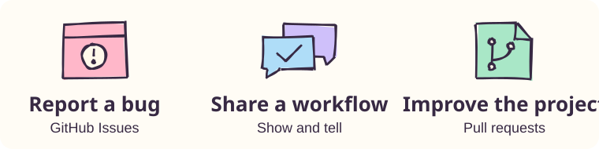

お使いの MCP クライアントで Ruin が動いたら、[設定とツールの実行結果を共有してください](https://github.com/yuki4266/ruin-everything/discussions/categories/show-and-tell)。次に試す人の手がかりになります。接続で困ったときは [Q&A で質問できます](https://github.com/yuki4266/ruin-everything/discussions/categories/q-a)。

[不具合を報告する](https://github.com/yuki4266/ruin-everything/issues/new?template=bug.yml) · [アイデアを提案する](https://github.com/yuki4266/ruin-everything/discussions/categories/ideas) · [翻訳・テスト・修正に参加する](CONTRIBUTING.md)

### 貢献者

動作確認、質問への回答、修正にご協力いただいた皆さんに感謝します。以下は GitHub のコミット履歴に記録された貢献者です。

<a href="https://github.com/yuki4266/ruin-everything/graphs/contributors"></a>

## スターの推移

<a href="https://www.star-history.com/?repos=yuki4266%2Fruin-everything&amp;type=date">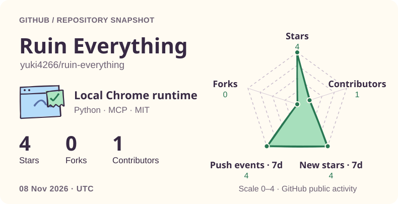</a>

画像をクリックすると、最新のスター数の推移を確認できます。

⭐ [Ruin がブラウザーでの作業再開に役立ったら、GitHub でスターをお願いします。](https://github.com/yuki4266/ruin-everything)

### 信頼済みログイン設定

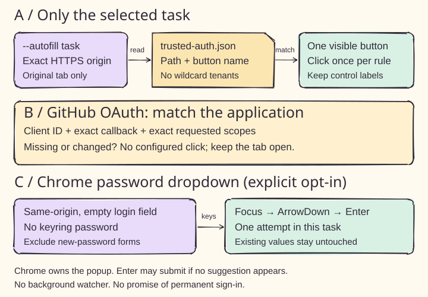

図 A は `~/.ruin-everything/trusted-auth.json` の `trusted_oauth_clients` を示します。`--autofill` 使用時、設定済みのログイン、SSO、Stay signed in、Trust this browser ボタンを規則ごとに一度だけクリックします。HTTPS オリジン、パス、ボタン規則を照合します。図 D は `https://*.greenhouse.io`、`https://*.myworkdayjobs.com`、`https://*.duke.edu` による多階層サブドメイン対応を示します。完全一致の設定が優先され、認証情報と操作は選択したテナントに限定されます。[設定例](docs/trusted-auth.example.json) には Glama、Greenhouse、Workday、Duke SSO を含み、未検証のボタン規則は空にしています。

図 B の GitHub OAuth ではクライアント ID、コールバック URL、スコープも一致する必要があります。タスクの文章は許可を拡張しません。図 C は任意の Chrome パスワード操作です。keyring にパスワードがない場合、フォーカス、ArrowDown、Enter を送信します。候補がないとフォームを送信する場合があり、入力成功や永続ログインは保証しません。

Chrome のテスト用ページで一致判定、権限変更の拒否、試行回数、入力欄の除外を検証しました。ネイティブの候補選択と本番の認可ページは未検証です。[設定の詳細](docs/trusted-auth.md)を参照してください。既存のブラウザー権限要件は引き続き適用されます。

GitHub 認可では標準ボタンセレクターを使用でき、ボタン名の事前設定は不要です。クライアント ID、コールバック、スコープの照合は必須です。Chrome のテストでドメイン境界、ポート、別テナントの拒否と標準セレクターを検証しました。Glama への実際の登録は未検証です。

設定例には `https://paypal.com` と `https://*.paypal.com` のパスワード選択のみの設定を追加しました（パネル C）。操作リストは空で、ログイン、支払い、外部認可ボタンは事前許可しません。境界テストはルート、多段サブドメイン、偽装サフィックス、HTTP、別ポートを対象とし、実際の PayPal ログインは未検証です。

## 永続セッションと Duke の保存済みログイン

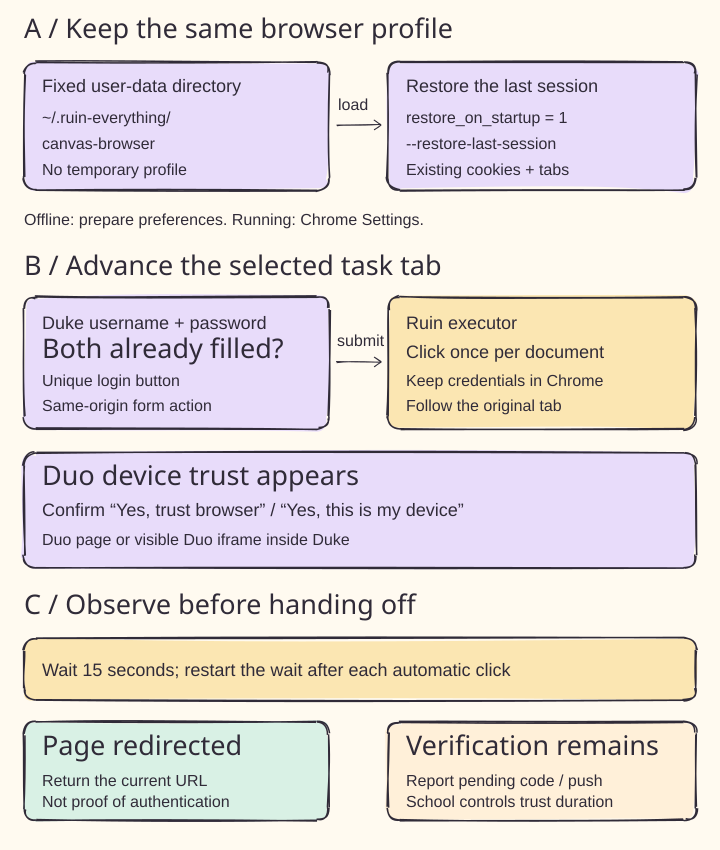

図 A：固定ディレクトリ `~/.ruin-everything/canvas-browser` を使います。起動前に既存設定を保ちながら `session.restore_on_startup = 1` を設定し、`--restore-last-session` で起動します。実行中の Chrome の設定ファイルは書き換えません。`chrome://settings/onStartup` の「前回開いていたページを開く」で変更できます。現在の Chrome は Secure Preferences に保存する場合があります。

図 B：`ruin_browser`（inspect/read を含む）、`ruin_action`、CLI タスクは、選択したタブで入力済みの Duke ログインを実行器経由で進めます。一意の `#Submit` またはログインボタンと、Duke と同一オリジンへの送信が必要です。HTTPS `*.duosecurity.com` の端末信頼ボタンと Duke 内の可視 Duo iframe に対応します。学術ウォッチャーは開始済みの認証フローだけを追跡します。同じ文書を再送信せず、資格情報を出力しません。

図 C：自動入力や認証を 15 秒待ち、自動クリック後も 15 秒待ってから、残ったコード、電話通知、未入力欄を報告します。元のタブを保持します。リダイレクトは認証成功の証明ではありません。信頼期間は大学の設定によるため、30 日間や永続ログインは保証しません。

検証：隔離ブラウザで実際の再起動後のセッション Cookie 復元、遅延入力、Duo 信頼、iframe、オリジン、重複防止、15 秒待機をテストしました。ローカル Chrome の設定変更と再読み込みも確認済みです。実際の Duke/Duo 認証は未検証です。新しいツール説明には MCP の再接続が必要です。 インストール済み Google Chrome の再起動テストも成功しました。全体の回帰テスト 67 件と、最終変更後のアクション再開・再描画の追加確認 2 件が成功しました。
