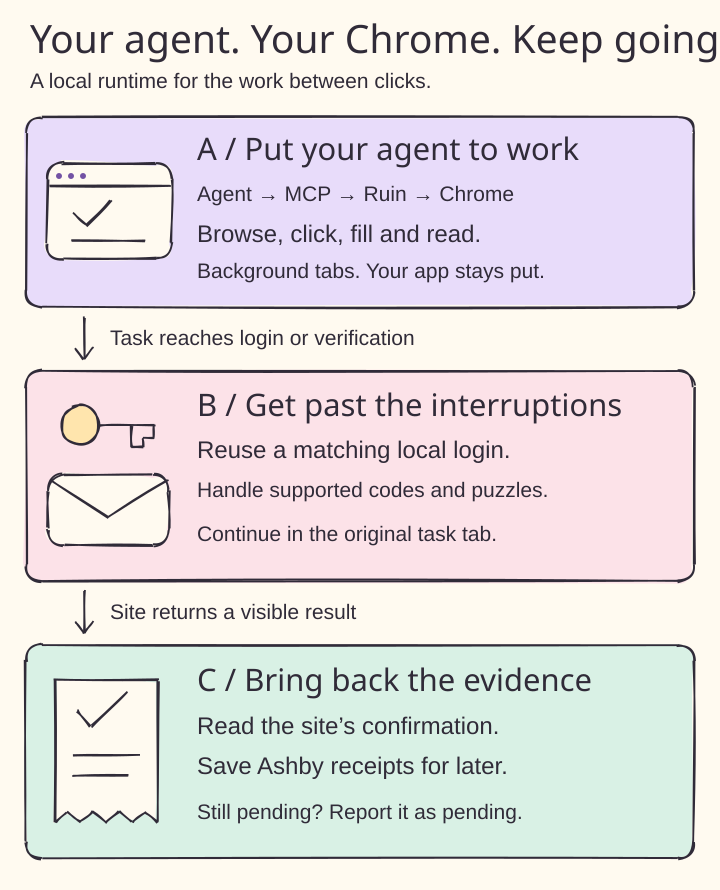
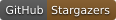
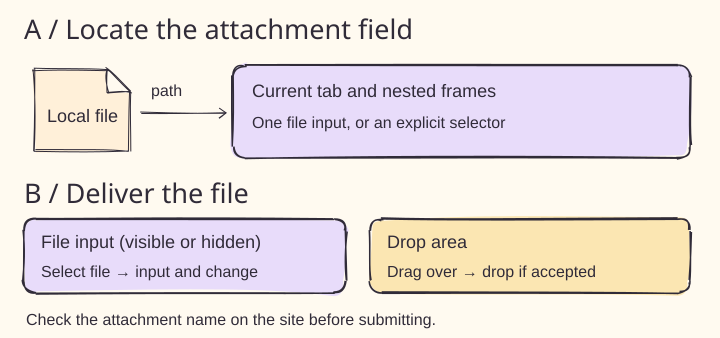
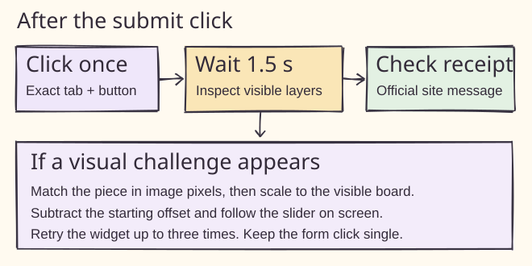
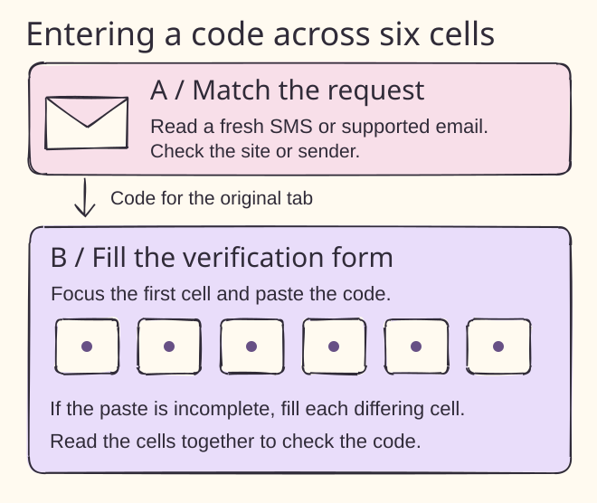
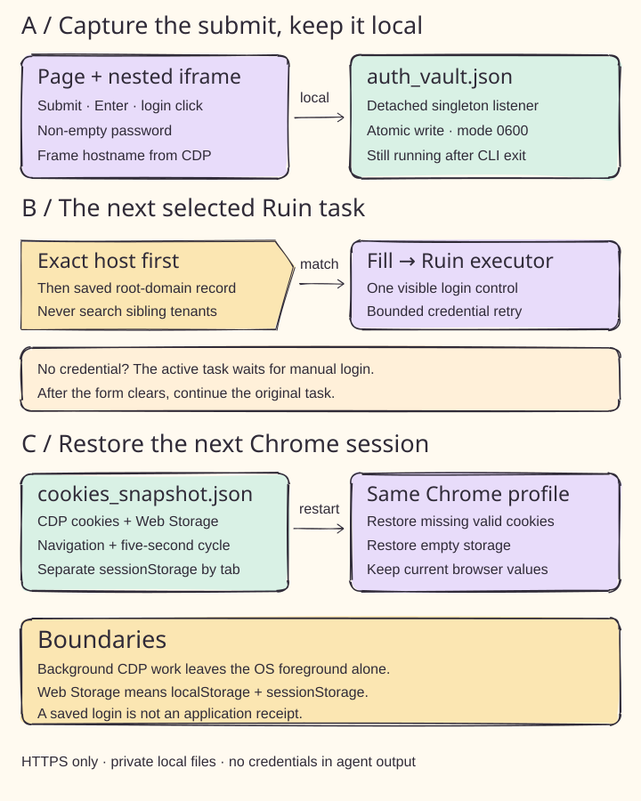
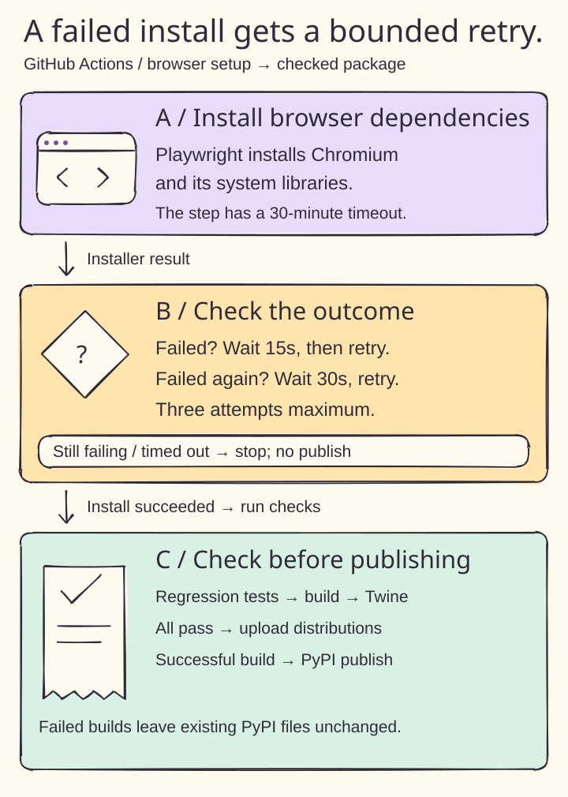
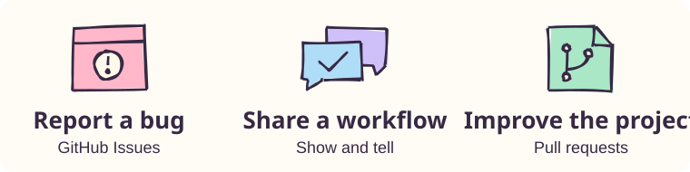

<p align="right"><strong>English</strong> · <a href="README.zh-CN.md">简体中文</a> · <a href="README.ja.md">日本語</a> · <a href="README.es.md">Español</a></p>

# Ruin Everything

### Give your agent the browser. Get your time back.

**Your agent clicks. Ruin keeps the work moving.**

Ruin Everything is a **local Chrome runtime for browser agents**. It lets your agent use the sessions, cookies and extensions already in your shared Chrome profile, work in background tabs, and continue through supported login and verification steps. Browse websites, fill forms, read pages and come back with evidence of what happened.



<p align="center">
  <a href="https://github.com/yuki4266/ruin-everything/stargazers"></a>
  <a href="#quickstart"></a>
  <a href="#connect-an-agent-over-mcp"></a>
  <a href="LICENSE"></a>
</p>

[Get started](#quickstart) · [Core features](#core-features) · [Real workflows](#real-workflows) · [What's verified](#verification) · [Technical reference](docs/runtime-reference.md)

## Less babysitting. More finished work.

The agent reaches a login page. A code lands in your inbox. A challenge appears after Submit. Then the conversation ends and nobody knows whether the application went through.

**Ruin handles the browser work that keeps interrupting the task.** Figure A shows the shared browser; B covers login and verification; C brings the result back to something you can check.

<a id="core-features"></a>

| Core feature | What you get |
| --- | --- |
| **Your Chrome, ready to work** | Navigate, click, type, select and extract text across websites. Keep using the same profile, cookies and extensions between agent sessions. |
| **An agent that stays out of your way** | Task tabs open in the background. Ruin keeps them interactive without switching your foreground app, and preserves unrelated tabs. |
| **Log in once. Reuse it when you can.** | The local vault captures manual password logins and can fill a matching login later. Cookie and Web Storage snapshots help restore state after Chrome restarts. Sites still control expiry. |
| **Keep moving through verification** | Supported flows handle fresh email codes, SMS codes and visual puzzles in the original task tab. Unresolved challenges return a pending state. |
| **Less repeated account setup** | A local identity profile fills supported signup and contact forms. Optional Workday/iCIMS recovery handles recognized account errors and password-reset requests. |
| **Proof you can come back to** | The Ashby watcher saves the site's submission confirmation by job URL. Look it up later—even after Chrome closes. |

General browsing works through `ruin_browser`; the named sites below are examples of extra automation. The agent plans the task; Ruin runs its browser actions.

### Attach a local file

Pass the exact tab URL as `site` and an absolute `file_path` to `ruin_browser(operation="upload")` or its alias `set_files`. As panel A shows, you can omit `selector` when exactly one file input exists across the page and its frames. For a form with multiple fields, select the intended input. Panel B shows the explicit drop-area route. Browser tests verify both paths, including a hidden input in a nested frame.



<a id="quickstart"></a>
<a id="use-a-shared-local-chrome-window"></a>

## Three steps to your first browser task


### 1. Start the shared browser

You need **Python 3.11+, Google Chrome and [uv](https://docs.astral.sh/uv/getting-started/installation/)**. This quickstart uses the current GitHub code so it includes the features described here.

```sh
uvx --from 'ruin-everything @ git+https://github.com/yuki4266/ruin-everything.git@main' ruin browser
```

Ruin starts or reconnects to Chrome on `127.0.0.1:9222`. Its persistent profile is `~/.ruin-everything/canvas-browser`. Sign in to the sites you need **in that profile**; this does not import another Chrome profile's logins. Chrome and task tabs stay open when the command exits.

<a id="connect-an-agent-over-mcp"></a>

### 2. Connect your agent

Add this to your MCP client's server configuration, then restart the connection. The client must be able to run `uvx`.

```json
{
  "mcpServers": {
    "ruin-everything": {
      "command": "uvx",
      "args": [
        "--isolated", "--refresh", "--from",
        "ruin-everything @ git+https://github.com/yuki4266/ruin-everything.git@main",
        "ruin-mcp"
      ],
      "env": { "RUIN_AUTO_UPDATE": "0" }
    }
  }
}
```

Prefer the published package? Replace the Git source with `ruin-everything`. Git updates arrive on the next server launch; PyPI features depend on the published version. [Installation and update details](docs/runtime-reference.md#how-updates-reach-your-machine).

<a id="first-mcp-call"></a>

### 3. Give it a task

> Use Ruin to open https://example.org and tell me the page title and visible links.

The entry point is `ruin_browser(operation="navigate", url="https://example.org")`. Follow-up calls use the returned current URL. No API key is required for Ruin's MCP server; your agent uses its own model connection. The optional standalone model-driven CLI needs the agent extras and `OPENAI_API_KEY`.

For account and signup helpers, install a persistent checkout and run `ruin identity`. Select the background editor tab to add your details and choose whether to enable automatic signup. `ruin ats-setup` separately opts into ATS password recovery. [Setup and configuration](docs/runtime-reference.md#local-account-registration).

<a id="real-workflows"></a>
<a id="institutional-sign-in-in-the-background"></a>

## Where it earns its keep



| You're trying to… | Ruin's extra help | Verification so far |
| --- | --- | --- |
| **Get through a recruiting site's puzzle** | Handle the supported ZhongAn/Moka jigsaw or Feishu Jobs rotation slider. | Live SMS countdowns observed on both; ZhongAn also returned its success page and application-history entry. |
| **Finish a Greenhouse email check** | Match a fresh Outlook message to the employer and request, then enter its code in the job tab. | Browser fixtures; live employer/Outlook compatibility remains unverified. |
| **Recover a Workday or iCIMS account** | Use local identity details, supported signup/activation and optional bounded password recovery. | Browser fixtures; live Workday dialog inspection. Production layouts vary. |
| **Find out whether an Ashby application went through** | Watch for the official confirmation and save a receipt for the exact job. | Local receipt and browser integration tests. A missing record means the outcome is unknown. |
| **Get to a paper through Duke** | Follow supported institutional access on IEEE, ACM and Springer; continue filled Duke login and Duo device-trust screens. | Live IEEE lookup, Duke redirect and PDF access; ACM/Springer covered by fixtures. |

These are specific supported flows. Puzzle handling can require a local Ollama vision model; SMS reading requires macOS Messages access; mail flows need Outlook Web signed in. Phone approvals and unsupported checks can still need you. [Workflow requirements and commands](docs/runtime-reference.md).

For authorized form submissions, use `ruin_action` with the exact current URL and visible button label. It checks for verification after the click. **A cleared challenge is a step forward; the site's receipt is the evidence of submission.**

### Enter a code across several boxes

Panel A shows how Ruin matches an incoming SMS or supported Outlook message. Panel B shows how it pastes the code into a split form and fills any remaining cells. The Ctrip phone check was verified live. Both input paths were tested with react-otp-input 3.1.1.



## Six tools. One shared browser.


| Tool | Use it for |
| --- | --- |
| `ruin_browser` | List tabs, navigate, inspect, read, click, fill, press keys and select options. |
| `ruin_action` | Submit an authorized form and handle supported follow-up verification; omit the button to resume. |
| `ruin_auto_register` | Continue supported signup, account or SMS-login steps using the local identity profile. |
| `inspect_application_challenge` | Identify a Greenhouse/Ashby challenge or locate the supported application tab. |
| `get_ashby_receipt` | Look up saved submission evidence without opening Chrome. |
| `watch_ashby_receipt` | Watch the original Ashby tab for confirmation and save it. |

[Agent routing instructions](AGENTS.md) · [CLI and detailed behavior](docs/runtime-reference.md) · [Trusted-login configuration](docs/trusted-auth.md)

## Your machine. Your browser state.



Browser execution and credential handling run locally. **The automatic login vault stores plaintext passwords** in `~/.ruin/auth_vault.json` with owner-only permissions (`0600`); they stay out of agent tool results. Cookies and Web Storage are also backed up locally. Set `RUIN_LOCAL_AUTH_VAULT=0` to disable automatic listener startup for that client. [Vault behavior and storage limits](docs/runtime-reference.md#local-auth-vault).

Your connected agent may send page text to its model provider. Site sessions still expire, and some verification still needs human input. Ruin preserves browser state and resumes supported steps; it cannot promise permanent login or success on every site.

<a id="verification"></a>

## What has actually been checked


**Current check:** all 103 local regression tests passed; source/wheel builds and strict Twine metadata checks passed. The retry script is also checked for first-attempt success, recovery on attempts two and three, and persistent failure. No new live website run is claimed.



The failed CI run stopped on Ubuntu mirror DNS errors while fetching extra font packages. Hosted Ubuntu already supplied the Chromium shared libraries. CI now installs Chromium directly and validates the runner through the browser regression suite (figure A–C). Browser downloads get at most three attempts, with 15s and 30s waits and a 30-minute step timeout. Successful tests and packaging checks enable PyPI publishing. [CI results](https://github.com/yuki4266/ruin-everything/actions/workflows/publish.yml).

Local tests cover shared sessions, background tabs, login capture and restoration, tenant boundaries, verification routing and receipt storage. The table above distinguishes live observations from simulated browser tests. See the reference for the conditions and limits of each check.

To run the regression suite from a development checkout:

```sh
python -m pip install -e '.[agent]'
python -m playwright install chromium
RUIN_AUTO_UPDATE=0 RUIN_RULE_UPDATES=0 python -m unittest discover -s tests -v
```

The illustrations are original, editable SVGs built with Rough.js and Kalam. [Figure sources](docs/figures) · [Contributing](CONTRIBUTING.md) · [Development plan](PLAN.md) · [MIT license](LICENSE)

<a id="community"></a>

## Put it to work. Tell us where it gets stuck.



[Report a bug](https://github.com/yuki4266/ruin-everything/issues/new?template=bug.yml) · [Share a workflow](https://github.com/yuki4266/ruin-everything/discussions/categories/show-and-tell) · [Suggest a feature](https://github.com/yuki4266/ruin-everything/discussions/categories/ideas)

**If Ruin saved you another round of browser babysitting, [give it a star](https://github.com/yuki4266/ruin-everything).**

<!-- mcp-name: io.github.yuki4266/ruin-everything -->
