# Ruin Everything

**A local Chrome runtime for browser agents.**

What happens to a half-finished form when an agent stops? The answers live in a browser tab. Whether the application went through is a separate question that only the site can answer.

Ruin Everything keeps the original tab open in Chrome on your machine. A later run can reconnect, finish verification where the site allows it, and check the site's response. On Ashby, the runner can return the saved receipt for that job even after the tab closes.

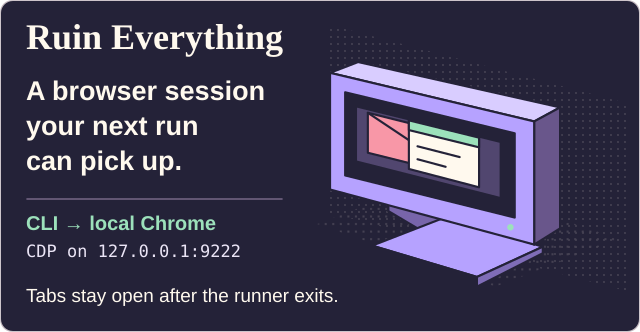

[Set up Chrome](#use-a-shared-local-chrome-window) · [Click tasks](#run-a-browser-click-task) · [Greenhouse](#verify-a-greenhouse-application-with-outlook-web) · [Ashby](#resume-an-authorized-ashby-application) · [MCP tools](#connect-an-agent-over-mcp) · [Canvas example](#example-read-courses-after-school-sign-in)

## Choose a starting point

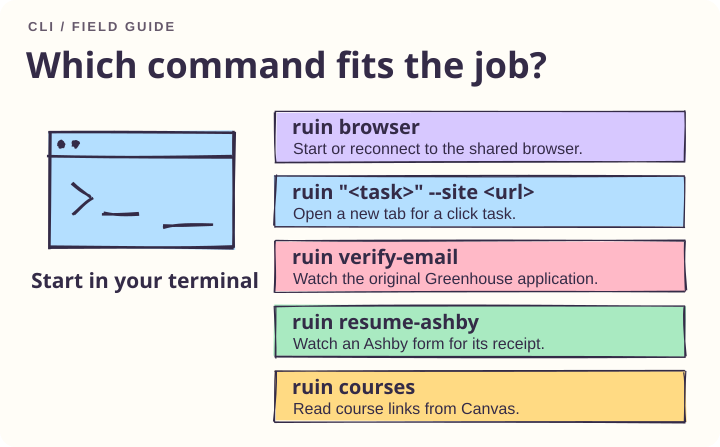

For a new task, start the shared browser and open the target site. For an interrupted application, choose the site-specific watcher and pass the original job URL. Generic click tasks open a new tab.

## Use a shared local Chrome window

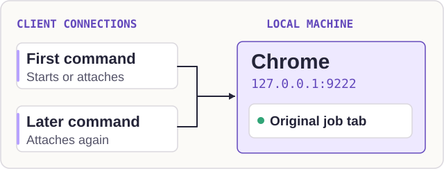

Install from the repository directory with Python 3.11+ and Google Chrome:

```sh
python3 -m venv .venv
source .venv/bin/activate
python -m pip install -e .
ruin browser
```

Run `ruin browser` to start or reconnect to the project browser. Every CLI task uses Python Playwright over CDP. The default endpoint is `http://127.0.0.1:9222`. The runner launches Chrome with a dedicated profile at `~/.ruin-everything/canvas-browser` when this port is free. The CDP connection preserves the existing browser context settings, including its download behavior. Chrome stays open after the command exits. Other local clients can attach to the same endpoint and locate the job tab by its full URL. Give one client ownership of submission for each application.

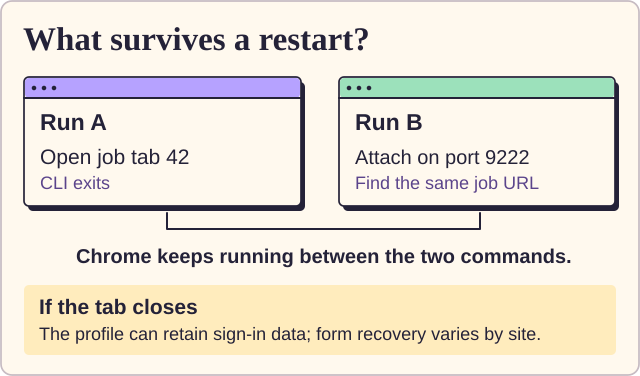

Open Outlook Web in this profile and complete any required Microsoft sign-in before requesting a fresh email code. Closing the job tab, quitting Chrome or a site session expiring can still interrupt an application. A draft in a chat-specific browser must be recovered separately.

## Run a browser click task

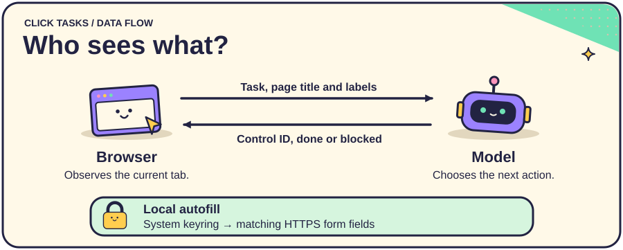

Install the optional dependencies with `python -m pip install -e '.[agent]'` and set `OPENAI_API_KEY`. Give the model an HTTPS starting page and a specific task:

```sh
ruin "Open the help page" --site https://example.org --channel chrome
```

The runner sends the task, page title and visible action labels to the selected model. It clicks the chosen control directly and observes the page again. A task can use one tab and up to 20 steps.

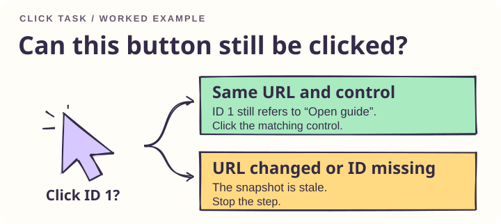

For example, if a visible button is labeled **Open guide**, the model can select its current ID. A changed URL or an ID missing from the snapshot stops that step. A blocked model decision leaves the page open for inspection.

### Local credential filling

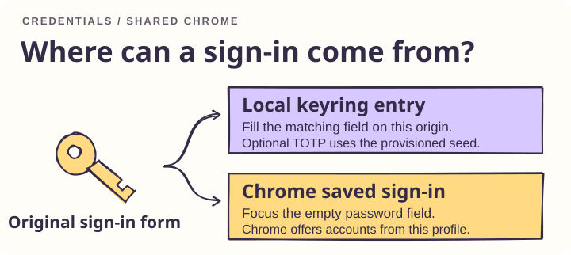

Add `--autofill` to use the system keyring and Chrome’s sign-in form. For a form with one visible password field that submits to the selected HTTPS origin, the runner clicks the empty field so Chrome can offer credentials saved in **that browser profile**. Complete sign-in in the open tab. The runner waits up to three minutes for the credential fields to disappear, then resumes the task. It leaves account selection and form submission to the login UI. A Chrome fixture verifies same-tab continuation with a restrictive script policy.

To provision credentials for local filling, use the entries below. The optional TOTP entry holds the site's Base32 seed.

```sh
keyring set ruin:https://example.org username
keyring set ruin:https://example.org password
keyring set ruin:https://example.org totp
```

## Verify a Greenhouse application with Outlook Web

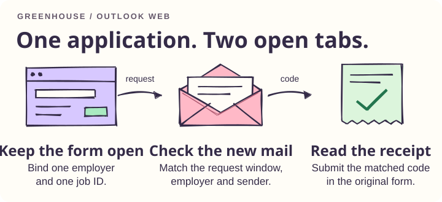

On macOS or Linux, attach to a local debugging-enabled Chrome session that already has Outlook Web signed in and the original Greenhouse job tab open. Replace the example URL and employer with the exact job and the name used in its email. Start the watcher before the application requests a code. The existing application workflow still owns the initial submit.

```sh
ruin verify-email --cdp http://127.0.0.1:9222 \
  --site https://job-boards.greenhouse.io/example/jobs/12345 \
  --company "Example Employer" --timeout 180
```

The watcher takes a snapshot of visible Outlook inbox rows and waits for a new or updated row whose timestamp follows the request window. It checks the employer, subject wording and Greenhouse sender, reads the code from the opened message, and submits it in the original job tab. A local lock serializes watcher processes. Keep other applications for the same employer idle during verification.

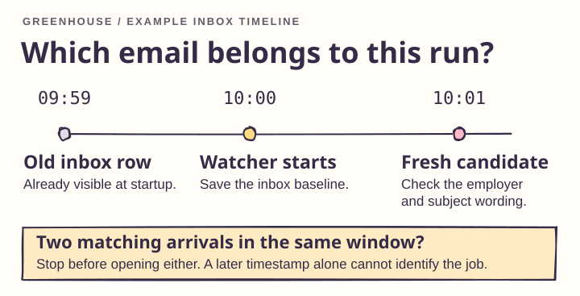

In the inbox diagram, a 09:59 message already exists when the watcher starts at 10:00. The watcher checks the 10:01 candidate against the employer and verification wording in the row, then checks the sender in the opened message. If two new candidates match, it stops before selecting either one. These times illustrate ordering; the watcher uses the recorded timestamps from the live run.

### Recover an open challenge

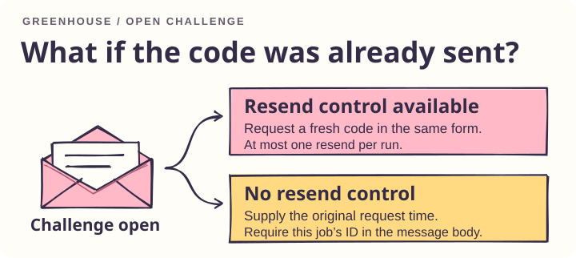

If a challenge is already open at startup and offers a resend control, it requests a fresh code there. It makes at most one resend per run.

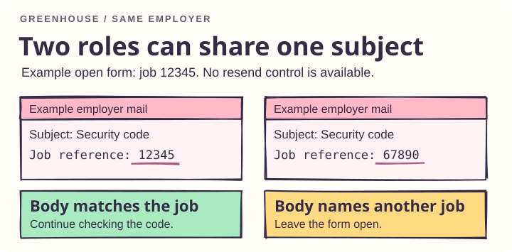

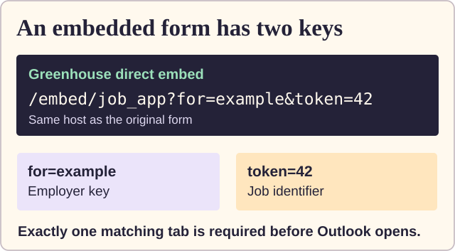

For a direct Greenhouse embed, pass the full quoted URL (including both `for` and `token`). If an existing challenge has no resend control, supply `--requested-at UNIX_SECONDS` from that job’s original request. For this recovery path the message body must also identify the job ID. A subject shared by two roles at the same employer cannot establish which form owns the code. A tab in another chat’s isolated browser must be handled there.

The prototype supports English, top-level Greenhouse forms and Outlook layouts exposing message identifiers, timestamps, sender addresses and a message body. Missing evidence or an ambiguous match stops verification. Only a visible receipt counts as success. A timeout can also happen *after* submission; check the original tab before retrying. Message contents and codes stay outside the model loop. The integration has been tested with browser fixtures; compatibility with a live employer form and Outlook tenant remains unverified.

## Resume an authorized Ashby application

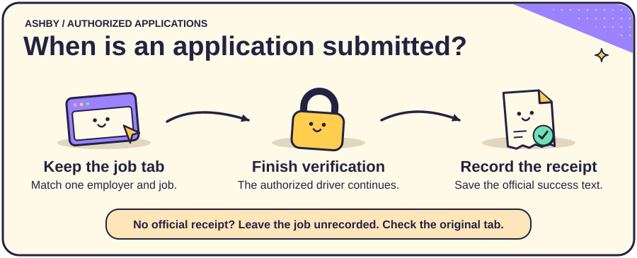

Use this workflow when a reviewed application has already reached verification. The original application driver owns the authorization for that job and completes the live challenge in the same tab. Start the receipt watcher alongside that driver, using the exact application URL:

```sh
ruin resume-ashby --cdp http://127.0.0.1:9222 \
  --site 'https://jobs.ashbyhq.com/EMPLOYER/JOB-UUID/application' --timeout 300
```

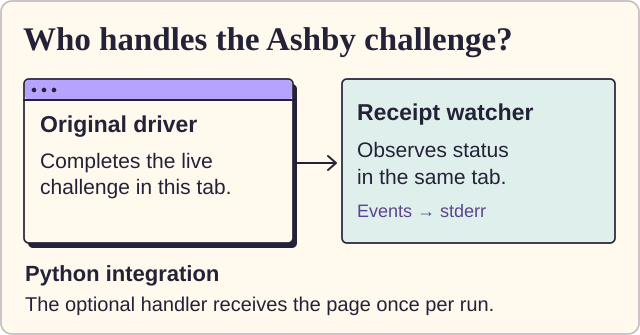

The CLI attaches to one matching tab and emits JSON state changes on standard error. On `challenge_visible`, the authorized driver uses the current widget. A driver using the Python API can supply its own approved handler directly:

```python
receipt = await resume_ashby(context, application_url, timeout=300,
                             directory=receipt_directory, on_event=report_status,
                             on_challenge=complete_authorized_challenge)
```

Import `resume_ashby` from `ruin.agent.ashby`. The handler receives the original Playwright page once per run. The standalone CLI observes the browser; it requires an application driver or person to interact with the widget. A completed challenge may automatically submit the form. Leave any existing submission in flight and watch for its result. An enabled Submit button by itself is insufficient evidence to send another request.

### Receipt storage and retries

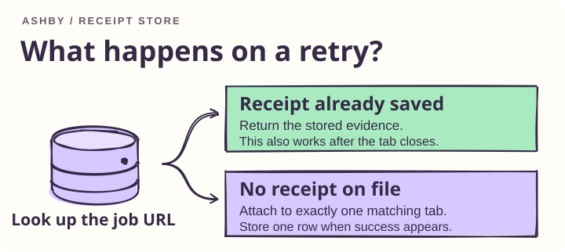

The watcher records success only when the same job displays Ashby's visible **Success** status with **Your application was successfully submitted**. It returns the receipt as JSON on standard output and stores one row per job in `~/.ruin-everything/ashby-receipts.sqlite3`. A retry returns that stored receipt. A timeout, changed job or ambiguous tab produces an error without marking the job submitted. An external application tracker should import only a returned receipt.

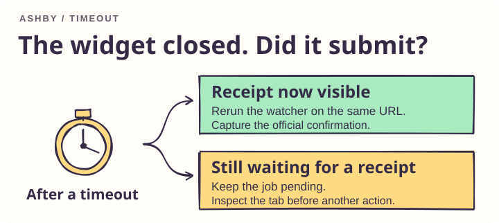

For example, a challenge can disappear while the site is still processing the application. If the watcher times out then, check the original tab before taking another action. If that tab later displays the official receipt, rerun the watcher with the same URL to capture it.

The illustrated receipt is an example. The receipt pattern comes from a completed Baseten application. The reusable command was tested with simulated Ashby pages in Chrome, including a hidden receipt, a changed job, duplicate tabs and a retry after the tab closed.

## Connect an agent over MCP

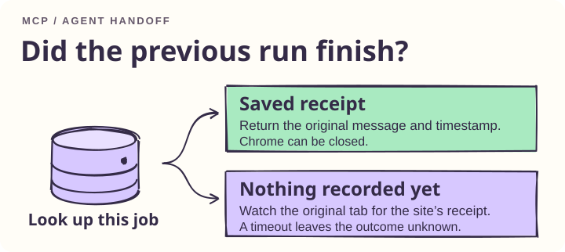

Give the client the exact job URL and describe what you see. If the question is whether an Ashby application went through, the client checks the receipt journal first. If the form is waiting for verification, the client inspects the open tab.

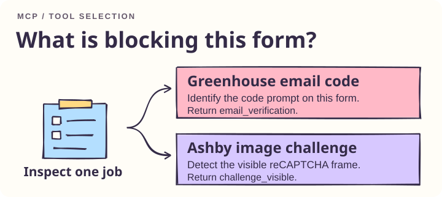

| Tool | When to call it | Result |
| --- | --- | --- |
| `inspect_application_challenge` | Greenhouse asks for an eight-character email code, a connector reports `[one-time authentication code withheld]`, or Ashby shows a reCAPTCHA grid. Also use it to locate a lost supported form. | The provider and visible state. A missing or duplicate tab gets its own result. The form stays open. |
| `get_ashby_receipt` | At handoff, even with Chrome closed | A saved receipt or `unrecorded`. A missing record leaves the outcome unknown. |
| `watch_ashby_receipt` | The original form is open and the outcome is uncertain | An existing receipt, or fresh evidence from the same job. A timeout is a tool error. The watcher leaves the form open. |

Install [uv](https://docs.astral.sh/uv/getting-started/installation/) once. In an MCP client with JSON configuration, this example runs the latest [PyPI release](https://pypi.org/project/ruin-everything/). The client must be able to find `uvx` on its PATH. An absolute path to `uvx` also works.

```json
{
  "mcpServers": {
    "ruin-everything": {
      "command": "uvx",
      "args": [
        "--isolated", "--refresh",
        "--from", "ruin-everything[mcp]",
        "ruin-mcp"
      ],
      "env": { "RUIN_AUTO_UPDATE": "0" }
    }
  }
}
```

To track the GitHub branch directly, set `--from` to `ruin-everything[mcp] @ git+https://github.com/yuki4266/ruin-everything.git@main`. Both configurations launch the actual `ruin-mcp` executable. A two-version smoke test verified refresh on both the Git and package paths. An existing editable installation can still launch it directly.

To register the server for your user account, run the command for your client. Open a new session to pick up the tool list.

```sh
codex mcp add ruin-everything --env RUIN_AUTO_UPDATE=0 -- uvx --isolated --refresh --from 'ruin-everything[mcp]' ruin-mcp
claude mcp add --scope user --transport stdio ruin-everything -e RUIN_AUTO_UPDATE=0 -- uvx --isolated --refresh --from 'ruin-everything[mcp]' ruin-mcp
```

The repository includes [routing instructions](AGENTS.md#ruin-everything-application-routing) for Codex and imports them from [CLAUDE.md](CLAUDE.md). To apply them in other workspaces, copy the application routing section into your user-level `~/.codex/AGENTS.md` or `~/.claude/CLAUDE.md`. Client permissions and site verification still apply to Duo, PayPal and other unsupported providers.

All three tools take `site`. The inspector checks once by default. Set `wait_seconds` to 1–300 to watch that same tab for a change from `pending`. From the CLI, use `ruin watch --site "$JOB_URL" --timeout 30`. The watch ends after detecting a supported state, losing the original tab, or reaching the time limit.

In a local Chrome simulation, a fresh Codex CLI session given only the Greenhouse URL and the eight-character-code symptom selected `inspect_application_challenge` as its first tool call and returned `email_verification`. The simulated form stayed empty.

The Ashby receipt watcher takes `timeout_seconds` (default 15, range 1–300). A returned receipt contains `state`, `site`, `observed_at` and the site's confirmation `message`. The application driver owns form interaction. After a timeout, check the same URL again before considering another submission.

The server uses the official Python MCP SDK over stdio. A browser automation client such as Playwright MCP can run alongside it by attaching to the same local Chrome with `--cdp-endpoint http://127.0.0.1:9222`. The integration test exercises two successive SDK clients and a simulated employer page in Chrome. [Python MCP SDK](https://github.com/modelcontextprotocol/python-sdk) · [Playwright MCP connection options](https://github.com/microsoft/playwright-mcp#configuration)

## How updates reach your machine

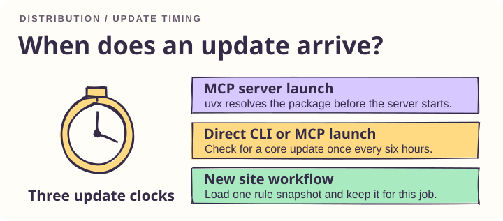

| What changes | When you get it |
| --- | --- |
| MCP package via uvx | On the next server launch, uv resolves the latest version available from the configured source. A long-running server keeps its loaded code until restart. Initial installation and online refresh require network access. |
| Direct installation | CLI and MCP startup schedule a quiet background check at most once every six hours per installation. A clean `main` checkout tracking `origin/main` fast-forwards. A regular pip installation checks PyPI for a newer version. Installed uv tools use their own upgrade command. Set `RUIN_AUTO_UPDATE=0` to manage versions yourself. |
| Site rules | Each new Greenhouse verification or live Ashby observation requests the project's [selector file](ruin/rules/sites.json) with a two-second network timeout. A workflow keeps its initial snapshot through completion. Offline or invalid updates fall back to the last valid cache at `~/.ruin/sites.json`, then to packaged defaults. Set `RUIN_RULE_UPDATES=0` to use the bundled copy. |

The rule file describes Ashby receipt elements, Greenhouse verification inputs and the email-code pattern, and Outlook rows and message bodies. The installed adapters enforce trusted origins, sender identity, job matching and receipt wording. A change to those checks requires a code release.

For maintainers, configure one [PyPI Trusted Publisher](https://docs.pypi.org/trusted-publishers/creating-a-project-through-oidc/) for project `ruin-everything`, owner `yuki4266`, repository `ruin-everything`, workflow `publish.yml` and environment `pypi`. A push to main builds the version in `pyproject.toml` with the workflow run number as a fourth release component. For a tagged release, set the project version and push the matching tag (for example, `0.2.0` and `v0.2.0`). Both routes run the browser tests, build and check the wheel and source distribution, then publish using GitHub's OIDC identity. [Release workflow](.github/workflows/publish.yml) · [uv tool updates](https://docs.astral.sh/uv/concepts/tools/)

## Example: read courses after school sign-in

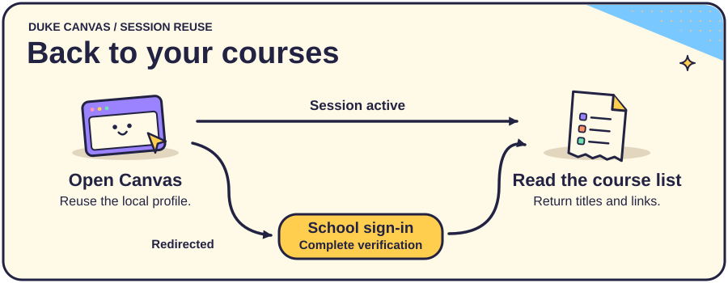

The Duke Canvas adapter demonstrates how a task resumes after an interactive login. Run the lookup in the shared profile:

```sh
ruin courses
```

The result contains course names and links. Use `--json` for structured output:

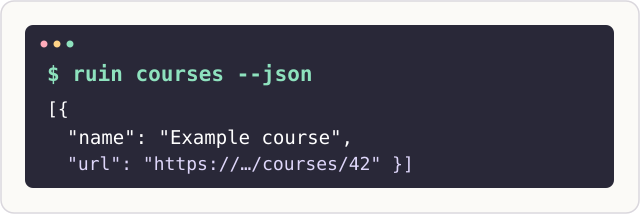

To select an existing local debugging endpoint explicitly, run:

```sh
ruin courses --cdp http://127.0.0.1:9222 --json
```

The sign-in branch waits up to 180 seconds for the school to return the browser to Canvas. Set `--timeout 300` for a longer wait. Duo approval takes place on the school sign-in path. [Duke device recovery](https://oit.duke.edu/help/articles/kb0036398/)

## Verification

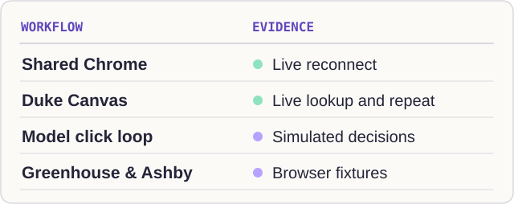

Update tests cover overlapping startup checks, changes between rule snapshots, invalid downloads and offline fallback. Runtime checks verified a shared Chrome tab across independent CDP connections. For browser tests, install the Playwright Chromium build or use installed Chrome. Run `python -m unittest discover -s tests -v`. Install the agent extras to include the mocked model test. For installed Chrome, prefix the command with `RUIN_TEST_CHANNEL=chrome`.

A live Duke run returned course links after sign-in. A second run with the same profile also returned the list after visiting the school login route. The number of Duo prompts was not measured. The general click loop has been exercised with a simulated model response.

The hand-drawn diagrams are editable SVGs. They use Rough.js linework and Kalam lettering. [Figure sources](docs/figures) · [Rough.js](https://roughjs.com/) · [Kalam font license](docs/figures/Kalam-LICENSE.txt)

[Development plan](PLAN.md) · [Contribution and figure guidelines](AGENTS.md) · [MIT license](LICENSE)
