<p align="right"><strong>English</strong> &nbsp;·&nbsp; <a href="README.zh-CN.md">简体中文</a> &nbsp;·&nbsp; <a href="README.ja.md">日本語</a> &nbsp;·&nbsp; <a href="README.es.md">Español</a></p>

# 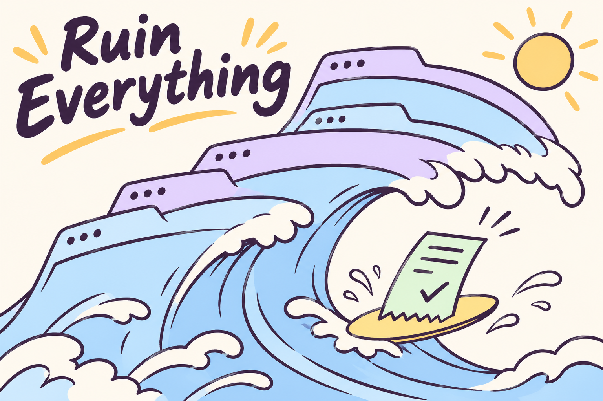

<p align="center">
  <a href="https://github.com/yuki4266/ruin-everything/stargazers"></a>
  <a href="#use-a-shared-local-chrome-window"></a>
  <a href="#connect-an-agent-over-mcp"></a>
  <a href="LICENSE"></a>
</p>

**Your default local Chrome runtime for every website.** Ruin connects browser agents to Chrome at `127.0.0.1:9222` for browsing, navigation, DOM interaction, form filling, extraction and multi-step web tasks. It reuses the existing browser session, cookies and extensions. Application and institutional adapters are optional examples.

[Set up Chrome](#use-a-shared-local-chrome-window) · [Connect an MCP client](#connect-an-agent-over-mcp) · [See what has been tested](#verification) · [Try your first MCP call](#first-mcp-call) · [Contribute](#community)

## Nested hCaptcha challenges

Panel A shows provider-specific detection before generic slider heuristics: visible hCaptcha grids use indexed `.task-image` handles, canvas tasks use image-relative points or two-dimensional drags, and an unchecked checkbox uses its control center. Hidden ancestor frames are excluded. Unsupported or uncertain tasks stay pending with a specific reason; they no longer report a misleading uniqueness failure.

Panel B shows coordinate conversion through every iframe content origin, including borders, padding, scrolling and positive axis-aligned CSS scale. Input uses Playwright's Chromium mouse events in top-level viewport pixels, then the widget's `.button-submit`. Panel C separates challenge continuation from the site's application receipt; the executor does not replay a pending form submission.

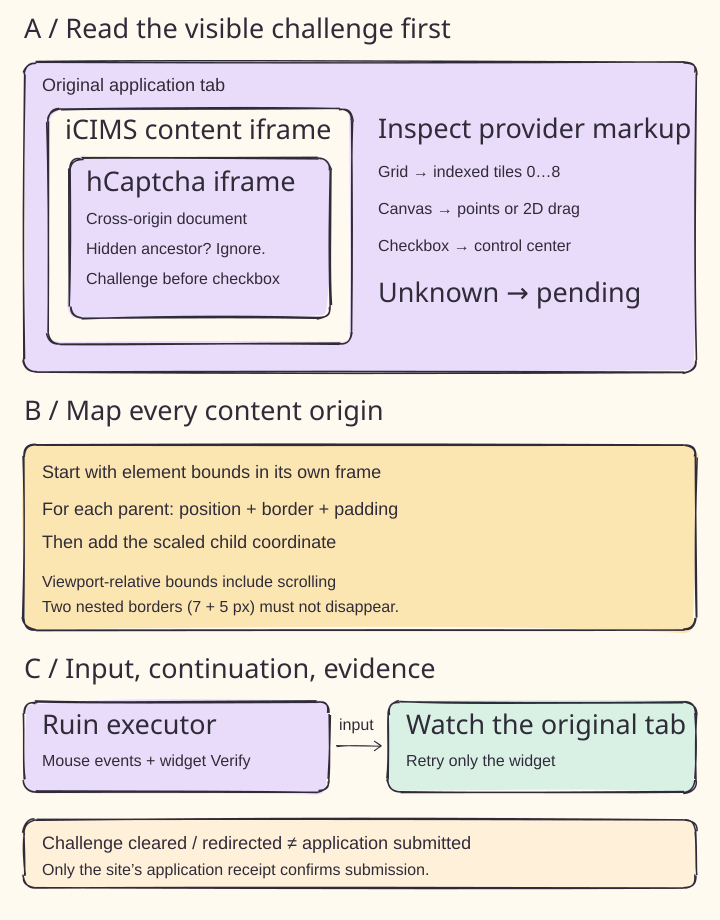

Verification: seven new isolated Chromium tests cover nested cross-origin grids, hidden duplicates and ancestors, checkbox input, two-dimensional drag, scaled canvas clicks, and uncertain/unsupported tasks. Seven existing post-action tests also pass. On the original Planview 5149 tab, a canvas drag had been misclassified as a horizontal slider; the corrected executor completed an agent-reviewed drag and the site redirected to iCIMS login. The local Ollama model remains the default; this live run does not establish unattended model accuracy. Login rejected the available credential, so no resume upload or application receipt is claimed. This checkout is updated; reconnect an installed MCP server to load it. No PyPI release is claimed.


## Universal browser automation

Use `ruin_browser` as the default entry point for any website. Panel A shows the shared local runtime; panel B shows tab selection. `navigate` reuses an exact destination tab, otherwise a single blank tab, otherwise opens a new tab. Give `site` to select a current tab explicitly. If the task names a site without a URL, navigate to a search engine and locate it without waiting for the user to open a page.

```json
{"operation":"navigate","url":"https://example.org"}
```

Panel C shows the continuation loop. Use the returned current URL as `site` for `inspect`, `read`, `click`, `fill`, `press` or `select`. Inspection returns visible text and selectors without reading input values. Mutations require one visible element; `value` supplies text, a key or an option value. Clicks and Enter use the existing Ruin executor. `tabs` lists current URLs. Tabs remain open across calls, including redirects to another domain. Text is capped at 24,000 characters and controls at 300; use `read` with a narrower selector for detail.

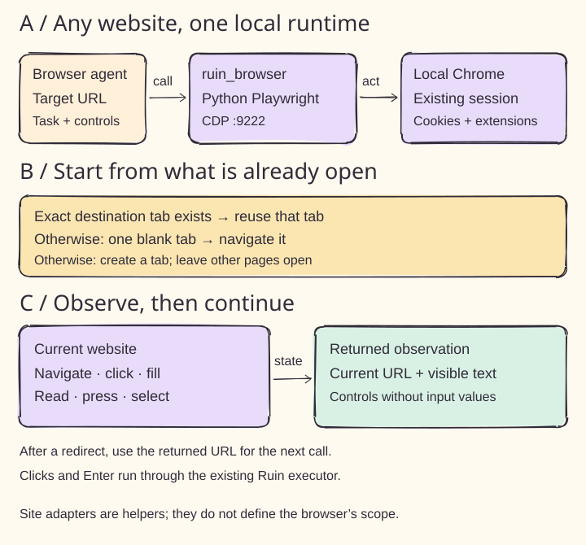

Verification: five isolated browser tests and the stdio MCP integration pass, covering blank-tab reuse, session cookies, ordinary forms, cross-domain continuation, ambiguous tabs and preservation of unrelated pages. Live Chrome also navigated from a blank tab to a search page. This is a repository update; reconnect MCP using this checkout or the Git source to load `ruin_browser`. No new PyPI release is claimed.


| In your browser | What Ruin can do |
| --- | --- |
| A Greenhouse application asks for an email code | [Match a fresh Outlook message to the application and fill the code.](#verify-a-greenhouse-application-with-outlook-web) |
| An Ashby tab closed after submission | [Look up a previously captured receipt by the exact job URL.](#receipt-storage-and-retries) |
| A Workday tenant asks you to sign in | [Use the local profile and follow a supported account activation back to the job.](#workday-accounts-and-signed-in-sessions) |
| You have phone numbers from several countries | [Choose a default in the offline identity editor.](#local-account-registration) |

## Institutional sign-in in the background

Run `ruin watch` to scan open and newly opened shared Chrome tabs every 500 ms. The watcher follows institutional search on IEEE Xplore, the ACM Digital Library and Springer Nature Link. It selects Duke University and follows the publisher’s redirect. At Duke SSO, Chrome can offer a saved login. An existing trusted-auth rule can disable the password dropdown. Duo remains in the normal browser flow.

On macOS, run `ruin watch --install` from a persistent installation to start the user service at login. Use `ruin watch --uninstall` to remove it. The service waits for shared Chrome and reconnects after a disconnect. `ruin watch --site URL` still inspects one application challenge.

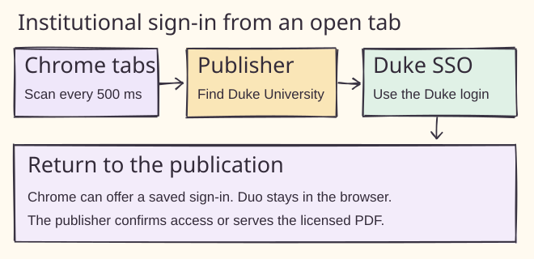

Live verification covered the IEEE institution lookup, the redirect to Duke, and a publisher PDF delivered with an existing Duke session. Isolated browser tests cover ACM and Springer discovery, newly opened tabs and duplicate suppression.

## Choose a starting point


For a new task, use `ruin_browser` to navigate directly to the target site in shared Chrome. For an interrupted application, choose the site-specific watcher and pass the original job URL. Generic click tasks open a new tab.


## Use a shared local Chrome window


Install from the repository directory with Python 3.11+ and Google Chrome:

```sh
python3 -m venv .venv
source .venv/bin/activate
python -m pip install -e .
ruin browser
```

Run `ruin browser` to start or reconnect to the project browser. Every CLI task uses Python Playwright over CDP. The default endpoint is `http://127.0.0.1:9222`. The runner launches Chrome with a dedicated profile at `~/.ruin-everything/canvas-browser` when this port is free. The CDP connection preserves the existing browser context settings, including its download behavior. Chrome stays open after the command exits. Other local clients can attach to the same endpoint and locate the job tab by its full URL. Give one client ownership of submission for each application.


Open Outlook Web in this profile and complete any required Microsoft sign-in before requesting a fresh email code. Closing the job tab, quitting Chrome or a site session expiring can still interrupt an application. A draft in a chat-specific browser must be recovered separately.

## Run a browser click task


Install the optional dependencies with `python -m pip install -e '.[agent]'` and set `OPENAI_API_KEY`. Give the model an HTTPS starting page and a specific task:

```sh
ruin "Open the help page" --site https://example.org --channel chrome
```

The runner sends the task, page title and visible action labels to the selected model. It clicks the chosen control directly and observes the page again. A task can use one tab and up to 20 steps.


For example, if a visible button is labeled **Open guide**, the model can select its current ID. A changed URL or an ID missing from the snapshot stops that step. A blocked model decision leaves the page open for inspection.

### Local credential filling


Add `--autofill` to use the system keyring and Chrome’s sign-in form. For a form with one visible password field that submits to the selected HTTPS origin, the runner clicks the empty field so Chrome can offer credentials saved in **that browser profile**. Complete sign-in in the open tab. The runner waits up to three minutes for the credential fields to disappear, then resumes the task. Without trusted login options, it leaves account selection and form submission to the login UI. A Chrome fixture verifies same-tab continuation with a restrictive script policy.

#### Local account registration

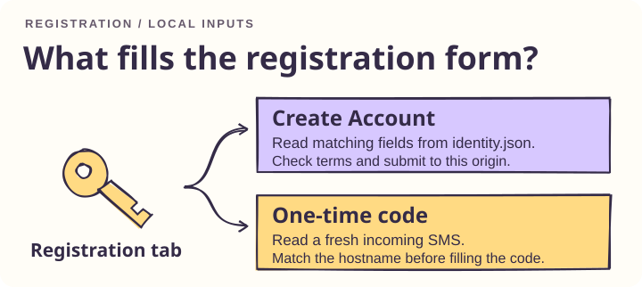

Run `ruin identity` to choose phone regions by name, save multiple numbers, select a default and reveal the password while editing. The offline editor uses the browser’s native select control and the phonenumbers library for dialing codes and international formatting. [python-phonenumbers](https://github.com/daviddrysdale/python-phonenumbers)

For manual setup of a browser task with `--site`, create `~/.ruin/identity.json` with owner-only permissions (`chmod 600`). Set `auto_signup` to `true` and supply string values for `first_name`, `last_name`, `email`, `phone` and `default_password`. This file stores the password in plain text. The local runner checks the selected HTTPS origin before each model decision until it submits a registration. It recognizes one visible **Create Account**, **Create an Account**, **Register** or **Sign Up** submit button on a same-origin POST form, fills recognized fields, and checks labeled Terms of Service, Terms of Use and Privacy Policy boxes. On an ordinary same-origin form it can also fill one empty, editable contact phone field. A visible matching signup field with a missing profile value leaves the tab open for completion.

For a subsequent single one-time-code field, the runner checks macOS Messages for up to 30 seconds for an incoming text received since the submission and ending in `@hostname #code`. Read access to the Messages database is required. MCP challenge and receipt results include a `signup_policy` field reporting the local setting. Chrome and SQLite fixtures exercise form submission, ordinary phone inputs, cross-origin actions, message age, direction and domain matching.

#### Feishu Jobs rotation puzzle

With the rotation puzzle open, pass the exact Feishu Jobs login URL to `ruin_auto_register` and enable `auto_signup` in the local profile. As shown below, the tool matches the edges of the two rings and drags the slider once. On the live Learnings recruiting site, the widget accepted the drag and the resend button showed a 30-second countdown. The tool returns `sms_requested` when that countdown is visible. An unresolved puzzle returns `slider_pending`.

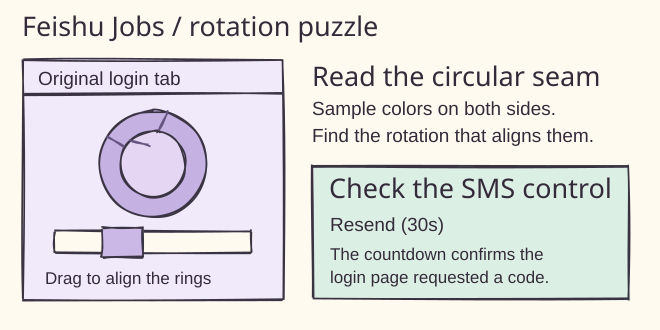

#### ZhongAn SMS login on Moka

When the ZhongAn campus job page shows the NetEase Yidun jigsaw, pass its full URL, including the `#/job/…` fragment, to `ruin_auto_register` with local `auto_signup` enabled. As shown below, the tool matches the piece outline to the gap and drags it in the original tab. On the live site, the SMS button changed to a resend countdown. The tool returns `sms_requested` for that countdown and `slider_pending` for an unconfirmed puzzle.

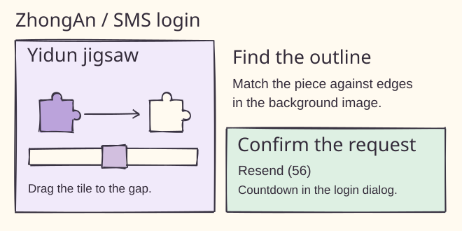

### After a form action

Use `ruin_action(site, button)` for an authorized submission, or `ruin action --site URL --button LABEL` from the CLI. Give the exact open URL and visible button name. Ruin clicks once, starts scanning the original tab and visible frames at 1.5 seconds and watches for a late popup through six seconds. Calling the same tool with only the URL resumes an open challenge. A retry operates on the widget. Confirm submission from the site’s receipt.

The figure shows how a jigsaw moves from image to page coordinates. Ruin combines ddddocr and OpenCV, accounts for the initial piece position and checks the rendered position before releasing. Browser fixtures exercise a delayed cross-origin popup, an offset piece rendered at a different scale, canvas layers, a decorative profile banner and grid controls. Image grids and single-layer visual puzzles use a local Ollama vision model (default `ollama pull qwen3-vl:2b-instruct`). After three unresolved rounds the tool reports `challenge_pending` with the tab open. The live ZhongAn flow returned its official success page, and the application history confirmed initial screening.


#### Workday accounts and signed-in sessions

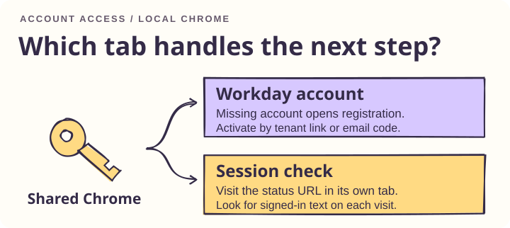

On supported English Workday tenant forms, the CLI browser task tries the local email and password first. An explicit missing-account message opens registration. A generic sign-in failure leaves the original job open. After registration, Ruin checks the signed-in Outlook mailbox for a fresh activation message, follows a direct activation link on the exact tenant host, waits for visible confirmation and returns to the job URL. The adapter supports native POST forms and script-driven Workday dialogs with a recognized submit control. Local Chrome fixtures cover existing accounts, registration, activation and returning to the job. Production tenant layouts and wrapped email links can differ.

The adapter selects Sign In inside the open Workday dialog, even when the page header also offers Sign In. For a six-digit email challenge, it checks for one fresh Outlook message with a link to the same tenant and one labeled code, enters the code in the original tab, then waits for visible activation confirmation. The Jain Global dialog controls were inspected in shared Chrome. The six-digit activation path was verified with a simulated mailbox.

For a code sent to an existing tab, use the request time recorded when the site sent the SMS. Optionally add `sms_senders` to the local identity file, mapping an exact hostname to its dedicated sender string. Plain six-digit codes must come from that sender. Domain-bound messages work without a sender entry. Both paths require read access to the Mac Messages database.

```sh
ruin verify-sms --site "$VERIFICATION_URL" --requested-at "$REQUEST_UNIX_SECONDS"
ruin keep-alive --site "$STATUS_URL" --signed-in-text "Account overview" --interval 900 --timeout 86400
```

Keep-alive opens a separate tab for the selected HTTPS status page. Use a read-only page with text unique to the signed-in view. The process checks that text after each visit, stops on redirects or missing text, and closes its own tab when finished. Run the command for the desired duration. Sites control their own session lifetimes. Simulated Chrome checks cover repeated GET requests and preservation of the original tab.


To provision credentials for local filling, use the entries below. The optional TOTP entry holds the site's Base32 seed.

```sh
keyring set ruin:https://example.org username
keyring set ruin:https://example.org password
keyring set ruin:https://example.org totp
```

## Verify a Greenhouse application with Outlook Web


On macOS or Linux, attach to a local debugging-enabled Chrome session that already has Outlook Web signed in and the original Greenhouse job tab open. Replace the example URL and employer with the exact job and the name used in its email. Start the watcher before the application requests a code. The existing application workflow still owns the initial submit.

```sh
ruin verify-email --cdp http://127.0.0.1:9222 \
  --site https://job-boards.greenhouse.io/example/jobs/12345 \
  --company "Example Employer" --timeout 180
```

The watcher takes a snapshot of visible Outlook inbox rows and waits for a new or updated row whose timestamp follows the request window. It checks the employer, subject wording and Greenhouse sender, reads the code from the opened message, and submits it in the original job tab. A local lock serializes watcher processes. Keep other applications for the same employer idle during verification.


In the inbox diagram, a 09:59 message already exists when the watcher starts at 10:00. The watcher checks the 10:01 candidate against the employer and verification wording in the row, then checks the sender in the opened message. If two new candidates match, it stops before selecting either one. These times illustrate ordering; the watcher uses the recorded timestamps from the live run.

### Recover an open challenge


If a challenge is already open at startup and offers a resend control, it requests a fresh code there. It makes at most one resend per run.


For a direct Greenhouse embed, pass the full quoted URL (including both `for` and `token`). If an existing challenge has no resend control, supply `--requested-at UNIX_SECONDS` from that job’s original request. For this recovery path the message body must also identify the job ID. A subject shared by two roles at the same employer cannot establish which form owns the code. A tab in another chat’s isolated browser must be handled there.

The prototype supports English, top-level Greenhouse forms and Outlook layouts exposing message identifiers, timestamps, sender addresses and a message body. Missing evidence or an ambiguous match stops verification. Only a visible receipt counts as success. A timeout can also happen *after* submission; check the original tab before retrying. Message contents and codes stay outside the model loop. The integration has been tested with browser fixtures; compatibility with a live employer form and Outlook tenant remains unverified.

## Resume an authorized Ashby application


Use this workflow when a reviewed application has already reached verification. The original application driver owns the authorization for that job and completes the live challenge in the same tab. Start the receipt watcher alongside that driver, using the exact application URL:

```sh
ruin resume-ashby --cdp http://127.0.0.1:9222 \
  --site 'https://jobs.ashbyhq.com/EMPLOYER/JOB-UUID/application' --timeout 300
```


The CLI attaches to one matching tab and emits JSON state changes on standard error. On `challenge_visible`, the authorized driver uses the current widget. A driver using the Python API can supply its own approved handler directly:

```python
receipt = await resume_ashby(context, application_url, timeout=300,
                             directory=receipt_directory, on_event=report_status,
                             on_challenge=complete_authorized_challenge)
```

Import `resume_ashby` from `ruin.agent.ashby`. The handler receives the original Playwright page once per run. The standalone CLI observes the browser; it requires an application driver or person to interact with the widget. A completed challenge may automatically submit the form. Leave any existing submission in flight and watch for its result. An enabled Submit button by itself is insufficient evidence to send another request.

### Receipt storage and retries


The watcher records success only when the same job displays Ashby's visible **Success** status with **Your application was successfully submitted**. It returns the receipt as JSON on standard output and stores one row per job in `~/.ruin-everything/ashby-receipts.sqlite3`. A retry returns that stored receipt. A timeout, changed job or ambiguous tab produces an error without marking the job submitted. An external application tracker should import only a returned receipt.


For example, a challenge can disappear while the site is still processing the application. If the watcher times out then, check the original tab before taking another action. If that tab later displays the official receipt, rerun the watcher with the same URL to capture it.

The illustrated receipt is an example. The receipt pattern comes from a completed Baseten application. The reusable command was tested with simulated Ashby pages in Chrome, including a hidden receipt, a changed job, duplicate tabs and a retry after the tab closed.

## Connect an agent over MCP


Tagged releases include the MCP server by default. A registry client can launch the package directly with `uvx ruin-everything@0.2.0`. [GitHub releases](https://github.com/yuki4266/ruin-everything/releases)

For general tasks, start with `ruin_browser`. For a specialized application check, give the client the exact job URL and describe what you see. If the question is whether an Ashby application went through, the client checks the receipt journal first. If the form is waiting for verification, the client inspects the open tab.


| Tool | When to call it | Result |
| --- | --- | --- |
| `ruin_browser` | Default for browsing, navigation, interaction and extraction on any website. | Current URL, visible page state or action result in shared Chrome. |
| `ruin_action` | The exact original tab and visible button name for an authorized form action. | One click with automatic visual verification, or resume with the URL alone. |
| `ruin_auto_register` | The selected registration or contact form is open at its exact HTTPS URL. | Local profile action and current signup policy. A submitted form can still require verification. |
| `inspect_application_challenge` | Greenhouse asks for an eight-character email code, a connector reports `[one-time authentication code withheld]`, or Ashby shows a reCAPTCHA grid. Also use it to locate a lost supported form. | The provider and visible state. A missing or duplicate tab gets its own result. The form stays open. |
| `get_ashby_receipt` | At handoff, even with Chrome closed | A saved receipt or `unrecorded`. A missing record leaves the outcome unknown. |
| `watch_ashby_receipt` | The original form is open and the outcome is uncertain | An existing receipt, or fresh evidence from the same job. A timeout is a tool error. The watcher leaves the form open. |

Install [uv](https://docs.astral.sh/uv/getting-started/installation/) once. In an MCP client with JSON configuration, this example runs the latest [PyPI release](https://pypi.org/project/ruin-everything/). The client must be able to find `uvx` on its PATH. An absolute path to `uvx` also works.

```json
{
  "mcpServers": {
    "ruin-everything": {
      "command": "uvx",
      "args": [
        "--isolated", "--refresh",
        "--from", "ruin-everything[mcp]",
        "ruin-mcp"
      ],
      "env": { "RUIN_AUTO_UPDATE": "0" }
    }
  }
}
```

To track the GitHub branch directly, set `--from` to `ruin-everything[mcp] @ git+https://github.com/yuki4266/ruin-everything.git@main`. Both configurations launch the actual `ruin-mcp` executable. A two-version smoke test verified refresh on both the Git and package paths. An existing editable installation can still launch it directly.

To register the server for your user account, run the command for your client. Open a new session to pick up the tool list.

```sh
codex mcp add ruin-everything --env RUIN_AUTO_UPDATE=0 -- uvx --isolated --refresh --from 'ruin-everything[mcp]' ruin-mcp
claude mcp add --scope user --transport stdio ruin-everything -e RUIN_AUTO_UPDATE=0 -- uvx --isolated --refresh --from 'ruin-everything[mcp]' ruin-mcp
```

<a id="first-mcp-call"></a>

### Try your first MCP call

After connecting your client, try this prompt with the fictional URL below. It works with Chrome closed and requires no job application or identity profile.

> Call `get_ashby_receipt` for `https://jobs.ashbyhq.com/example/aaaaaaaa-bbbb-cccc-dddd-eeeeeeeeeeee/application` and tell me its state.

On a fresh install, the expected state is `unrecorded`: the tool checked the local journal and found no receipt for this example. This read-only call was verified against the PyPI server.

The repository includes [routing instructions](AGENTS.md#ruin-everything-application-routing) for Codex and imports them from [CLAUDE.md](CLAUDE.md). To apply them in other workspaces, copy the Browser Automation section and any relevant application routing rules into your user-level `~/.codex/AGENTS.md` or `~/.claude/CLAUDE.md`. PayPal sign-in can be attempted through the generic local Chrome login flow ([trusted login figure, panel C](docs/figures/trusted-auth.svg)). No dedicated PayPal Security Challenge adapter is implemented; normal site verification may still appear on local Chrome. This is a documentation clarification based on code inspection, not a verified live PayPal sign-in. Duo codes and phone pushes still use normal site verification; the [saved-login helper](#persistent-sessions-and-saved-duke-login) handles filled Duke forms and Duo device trust.

The five specialized tools take `site`; `ruin_browser` also supports tab listing and navigation without an existing target tab. The inspector checks once by default. Set `wait_seconds` to 1–300 to watch that same tab for a change from `pending`. From the CLI, use `ruin watch --site "$JOB_URL" --timeout 30`. The watch ends after detecting a supported state, losing the original tab, or reaching the time limit.

In a local Chrome simulation, a fresh Codex CLI session given only the Greenhouse URL and the eight-character-code symptom selected `inspect_application_challenge` as its first tool call and returned `email_verification`. The simulated form stayed empty.

The Ashby receipt watcher takes `timeout_seconds` (default 15, range 1–300). A returned receipt contains `state`, `site`, `observed_at` and the site's confirmation `message`. The application driver owns form interaction. After a timeout, check the same URL again before considering another submission.

The server uses the official Python MCP SDK over stdio. A browser automation client such as Playwright MCP can run alongside it by attaching to the same local Chrome with `--cdp-endpoint http://127.0.0.1:9222`. The integration test waits for Chrome to advertise its local debugging port, then connects two successive SDK clients to the simulated employer page. [Python MCP SDK](https://github.com/modelcontextprotocol/python-sdk) · [Playwright MCP connection options](https://github.com/microsoft/playwright-mcp#configuration)

## How updates reach your machine


| What changes | When you get it |
| --- | --- |
| MCP package via uvx | On the next server launch, uv resolves the latest version available from the configured source. A long-running server keeps its loaded code until restart. Initial installation and online refresh require network access. |
| Direct installation | CLI and MCP startup schedule a quiet background check at most once every six hours per installation. A clean `main` checkout tracking `origin/main` fast-forwards. A regular pip installation checks PyPI for a newer version. Installed uv tools use their own upgrade command. Set `RUIN_AUTO_UPDATE=0` to manage versions yourself. |
| Site rules | Each new Greenhouse verification or live Ashby observation requests the project's [selector file](ruin/rules/sites.json) with a two-second network timeout. A workflow keeps its initial snapshot through completion. Offline or invalid updates fall back to the last valid cache at `~/.ruin/sites.json`, then to packaged defaults. Set `RUIN_RULE_UPDATES=0` to use the bundled copy. |

The rule file describes Ashby receipt elements, Greenhouse verification inputs and the email-code pattern, and Outlook rows and message bodies. The installed adapters enforce trusted origins, sender identity, job matching and receipt wording. A change to those checks requires a code release.

For maintainers, configure one [PyPI Trusted Publisher](https://docs.pypi.org/trusted-publishers/creating-a-project-through-oidc/) for project `ruin-everything`, owner `yuki4266`, repository `ruin-everything`, workflow `publish.yml` and environment `pypi`. A push to main builds the version in `pyproject.toml` with the workflow run number as a fourth release component. For a tagged release, set the project version and push the matching tag (for example, `0.2.0` and `v0.2.0`). Both routes run the browser tests, build and check the wheel and source distribution, then publish using GitHub's OIDC identity. [Release workflow](.github/workflows/publish.yml) · [uv tool updates](https://docs.astral.sh/uv/concepts/tools/)

## Example: read courses after school sign-in


The Duke Canvas adapter demonstrates how a task resumes after an interactive login. Run the lookup in the shared profile:

```sh
ruin courses
```

The result contains course names and links. Use `--json` for structured output:


To select an existing local debugging endpoint explicitly, run:

```sh
ruin courses --cdp http://127.0.0.1:9222 --json
```

The sign-in branch waits up to 180 seconds for the school to return the browser to Canvas. Set `--timeout 300` for a longer wait. Duo approval takes place on the school sign-in path. [Duke device recovery](https://oit.duke.edu/help/articles/kb0036398/)

## Verification


Update tests cover overlapping startup checks, changes between rule snapshots, invalid downloads and offline fallback. Runtime checks verified a shared Chrome tab across independent CDP connections. For browser tests, install the Playwright Chromium build or use installed Chrome. Run `python -m unittest discover -s tests -v`. Install the agent extras to include the mocked model test. For installed Chrome, prefix the command with `RUIN_TEST_CHANNEL=chrome`.

A live Duke run returned course links after sign-in. A second run with the same profile also returned the list after visiting the school login route. The number of Duo prompts was not measured. The general click loop has been exercised with a simulated model response.

The hand-drawn diagrams are editable SVGs. They use Rough.js linework and Kalam lettering. [Figure sources](docs/figures) · [Rough.js](https://roughjs.com/) · [Kalam font license](docs/figures/Kalam-LICENSE.txt)

[Development plan](PLAN.md) · [Contribution and figure guidelines](AGENTS.md) · [MIT license](LICENSE)

<a id="community"></a>

## Contribute to Ruin Everything


Trying Ruin in a new MCP client? [Share your setup and one tool result](https://github.com/yuki4266/ruin-everything/discussions/categories/show-and-tell) so someone else can repeat it. If setup stopped partway, [ask in Q&A](https://github.com/yuki4266/ruin-everything/discussions/categories/q-a).

[Report a bug](https://github.com/yuki4266/ruin-everything/issues/new?template=bug.yml) · [Suggest an idea](https://github.com/yuki4266/ruin-everything/discussions/categories/ideas) · [Contribute a translation, test or fix](CONTRIBUTING.md)

### Contributors

Thank you to everyone who tests a workflow, answers a question or sends a patch. GitHub commit contributors appear below.

<a href="https://github.com/yuki4266/ruin-everything/graphs/contributors"></a>

## Star History

<a href="https://www.star-history.com/?repos=yuki4266%2Fruin-everything&amp;type=date">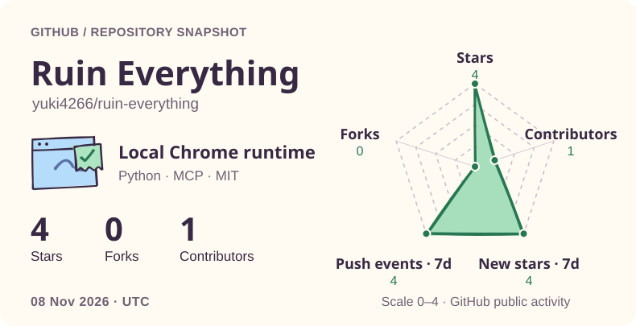</a>

Select the snapshot to explore the latest star history.

⭐ [If Ruin helped you recover a browser task, give it a star on GitHub.](https://github.com/yuki4266/ruin-everything)

<!-- mcp-name: io.github.yuki4266/ruin-everything -->

### Trusted login configuration

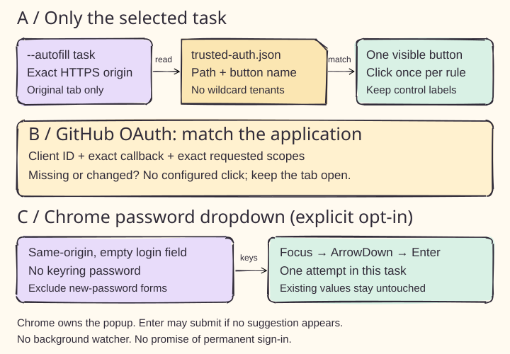

Panel A shows the new `trusted_oauth_clients` configuration in `~/.ruin-everything/trusted-auth.json`. With `--autofill`, the selected task can click configured login, SSO, Stay signed in or Trust this browser buttons once. Match HTTPS origins, paths and button rules. Panel D adds explicit `https://*.greenhouse.io`, `https://*.myworkdayjobs.com` and `https://*.duke.edu` patterns for multi-level subdomains; exact entries override wildcard entries. Credentials and actions stay on the selected tenant origin. The [example configuration](docs/trusted-auth.example.json) includes Glama, Greenhouse, Workday and Duke SSO, with no unverified button rules enabled.

Panel B requires a GitHub OAuth client ID, exact callback and exact scopes before a configured authorization click. Task wording cannot expand permissions. Panel C adds an explicit Chrome password-dropdown option when keyring has no password: focus, ArrowDown, Enter. Chrome may submit the form when no suggestion is present. This is a best-effort keyboard attempt, not a guarantee of filling or permanent login.

Chrome fixtures verify matching, refusal on changed permissions, single attempts and password-field exclusions; native password-manager suggestions and production consent pages remain unverified. See the [configuration reference](docs/trusted-auth.md). Existing browser permission requirements still apply.

GitHub authorization can now use the standard button selector without a configured label; client ID, callback and scopes remain mandatory. Chrome fixtures verify suffix boundaries, ports, cross-tenant refusal and the default selector. Live Glama submission is not yet verified.

The example now includes password-only opt-in for `https://paypal.com` and `https://*.paypal.com` (panel C). Their empty action lists do not pre-approve login, payment or external authorization buttons. Boundary tests cover root and nested subdomains, deceptive suffixes, HTTP and other ports; live PayPal login is not verified.

## Persistent sessions and saved Duke login

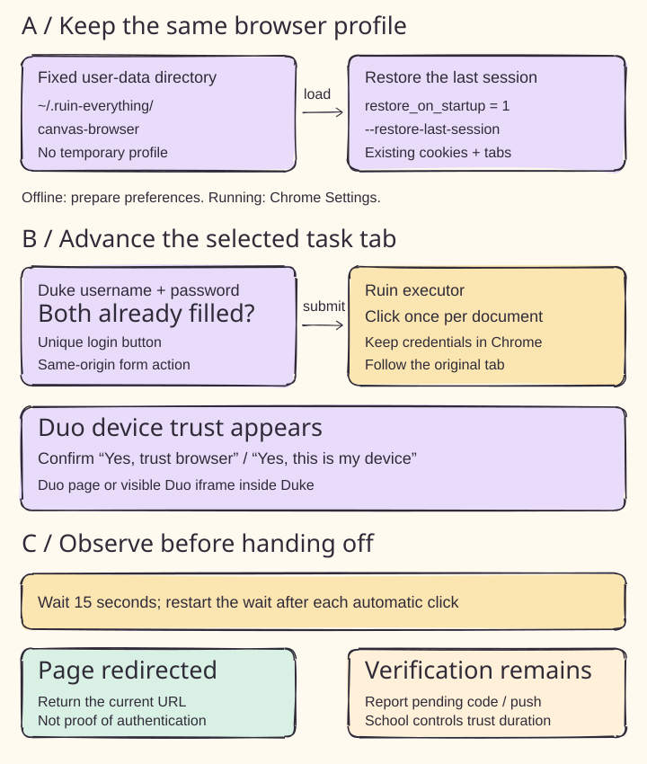

Panel A: Chrome uses the fixed `~/.ruin-everything/canvas-browser` user-data directory. Before an offline launch, Ruin preserves existing preferences, sets `session.restore_on_startup = 1`, and starts with `--restore-last-session`. Existing Chrome is reused without rewriting its live preference files. To change a running profile, select **Continue where you left off** in `chrome://settings/onStartup`; current Chrome may store this setting in Secure Preferences.

Panel B: on the selected task tab, `ruin_browser` (including inspect/read), `ruin_action`, and the CLI task advance already-filled Duke username/password forms through the executor. A unique `#Submit` or recognized login button must submit to Duke's own origin. Duo device-trust buttons are supported on HTTPS `*.duosecurity.com`, including a visible iframe inside Duke. The academic watcher follows these trust controls only in a started institutional flow. Credentials stay in the browser; one document is not submitted twice.

Panel C: wait 15 seconds for autofill or verification, and another 15 seconds after each automatic login/trust action. A remaining code, phone push or empty credential form is then reported in the original tab. Redirects are reported as redirects, not proof of authentication. School policy controls session expiry and remembered-device duration; no permanent login or fixed 30-day trust is promised.

Verification: isolated browser tests cover session-cookie restoration across an actual browser restart, saved login, delayed autofill, device trust, iframes, origin checks, repeat suppression and the full 15-second push wait. The local Chrome startup preference was set and reloaded successfully. No live Duke/Duo challenge was open for end-to-end validation. Reconnect MCP to load the updated tool descriptions. Validation also passed on installed Google Chrome. The full regression run passed 67 tests; two follow-up action/re-render checks passed after the final integration change.
