<p align="right"><a href="README.md">English</a> · <strong>简体中文</strong> · <a href="README.ja.md">日本語</a> · <a href="README.es.md">Español</a></p>

# Ruin Everything

### 把浏览器交给 Agent，把时间拿回来。

**让 Agent 干活，不用一路陪它点。**

Ruin Everything 是 **浏览器 Agent 的本地 Chrome 运行时**。用人话说：让 Agent 接着用你在共享 Chrome 配置里登录过的账号，在后台打开网页、填表、读内容，遇到支持的登录和验证步骤就接着处理，最后告诉你事情到底办到了哪一步。

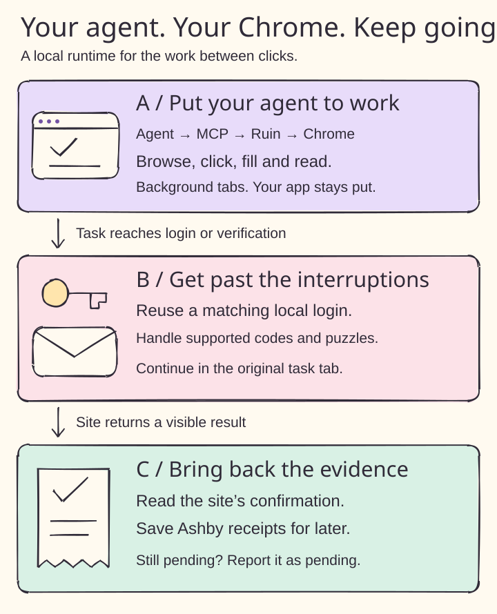

<p align="center">
  <a href="https://github.com/yuki4266/ruin-everything/stargazers">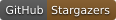</a>
  <a href="#quickstart"></a>
  <a href="#connect-an-agent-over-mcp"></a>
  <a href="LICENSE"></a>
</p>

[马上上手](#quickstart) · [核心功能](#core-features) · [实际场景](#real-workflows) · [验证情况](#verification) · [技术参考（英文）](docs/runtime-reference.md)

## 少当监工，多办成事。

网页刚打开，又要登录。表填完了，又要邮箱验证码。点了提交，又弹出验证。好不容易跑完，对话一结束，连“到底投上没有”都说不清。

**Ruin 就是来接住这些打断任务的环节。** 上图 A 是持续复用的浏览器，B 是登录和验证，C 是能查证的结果。

<a id="core-features"></a>

| 核心功能 | 对你有什么用 |
| --- | --- |
| **浏览器接着用，任务接着跑** | 跨网站打开页面、点击、输入、选择和提取文字。换一轮 Agent 会话，也能继续使用同一份 Chrome 配置、Cookie 和扩展。 |
| **它在后台忙，你在前台忙你的** | 任务标签页在后台打开并保持可交互，不把你正在用的应用切走，也保留无关标签页。 |
| **登过的账号，能复用就复用** | 本地凭据库记住手动密码登录，在匹配的登录页面复用。Cookie 和网页存储备份帮助恢复重启后的状态；登录有效期仍由网站决定。 |
| **验证码来了，支持的就接着处理** | 在原任务页处理已支持流程里的新邮件验证码、短信验证码和图片验证。没过就明确返回待处理。 |
| **少填几遍资料，少折腾几次账号** | 本地身份资料用于支持的注册和联系表单。可选的 Workday/iCIMS 账号恢复处理已识别的账号错误和密码重置请求。 |
| **投没投上，留个凭据** | Ashby 监听器按职位网址保存网站的提交确认。关掉 Chrome 之后，也能回来查已保存的回执。 |

通用网页操作统一走 `ruin_browser`；下面列的网站有额外适配。Agent 负责安排任务，Ruin 负责执行浏览器动作。

### 上传本地文件

调用 `ruin_browser(operation="upload")` 或别名 `set_files` 时，以 `site` 指定当前标签页的完整网址，并通过 `file_path` 传入绝对路径。图 A 中，页面及其所有嵌套框架只有一个文件输入框时，可省略 `selector`。有多个时须指定目标。图 B 展示显式指定拖放区的操作。浏览器测试覆盖了这两条路径，包括嵌套框架中的隐藏输入框。

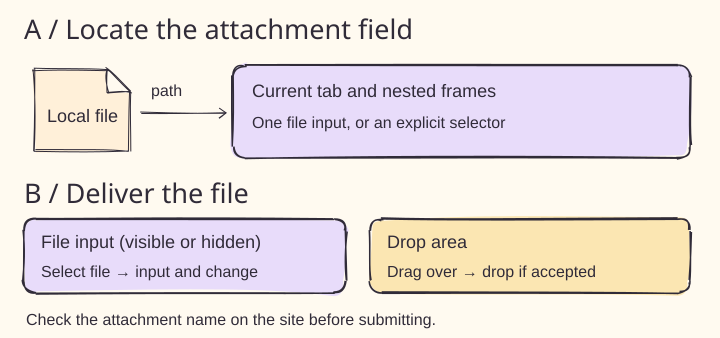

<a id="quickstart"></a>
<a id="use-a-shared-local-chrome-window"></a>

## 三步，开始干活

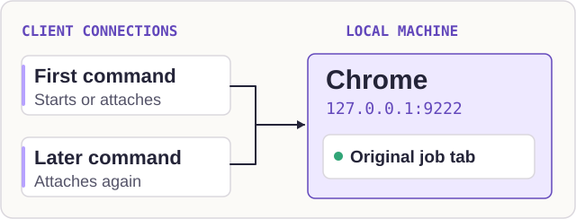

### 1. 启动共享浏览器

准备好 **Python 3.11+、Google Chrome 和 [uv](https://docs.astral.sh/uv/getting-started/installation/)**。下面直接使用当前 GitHub 代码，包含本文介绍的新功能。

```sh
uvx --from 'ruin-everything @ git+https://github.com/yuki4266/ruin-everything.git@main' ruin browser
```

Ruin 会启动或连接 `127.0.0.1:9222` 上的 Chrome，固定使用 `~/.ruin-everything/canvas-browser` 保存浏览器状态。请在**这份浏览器配置里**登录需要的网站；它不会自动导入其他 Chrome 配置的账号。命令退出后，浏览器和任务标签页仍然保留。

<a id="connect-an-agent-over-mcp"></a>

### 2. 接上你的 Agent

把下面配置加入 MCP 客户端，然后重新连接。客户端需要能运行 `uvx`。

```json
{
  "mcpServers": {
    "ruin-everything": {
      "command": "uvx",
      "args": [
        "--isolated", "--refresh", "--from",
        "ruin-everything @ git+https://github.com/yuki4266/ruin-everything.git@main",
        "ruin-mcp"
      ],
      "env": { "RUIN_AUTO_UPDATE": "0" }
    }
  }
}
```

想用已发布的包，把 Git 来源替换为 `ruin-everything`。Git 更新在下一次启动服务时加载；PyPI 包是否包含某项功能，取决于发布版本。[安装和更新细节](docs/runtime-reference.md#how-updates-reach-your-machine)。

<a id="first-mcp-call"></a>

### 3. 给它一句任务

> Use Ruin to open https://example.org and tell me the page title and visible links.

入口是 `ruin_browser(operation="navigate", url="https://example.org")`，后续操作使用返回的当前网址。Ruin 的 MCP 服务本身不需要 API Key，Agent 使用它自己的模型连接。可选的独立模型驱动 CLI 需要安装 agent 扩展并设置 `OPENAI_API_KEY`。

需要注册和账号功能时，在持久安装的项目中运行 `ruin identity`，手动切到后台打开的资料编辑页，填写个人信息并选择是否开启自动注册。`ruin ats-setup` 单独开启 ATS 密码恢复。[配置方法](docs/runtime-reference.md#local-account-registration)。

<a id="real-workflows"></a>
<a id="institutional-sign-in-in-the-background"></a>

## 这些地方，它真能帮上忙

### Cloudflare Turnstile 验证续接

Ruin 通过封闭 Shadow DOM 定位外层 iframe，检查可见状态，最多执行一次有界 CDP 鼠标操作。布局不明、遮挡或验证失败时保留待处理状态，不重复点击提交；截图后备识别使用本地视觉模型。保留既有 Chrome 配置，后续启动包含 `AutomationControlled` 抑制参数，选定标签页的初始化补丁幂等执行，不硬编码屏幕坐标偏移。

仅把网站真实签发且未过期的 `cf_clearance` 保存到私有 `~/.ruin/cookies_snapshot.json` 命名空间，并限同一配置和浏览器用户代理恢复。普通 Turnstile 通常只返回一次性令牌，不记录或保存令牌值；验证通过不代表申请提交成功。参见[实现、来源与现场验证](docs/runtime-reference.md#turnstile-continuation)。

最新验证：引擎选择测试及独立 Patchright/Chrome 提交测试通过，恢复操作不会重复提交。现场按授权重启后已核验启动参数并恢复 11 个标签页，Patchright 和 vault 连接成功。Workable 与雇主邮件均确认收件，提交副本的文字回答与保存版本一致；无法据此断言哪项修改导致验证通过，也不保证后续验证必定成功。完整回归与构建结果见运行时文档。

现支持可选 Patchright 引擎，任务与常驻 vault 服务使用同一 API 和异常类型。在本源码目录安装 `pip install -e ".[patchright]"`，设置 `RUIN_BROWSER_ENGINE=patchright`，或在 `~/.ruin-everything/browser-engine.json` 保存 `{"engine":"patchright"}`。切换引擎后重启已有客户端和 vault。Patchright 模式不叠加 Ruin 的原型补丁，连接初始化有超时上限。浏览器仅在明确要求时重启，并保留原 Profile；见下图 A。

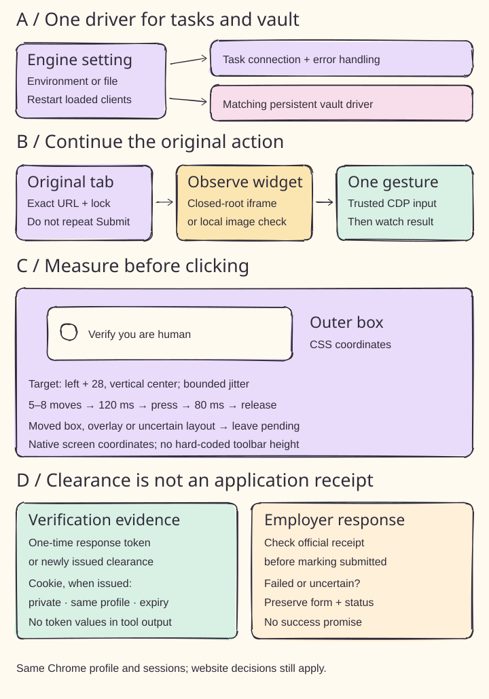

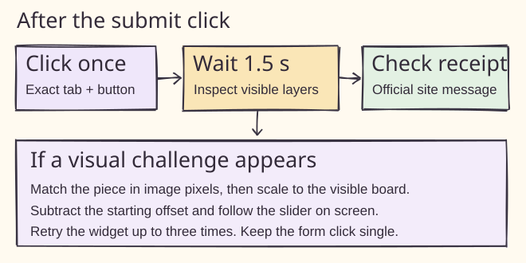

| 你要办的事 | Ruin 能接哪一段 | 目前验证到了哪 |
| --- | --- | --- |
| **过招聘网站的图片验证** | 处理众安/Moka 已支持的拼图滑块、飞书招聘旋转滑块。 | 两者均实测看到短信重发倒计时；众安还观察到成功页和申请历史记录。 |
| **完成 Greenhouse 邮箱验证** | 从 Outlook 匹配雇主和本次请求的新邮件，把验证码填回职位页。 | 已通过浏览器模拟测试；真实雇主页面与 Outlook 租户兼容性尚未验证。 |
| **处理 Workday / iCIMS 账号问题** | 使用本地资料，接上支持的注册、激活及可选的有限次数密码恢复。 | 浏览器模拟测试；检查过真实 Workday 登录弹窗。不同租户页面可能不同。 |
| **确认 Ashby 到底投没投上** | 等待官方确认，按原职位网址保存回执。 | 本地回执和浏览器集成测试。没有记录时，结果仍是未知。 |
| **通过 Duke 机构账号读论文** | 跟进 IEEE、ACM、Springer 支持的机构访问流程，继续已填好的 Duke 登录和 Duo 设备信任页面。 | IEEE 机构查找、Duke 跳转和 PDF 访问有实测；ACM / Springer 有模拟测试。 |

以上是具体适配的流程。部分图片验证需要本地 Ollama 视觉模型；读取短信需要 macOS Messages 权限；邮件流程需要先登录 Outlook Web。手机确认和未支持的检查仍可能需要你处理。[各流程前提和命令](docs/runtime-reference.md)。

已授权的表单提交使用 `ruin_action`，传入当前完整网址和页面上的按钮文字。点击后会检查是否出现验证。**验证过了算进了一步，网站给出回执才是提交证据。**

### 按顺序点击极验图标

Ruin 识别可见的极验弹窗，用 ddddocr 定位候选图标框，再由本地 Ollama 视觉模型将编号裁图与顶部提示从左到右匹配。按截图与 CSS 尺寸换算中心坐标，依次点击并自动确认；失败只刷新验证控件，最多尝试三次。B站图标验证已实测一次通过；登录与申请提交另行核验。高置信度的旋转模板匹配用于核对顺序；否则将每个目标图标单独匹配。浏览器测试覆盖 Retina、iframe 缩放、图片变化和有限重试。

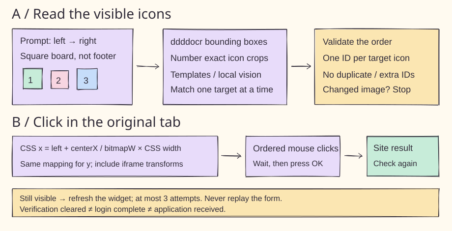

### 填写多格验证码

图 A 展示如何匹配本次请求的短信或受支持的 Outlook 邮件。图 B 展示如何向多格组件粘贴验证码，并逐格补齐。已在携程实测通过手机号验证，并用 react-otp-input 3.1.1 验证了两种输入方式。 单格输入也可按可见占位文字或无障碍名称识别；字段有歧义时不填写。B站短信按登录域名和请求时间匹配。

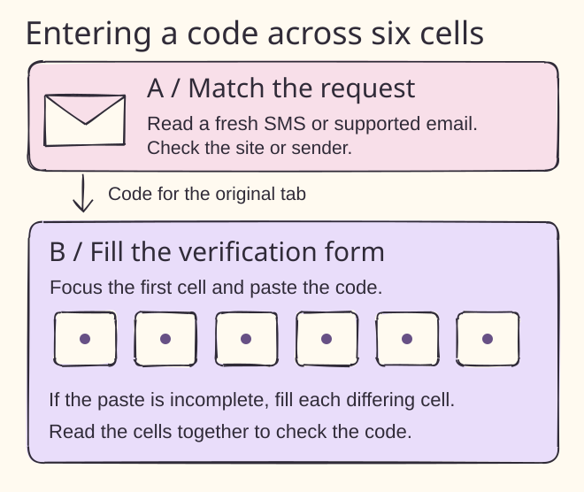

## 六个工具，共用一个浏览器

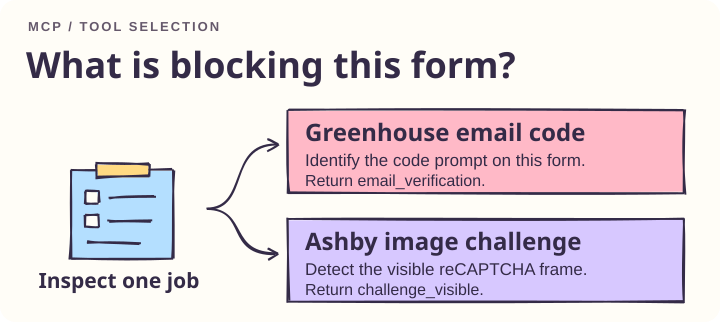

| 工具 | 做什么 |
| --- | --- |
| `ruin_browser` | 列出标签页、导航、检查页面、读取文字、点击、填表、按键、选择选项。 |
| `ruin_action` | 提交已授权表单并处理支持的后续验证；不传按钮可继续当前步骤。 |
| `ruin_auto_register` | 用本地身份资料继续支持的注册、账号或短信登录步骤。 |
| `inspect_application_challenge` | 识别 Greenhouse / Ashby 验证，或定位支持的申请页面。 |
| `get_ashby_receipt` | 不开 Chrome，也能查询已保存的提交凭据。 |
| `watch_ashby_receipt` | 监听原 Ashby 页面，看到确认后保存回执。 |

[Agent 路由规则](AGENTS.md) · [CLI 和详细行为](docs/runtime-reference.md) · [受信任登录配置](docs/trusted-auth.md)

## 浏览器在本机，登录资料也在本机

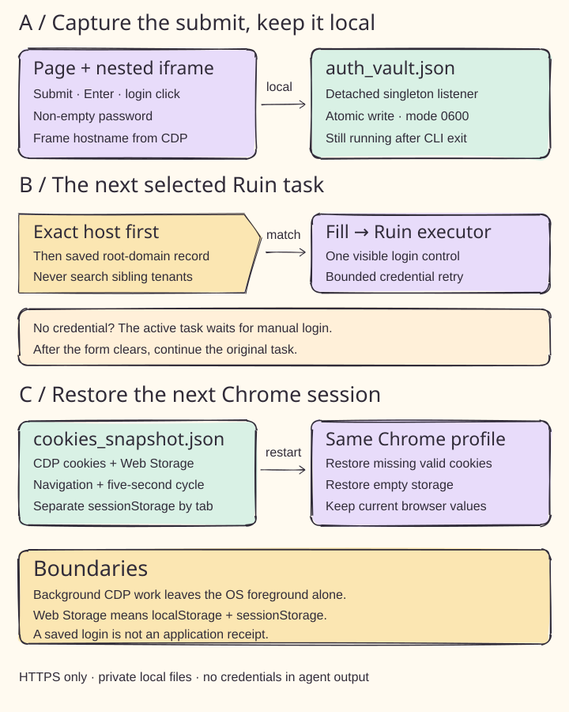

浏览器执行和凭据处理在本机运行。**自动登录凭据库以明文保存密码**，路径为 `~/.ruin/auth_vault.json`，权限为仅本人读写的 `0600`；密码不会出现在 Agent 工具结果里。Cookie 和网页存储也在本机备份。设置 `RUIN_LOCAL_AUTH_VAULT=0` 可关闭该客户端自动启动监听器的行为。[凭据库与存储范围](docs/runtime-reference.md#local-auth-vault)。

连接的 Agent 仍可能把页面文字发送给模型服务商。网站登录会过期，部分验证仍需要人工操作。Ruin 能保留浏览器状态、接上已支持步骤，不能保证永久登录或所有网站都能自动完成。

<a id="verification"></a>

## 宣传有底气，验证有出处

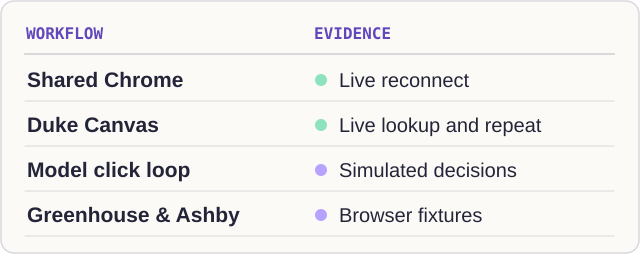

**本次验证：** Turnstile 续接与可选 Patchright 支持已合入 `main`（参见 Turnstile 图 A–D）。使用 Playwright 引擎一次运行，133 项回归测试全部通过；源码包、wheel 构建及 Twine 严格元数据检查也通过。上图区分本地模拟测试与实站证据；此前实站观察及其限制保留在[运行时文档](docs/runtime-reference.md#turnstile-continuation)中。

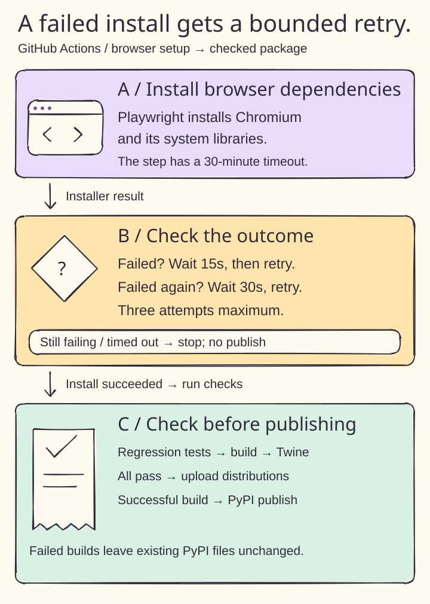

失败的 CI 在下载额外字体包时遇到 Ubuntu 软件源 DNS 错误，runner 已具备 Chromium 所需运行库。现在 CI 直接安装 Chromium，并通过完整浏览器回归测试验证运行环境（图 A–C）。浏览器下载最多尝试三次，重试前分别等待 15 秒和 30 秒，整个步骤限时 30 分钟。测试和打包检查通过后发布到 PyPI。[CI 结果](https://github.com/yuki4266/ruin-everything/actions/workflows/publish.yml)。

本地测试覆盖共享会话、后台标签页、登录捕获与恢复、租户隔离、验证路由和回执存储。上表明确区分实测与模拟测试，各项验证条件和边界见参考文档。

在开发项目中运行回归测试：

```sh
python -m pip install -e '.[agent]'
python -m playwright install chromium
RUIN_AUTO_UPDATE=0 RUIN_RULE_UPDATES=0 python -m unittest discover -s tests -v
```

配图为使用 Rough.js 和 Kalam 制作的原创可编辑 SVG。[配图源文件](docs/figures) · [参与贡献](CONTRIBUTING.md) · [开发计划](PLAN.md) · [MIT 许可证](LICENSE)

<a id="community"></a>

## 用起来，卡在哪就告诉我们

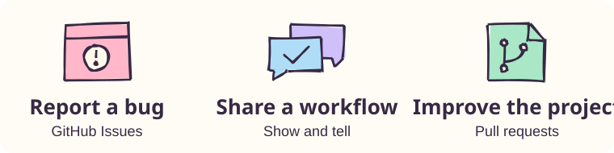

[报 Bug](https://github.com/yuki4266/ruin-everything/issues/new?template=bug.yml) · [晒你的工作流](https://github.com/yuki4266/ruin-everything/discussions/categories/show-and-tell) · [提新点子](https://github.com/yuki4266/ruin-everything/discussions/categories/ideas)

**如果 Ruin 让你少陪 Agent 折腾了一轮浏览器，[给它一颗 Star](https://github.com/yuki4266/ruin-everything)。**
