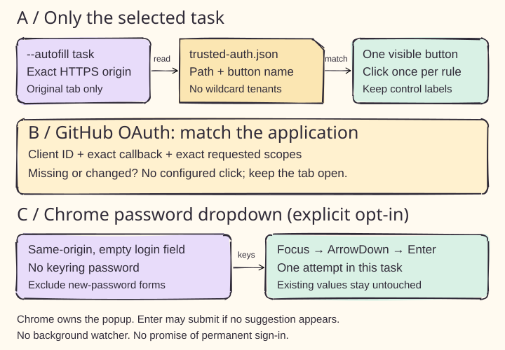

# Task-scoped trusted login actions



Panel A shows the configuration boundary. Copy `docs/trusted-auth.example.json` to `~/.ruin-everything/trusted-auth.json`, then run a browser task with `--autofill`. A missing file enables no trusted actions. A malformed file stops attachment. The shared CDP context loads this configuration beside its persistent profile. An existing tab at the exact task URL is reused and preserved after completion; ambiguous matches stop. Otherwise the runner opens a task tab. No listeners or initialization scripts click in other tabs. Existing client or browser permission requirements still apply.

Each `trusted_oauth_clients` entry has an exact `origin`, an optional `chrome_password_dropdown` boolean, and an `actions` list. The example names Glama, Greenhouse, Workday and Duke SSO, with empty action lists because their deployed button paths and OAuth client details have not been verified. Root origins do not include subdomains: add an exact Greenhouse or Workday tenant origin separately. Removing an entry disables its actions on the next attachment; it does not revoke grants already recorded by a provider.

For a verified same-origin page, an action has `origin`, `path`, `kind` and the exact accessible button `name`. Supported kinds are `login`, `sso`, `stay_signed_in`, `trust_browser` and `oauth`. For example, a verified `/session` page could use:

```json
{"origin":"https://example.org","path":"/session","kind":"stay_signed_in","name":"Stay signed in"}
```

This is a schema example, not a deployed-site selector. Only one visible, enabled button may match. Each rule is attempted once per task. A form action must remain on the current origin. Labels are printed as configured, without passwords or OAuth request URLs. The human-readable task text cannot expand the allowlist.

Panel B shows the GitHub OAuth adapter. Its action must use `https://github.com`, `/login/oauth/authorize`, `kind: "oauth"`, an exact button name, and an `oauth` object containing `client_id`, `redirect_uri` and `scopes`. The callback must belong to the selected task origin. All three parameters must occur exactly once in the authorization URL and match the configuration; omitted scopes do not imply permission. Do not paste tokens or authorization codes into this file. Other cross-origin providers, Google/Microsoft consent pages and Duo challenges have no automatic adapter in this change. They remain in the normal sign-in flow.

Panel C shows password fallback. When enabled for the task origin, an empty, editable, same-origin login password field receives focus, `ArrowDown`, then `Enter` if keyring has no password. Existing values, registration fields, ambiguous fields and cross-origin form actions are excluded. Chrome's native popup is not observable through the page DOM. Enter can submit the login form if no suggestion appears; this option authorizes that keyboard attempt, not guaranteed filling. The runner attempts it once and waits for sign-in to finish. Passwords remain in keyring or Chrome, not this JSON file.

Verification: isolated Chrome fixtures cover request mismatch, expanded scopes, duplicate query parameters, wrong task origins, ambiguous/disabled controls, repeated actions, existing passwords and keyboard fallback. Existing agent fixtures cover continuation with restrictive CSP. Native password-manager selection and production provider consent are not verified by these fixtures. Implementation reuses [Playwright locators](https://playwright.dev/python/docs/locators) and the [GitHub OAuth request parameters](https://docs.github.com/en/apps/oauth-apps/building-oauth-apps/authorizing-oauth-apps).
